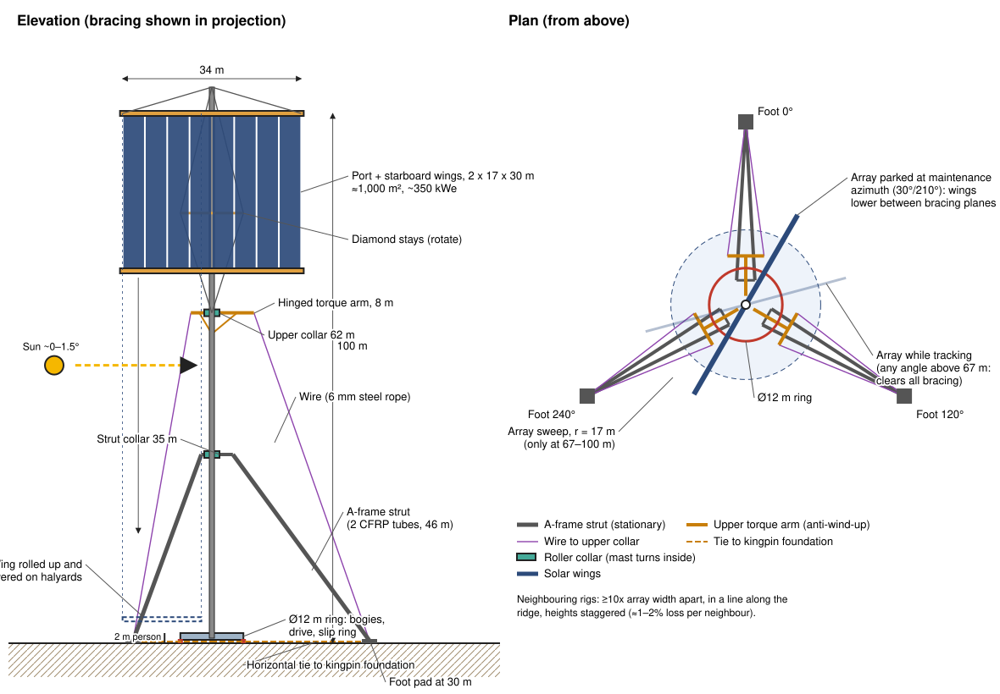
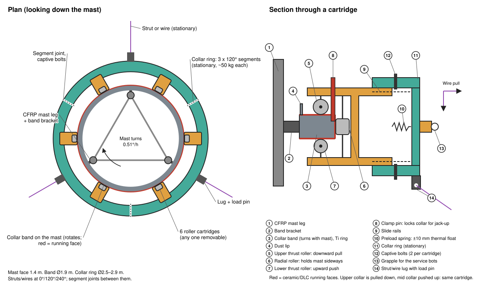
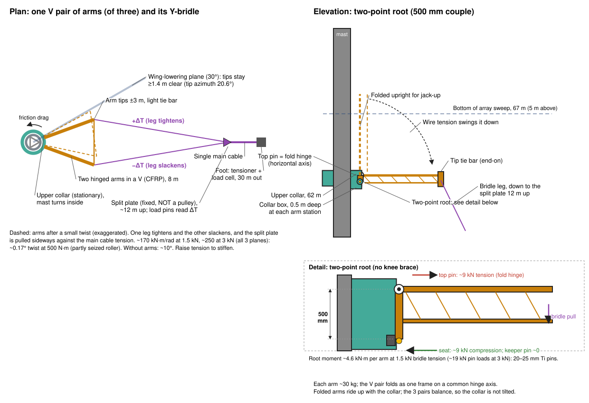
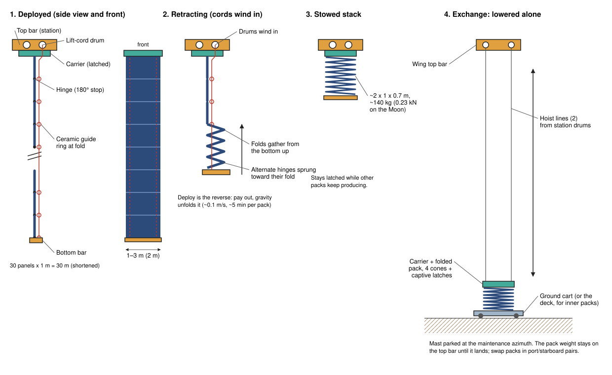
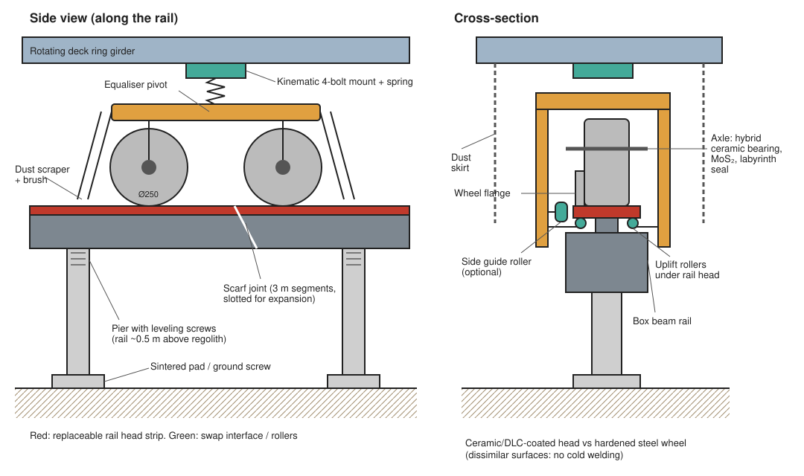

# Lunar polar rotating solar platform: concept design (rev 13, tall mast on a strut tripod)

A small turntable on a circular rail that turns a very tall mast, with the solar array at the top, for a lunar polar crater-rim or ridge site (e.g. Shackleton rim, Malapert, Connecting Ridge). This is a first-pass concept with sizing estimates. Numbers are starting points to refine, not verified engineering.

**Revision history**
- Rev 1: Ø42 m twin-rail turntable carrying a 30 m panel wall.
- Rev 2: rail ring cut to Ø12 m for logistics; cable-stayed rig that uses low gravity and no wind; human-supervised installation equipment.
- Rev 3: array raised to ~100 m to clear terrain and neighbour shadows; mast braced by stationary ground guys through roller collars; lowerable solar curtains.
- Rev 4: the ground guys and their tension anchors are replaced by a **strut tripod**. Three rigid struts run from a **mid-height collar** down to foot pads on the surface. Each foot is wire-braced up to an **upper collar** and tied **horizontally back to the platform's kingpin foundation**. It is a closed, pre-tensioned truss: no ground anchor ever has to resist being pulled up, and there are 2 collars instead of 3.
- Rev 5: base running gear changed to **3 bogies with 4 individually replaceable tyres each**. Three supports always share the load evenly, so rail flatness and settlement don't matter. Any tyre can be lifted off the rail and swapped without jacking the deck. About 10 m of clear rail between bogies leaves room to replace wear-surface segments without a bridging rail.
- Rev 6: **2 tyres per bogie** (6 in all). Each bogie pivots at its centre, so the whole base is statically determinate and every tyre carries exactly the same load, with no springs. Each tyre has a built-in **support shoe** for swaps. The tyres are vertical, not angled outward, because the load they carry is vertical.
- Rev 7: anti-**wind-up** bracing. The upper collar gets 3 **hinged rigid torque arms** whose tips carry the wires, and each strut becomes a narrow **A-frame**. Without them the upper collar would twist ~10° under a partly seized roller, and the strut collar is torsionally unstable (see section 4). The bogie pivot is now a stiff, travel-limited rocker with hard stops.
- Rev 8: the array is split into **port and starboard wings**. Each hangs on halyards from a **permanent top yard** and is raised and lowered on its own for installation and maintenance. The wing's weight stays on the same sheaves whichever height it is at, so lowering one wing does not unbalance the rig. Only taking a wing's weight off its halyards would, and that is handled by a ballast swap or by landing both wings together (section 4).
- Rev 9: each bracing plane's wires become a **single cable that splits into a Y-bridle** at a fixed split plate about 12 m above the ground. The two legs run to the tips of **two hinged arms in a V** on the upper collar. There is one tensioner and one load cell per plane, and twist resistance comes from the monitored, adjustable pre-tension.
- Rev 10: the curtains become **rigid concertina packs**, 1 to 3 m wide (2 m baseline), shipped and replaced as separate units. Each pack deploys and retracts like a **Roman blind**, and each can be **lowered on its own** to the ground for exchange. Lowering a whole wing is now only for top-bar work.
- Rev 11: two-point arm root (fold hinge + seat 500 mm below) instead of knee braces.
- Rev 12: hanging A-bracket knee (compression strut into a funnel cup).
- **Rev 13 (this):** the knee becomes the simplest possible part: a **flat V-plate**. Its 2 pin holes mount on the arm, and a single shackle hole at the apex takes a short wire **pendant** up to a stationary **crown ring** 1.5 m above the hinge. It works in **tension**: a flat bar would buckle in compression, and a shackle can't push. It hangs vertically when unloaded and tightens by itself as the arm comes down.

## 1. Why it rotates, and why it must be tall

At the poles the Sun stays within ~1.5° of the horizon and goes once around it each lunar day (29.5 Earth days). So the array must stand **vertical** and turn about a vertical axis **once every 29.5 days** (~0.51°/hour), always in the same direction.

At such low Sun angles every bump shades a long way: a 10 m rise casts a shadow ~380 m long at 1.5°, and a 100 m object ~3.8 km. On crater rims and ridges, how many hours of sunlight a point gets rises steeply with height above the ground, because the line to the Sun clears more of the far terrain. So the array top is pushed up as far as structure, installation and site allow. Published illumination models of polar sites, and tower concepts such as Honeybee Robotics' LUNARSABER (~100 m), point to the same order of height.

**How to set the height for a real site:** run a horizon/illumination analysis on LOLA elevation data for the exact spot, for array-top heights of, say, 20 to 200 m. Plot hours of sunlight per year against height and pick the knee of the curve. The structure in this document scales across that range (section 3).

## 2. Using low gravity and no wind

| Load | Earth | Moon | Effect on design |
|---|---|---|---|
| Wind | Governs tall masts | **None** | A slender 100 m+ mast and a 1,000 m² sail with almost no lateral load |
| Gravity | 9.81 m/s² | **1.62 m/s² (1/6)** | Mast and strut compression, wire tension, jacks and bearings are 1/6 the size |
| Seismic | Varies | Shallow moonquakes, small accelerations | Main lateral load; carried by the strut tripod |
| Thermal | Moderate | Large swings and one-sided sunlight | Thermal bow of the mast; use CFRP, keep the gradient steady (below) |
| Rotation dynamics | n/a | 0.51°/h | Negligible; ramp the drive steps gently |

How the design uses this:

1. **A slender braced mast.** Without wind and in 1/6 g, a light lattice mast needs only a little lateral bracing to reach 100 m or more. Its practical limit is set by the site, installation and shading, not strength.
2. **The bracing doesn't rotate.** A stationary **strut tripod** holds the mast through two **roller collars**, and the mast turns inside them. This keeps the base ring small (Ø12 m) while the bracing spreads wide (feet at 30 m).
3. **A closed truss, so no tension anchors.** Each bracing plane is a triangle: strut (compression), wire (tension) and the mast between the two collars. A horizontal tie from each foot to the kingpin foundation closes it at ground level. The three ties pull on the kingpin from 120° apart, so they cancel. The foot pads only ever push down on the ground. Holding up-pull in loose regolith is hard; bearing down on it is easy.
4. **The array sits above all the bracing.** It sweeps a 17 m radius circle from 67 to 100 m. The upper collar is at 62 m, so the turning array never meets a strut or wire. Above the collar the mast is braced by its own rotating **diamond stays** (spreaders and stays that turn with the mast, as on a racing yacht).
5. **Light rigid concertina packs** (~2 kg/m²) that hang from the top. In 1/6 g with no wind they unfold under their own weight and hang flat, with no frame needed to hold the 30 m height.
6. **Balanced rig.** The array is one plane through the mast, left and right equal, so its centre of mass stays on the axis.
7. **Steady sunlight makes thermal bow predictable.** Because the rig tracks the Sun, the same mast face is always sunlit, so the bow is nearly constant and can be trimmed out with wire tension. The mast sits behind the blanket, so its top section is in shade. CFRP tubes (α ≈ 0 to 1x10⁻⁶ /K) keep the bow to a few centimetres. The same 35 m length in aluminium would bow ~0.9 m.
8. **Light installation gear.** The whole mast plus array (~5 t) weighs about 8 kN on the Moon, so a modest jack at deck level can raise all of it (section 7).

## 3. Reference configuration (100 m baseline)

| Item | Value |
|---|---|
| Array top / bottom | **100 m / 70 m** above the deck |
| Mast | 105 m triangular CFRP lattice (Ti nodes), 1.2 to 1.5 m face, ~25 kg/m (~2.5 t), built in 3 m sections |
| Solar wings | **Port and starboard wings**, each 17 m x 30 m (~500 m²), total ≈ **1,000 m²**. Each wing is **8 concertina packs** hung from a top bar. ~1.37 t per wing (~2.2 kN on the Moon) |
| Concertina pack | Rigid panels ~2 m wide x 1 m tall (CFRP-honeycomb, ~2 kg/m² with cells), 30 panels hinged along their horizontal edges. Deployed: 2 m x 30 m. Folded: ~2 m x 1 m x 0.7 m, ~140 kg (~0.23 kN on the Moon). Packs from 1 to 3 m wide use the same station hardware |
| Power (30% cells, 1,361 W/m², ~85% system) | **~350 kWe** |
| Top yard (permanent) | 34 m truss fixed to the mast at 100 m, held by topping lifts; 2 halyard sheaves per wing (inner at 2 m, outer at 17 m from the mast) |
| Wing top bar | Each wing has a top bar on 2 halyards carrying 8 **pack stations** (carrier latch, 2 lift-cord drums, 2 hoist-line drums). No fixed bottom yard: each pack has its own small bottom bar |
| Roller collars (stationary) | **Strut collar at 35 m**, **upper collar at 62 m** |
| Struts | 3 **A-frames** at 120°: each 2 CFRP tubes Ø0.3 m x 2 mm, ~46 m long, ~3 kg/m, ball joints at both ends. Joined at the foot, spread ±1.5 m at a torque bracket 4 m out from the strut collar |
| Foot pads | 3 at **30 m radius**, ~1 m² sintered or gabion pad, compression only (~0.5 kN) |
| Upper torque arms | Per bracing plane, **2 hinged CFRP arms in a V** from the upper collar to tips 8 m out and ±3 m apart. The hinge axes line up, so the pair folds as one frame. A light tie bar joins the tips. Each arm has one fold hinge at the collar, plus a **V-plate + shackle + wire pendant** up to the crown ring 1.5 m above the hinge. ~30 kg per arm, ~1.5 kg per V-plate and pendant |
| Crown ring (stationary) | Light ring (Ø~3.4 m) on 3 short posts, 1.5 m above the upper collar. It carries 6 pendant lugs, and the pendant pulls from the 3 stations cancel through the ring |
| Cables | Per bracing plane, **one Y-bridle**: a single main cable (~13 m) from the foot tensioner up to a fixed **split plate** at ~12 m height, 26 m out, then 2 legs (~53 m) to the arm tips. 6 mm stainless wire rope, UV-proof. ~1.5 kN pre-tension per plane, adjustable to ~3 kN |
| Ties | Foot to kingpin foundation, horizontal at ground level (passing under the raised rail), ~1 kN |
| Upper bracing (rotating) | Diamond stays: spreaders ±6 m at 81 m, stays from 64 m (just above the crown ring) to the mast top |
| Rail ring | Ø12 m single rail, 12 segments of π m, **3 bogies x 2 tyres** at 120° |
| Rotating mass | ~12.6 t (mast 2.5 t, wings + top yard 3.1 t, deck 4 t, bogies 0.2 t, collar bands + margin 1.1 t, kingpin 1 t, diamond stays 0.5 t) |
| Lunar weight on the ring | ~20.5 kN; the pre-tensioned tripod lifts the mast very slightly (~1.5 kN), so the ring carries a little less |
| Maintenance azimuth | Mast parked so the array lies **between** bracing planes (e.g. 30°/210° when the struts are at 0°/120°/240°) |

**Scaling to other heights** (rough; same array, CFRP mast; struts sized for ~4x buckling margin):

| Array top | Upper collar | Strut collar | Foot radius | Strut length | Mast mass | Lunar weight |
|---|---|---|---|---|---|---|
| 60 m | 22 m | 12 m | ~12 m | ~17 m | 1.2 t | ~16 kN |
| **100 m** | **62 m** | **35 m** | **30 m** | **46 m** | **2.5 t** | **~20.5 kN** (rigid packs) |
| 150 m | 112 m | 60 m | ~50 m | ~78 m | 4.8 t | ~23 kN |
| 200 m | 162 m | 85 m | ~70 m | ~110 m | 8 t | ~29 kN |

Above ~150 m the struts get long enough that they need a larger lattice section or a mid-length brace. In practice the height is limited by:
- **Footprint**: the ridge must be ~2x the foot radius wide. That is smaller than the guy anchor footprint in rev 3, but ridges are often only a few hundred metres across.
- **Installation time** at the jack.
- **Sightlines to other collectors**: a taller rig shades more of the ridge.

**Pre-tension (100 m case).** Tighten the wire to ~1.5 kN and the tie to ~1 kN. That puts ~2.5 kN of compression in the strut (buckling load ~10 kN) and leaves each foot pressing ~0.5 kN on its pad. Keep strut compression above ~1.2x the wire tension so the feet never lift. Load cells on every wire and tie show the rig's state.

## 4. Mast, collars and wings

**Roller collars.** Each collar is a stationary ring around the mast, made of 3 bolted 120° segments so it can be fitted around the mast. At that height the mast carries a circular **collar band**: a Ti box ring bolted to the three mast legs, with ceramic/DLC-coated running faces on the top, outside and underside.

The collar holds **6 identical roller cartridges**. Each is a C-frame that wraps the band edge, like a base bogie wraps its rail. It carries three rollers:
- an **upper thrust roller**: the upper collar is pulled down by the wires,
- a **radial guide roller**: holds the mast sideways,
- a **lower thrust roller**: the strut collar is pushed up by the struts, and it also resists quake uplift.

So one cartridge design serves both collars. Each cartridge slides out radially on rails through a window in the collar ring. A preload spring gives ±10 mm of float for thermal mismatch, it has 2 captive bolts, and it has a grapple fixture for the climber robot. The collar works with any one cartridge removed.

The rollers use the same technology as the bogies (dry-lubricated hybrid bearings, dissimilar surfaces). The collars carry only light loads (pre-tension and quake loads), so the heavy, critical parts stay at ground level: vertical load, drive and slip ring. Dust is far lower at height.

A **transport clamp pin** in each cartridge locks the collar to the band during jack-up (section 7) and is pulled once the collar is at height.

**Preventing collar bearing seizure.** The upper collar is the hardest part to reach (62 m up). It carries a steady downward pull from the wires and sees the biggest temperature swings, so it gets the most protection. If it seized while the base kept driving, the mast would be twisted against the tripod. Protection is in five layers:

1. **Remove the causes of seizure.**
   - *Cold welding:* no like-on-like metal contact anywhere. Steel or Si₃N₄ rollers run on a ceramic/DLC-coated Ti band; races and balls are dissimilar (hybrid ceramic bearings).
   - *Lubricant loss:* dry films only (sputtered MoS₂ or WS₂ on races, PTFE/polyimide-composite cages that keep re-transferring lubricant). Nothing evaporates, freezes or creeps in vacuum.
   - *Thermal pinching:* the band and collar ring are both Ti, so they expand alike. Each radial roller sits on a **preload spring with ±10 mm float**, so no temperature difference or thermal bow of the mast can squeeze a roller tight. The thrust rollers are crowned and spring-loaded the same way. White thermal coating plus a light sunshade keep the collar near the mast's temperature.
   - *Dust:* at 62 m the collar is far above most lofted dust. Metal labyrinth lips on the band, a cover over each cartridge, and a brush skirt keep out what does arrive. Wear debris falls onto a catch shelf, not into the next roller.
   - *Light loads:* each collar's rollers are Ø100 mm.
     - *Upper collar:* the wires pull it down by 3 x 1.5 kN x sin 64° ≈ 4.0 kN, plus ~0.25 kN of its own weight. Shared by 6 upper thrust rollers, that is **~0.7 kN each** (0.9 kN with one cartridge out).
     - *Strut collar:* the struts push it up by 3 x 2.5 kN x sin 49° ≈ 5.7 kN, less its weight. That is **~0.9 kN on each lower thrust roller** (1.1 kN with one out).
     - *Radial rollers:* they only see spring preload, quake and thermal-trim loads, a few hundred N.
   - *Very few turns:* each roller runs on a ~6.1 m circle (band Ø1.95 m) once per lunar day, about 6.1 / (π x 0.1) ≈ **20 turns per lunar day**. That is ~240 a year, or ~2,400 in ten years, where an ordinary bearing makes that many turns in a few seconds. Rolling fatigue and wear are therefore negligible. The real risks are static ones during long, almost motionless spells: cold welding, fretting from vibration, and dust settling. The other measures here are aimed at those.
2. **Make a stuck roller harmless.**
   - Each roller has a **second rotation path**: the ball bearing runs on a dry-lubricated sleeve journal. If the bearing locks, the roller turns on the sleeve.
   - If both lock, the roller skids on its hard coated face rather than jamming. The other 5 cartridges keep guiding the mast.
   - No single cartridge can lock the collar.
3. **See it coming.** The difference in leg tension at each split plate reads collar friction torque directly.
   - Every roller has a small rotation sensor (magnet + Hall sensor). If the mast turns and a roller doesn't, the system alarms long before the bearing seizes.
   - Load cells on the wires and ties, drive motor current, and strain gauges on the mast between base and collar all track friction torque. A rising trend means "swap a cartridge soon".
4. **Protect the structure if it happens.**
   - The base drive has a **torque limiter** set just above normal collar friction. If the collar torque rises past it, the drive slips and stops. The mast is never forced to twist against a locked collar.
   - The array keeps working in its last position until the fault is cleared. At most a few percent of a lunar day's energy is lost.
5. **Fix it in place.**
   - The climber robot swaps the cartridge (2 captive bolts, slide out, slide in) while the other 5 hold the mast. Spare cartridges are kept on site.
   - Cartridges are also swapped on a schedule (for example, one per collar per year) and sent back for inspection, to learn real wear rates.
   - Before flight, prove all of this with a **vacuum-thermal life test** of a full cartridge, run on a band section in regolith simulant dust for many times the design number of revolutions.

**Wind-up: keeping the collars from turning with the mast.** Friction in the collar rollers drags the stationary collar round with the mast, so the bracing must hold it against twisting. In rev 4 to 6 every wire and strut lay in a vertical plane through the mast axis, so together they barely resisted twisting (`torsion_check.py` gives the numbers):

| Collar | Rev 4 to 6 | Rev 7 to 9 |
|---|---|---|
| Upper (wires) | ~2.9 kN·m/rad: ~0.2° of twist at normal friction (~10 N·m), **~10°** at 500 N·m (a partly seized roller) | Rev 7, two separate cables per plane: ~320 kN·m/rad. **Rev 9, Y-bridle**: ~170 kN·m/rad at 1.5 kN (**~0.17°** at 500 N·m), ~250 kN·m/rad at 3 kN |
| Strut collar | **Negative** (~ -7 kN·m/rad). Compressed struts on ball joints push the collar further round once it starts to turn: torsionally unstable, held only by roller friction | **A-frame struts**: ~14 MN·m/rad, effectively rigid |

How it works:
- **Torque arms with a Y-bridle (upper collar).** At each bracing plane two hinged arms form a V from the collar, with tips 8 m out and ±3 m apart. A single cable runs up from the foot to a fixed **split plate**, and from there two legs run to the two arm tips. In plan view it is a triangle again. If the collar starts to turn, one leg tightens and the other slackens, and the split plate is pulled sideways against the main cable's tension. This is the same idea as the "torque arm" used on tall guyed masts on Earth.
- **Why the split sits low.** The split plate is free to move, so the bridle resists twist partly through its pre-tension rather than purely by stretching the cable (`bridle_check.py`):

  | Split position (0 = at the arm tips, 1 = at the foot) | 0.1 | 0.3 | 0.5 | 0.7 | 0.9 |
  |---|---|---|---|---|---|
  | 1.5 kN pre-tension (kN·m/rad) | 23 | 42 | 72 | 125 | 227 |
  | 3.0 kN pre-tension (kN·m/rad) | 46 | 83 | 135 | 206 | 293 |

  Near the collar the bridle is weak; near the foot it acts almost like two separate cables. **The split is set at 0.8** (~12 m above the ground, 26 m out), where it is ~170 kN·m/rad at the normal 1.5 kN and still reachable from the ground for inspection.
- **The split must be a fixed plate, not a pulley.** A pulley would let the legs equalise and slide, and the twist resistance would almost vanish. Each leg is terminated on the plate separately.
- **Tension monitored and adjustable.** There is one screw tensioner and load cell per plane, at the foot. Because stiffness rises with tension, the operator can raise pre-tension (up to ~3 kN, ~250 kN·m/rad) if collar friction trends upward. Above 1.5 kN the struts and ties are re-trimmed to keep the feet pressing down.
- **V-plate pendant "knee" (tension, self-tightening).**
  - Each arm root is a single **fold hinge** (a horizontal pin in two lugs) on the collar ring.
  - The knee is one **flat V-plate** (Ti, ~8 mm thick, 40 mm legs, about 0.5 m across and 0.6 m deep). Its **2 pin holes** mount on 2 horizontally aligned pins on the arm's top chord, 3 m out from the hinge. Its **apex hole** takes a **shackle**.
  - The shackle connects to a short **wire pendant** (~2.3 m, 6 mm rope with a thimble), which runs up to a lug on the stationary **crown ring** 1.5 m above the hinge.
  - **Tension, not compression.** The bridle pulls the arm tip down, so the arm wants to rotate down about its hinge, and the pendant holds it up. The pendant runs ~3.4 kN at 1.5 kN bridle tension (~6.9 kN at 3 kN). A flat V-plate carries hundreds of kN in tension, but as a 3.35 m compression strut the same bar would buckle at ~0.2 kN, and a shackle cannot push. That is why this knee hangs *above* the arm rather than bracing from below.
  - **Hangs vertically when unloaded.** With the arm folded upright for jack-up, the pendant is slack and the V-plate just dangles from its two pins. As bridle tension swings the arm down, the pendant straightens and goes taut by itself at the horizontal position. That taut length *is* the arm stop: no latch, seat or funnel.
  - **Fitted at deck level.** The V-plate, shackle and pendant are all connected before jack-up, so nothing has to be shackled at height. The shackles are safety-pin type with cotters, and their pins and bows are coated or of dissimilar metals against cold welding.
  - **Crown ring.** A light stationary ring on 3 short posts above the collar takes all 6 pendants. Their horizontal pulls from the 3 stations balance through the ring, so neither the posts nor the collar see a net tilt. The ring sits at r ~1.7 m, clear of the turning mast, and the diamond stays start just above it at 64 m.
  - The hinge pin takes ~3 kN, pushed inward against the collar.
- **A-frame struts (strut collar).** Each strut is two tubes joined at the foot and spread ±1.5 m at a torque bracket 4 m out from the collar. This is the same triangle idea, in compression.
- **Clearances.** All arm, crossbar and A-frame tips stay within ~21° of their bracing plane, so the maintenance azimuth (30°/210°) stays clear for lowering the wings. Everything is at or below 62 m, under the array sweep.
- **Torque sensing.** Small load pins where the two legs attach to the split plate read the difference in leg tension, a direct measure of the upper collar's friction torque. The main cable's load cell at the foot reads the pre-tension. Together they give the seizure early warning in layer 3 below.

**Port and starboard wings of concertina packs.**

Each wing is a **top bar** with **8 concertina packs** side by side, each 2 m wide (1 to 3 m packs fit the same stations), with ~0.1 m gaps between them. A pack is 30 rigid panels, 1 m tall, hinged along their horizontal edges. Folded, it is a ~2 m x 1 m x 0.7 m stack of ~140 kg (~0.23 kN on the Moon), which ships, stores and handles easily.

There are three raise/lower mechanisms, used from most to least often.

**1. Deploying and retracting a pack (a Roman blind).**
- Each pack hangs by its **top frame** from a **carrier** latched to its station on the top bar.
- **Two lift cords**, one near each side edge, run from the station's cord drums down through **ceramic guide rings** at every fold line on the back of the pack. They are tied off to the pack's **bottom bar**.
- *Deploy:* the drums pay out. Gravity (1/6 g) unfolds the panels one after another from the top. The hinges have **180° stops**, so the fully open pack hangs flat and its bottom bar keeps it gently tensioned. At ~0.1 m/s a pack opens in ~5 minutes, smoothly and without swinging (no wind).
- *Retract:* the drums wind in. The cords lift the bottom bar, and the guide rings gather the panels into a neat zig-zag from the bottom up until the stack docks under the carrier. Alternate hinges are lightly sprung toward their fold direction, so every fold goes the right way.
- Each station has its own small motor and a fail-safe brake. Packs can move one at a time or all together.

**2. Exchanging one pack (routine maintenance).**
- Each station's carrier also hangs on **2 hoist lines** that run over sheaves in the top bar to the station's hoist drums.
1. Park the mast at the **maintenance azimuth**, so the wings lie in the clear 30°/210° plane between the bracing planes.
2. Retract the pack to its stack.
3. Release the carrier latch and **lower carrier + folded pack** straight down on the hoist lines to a **ground cart**, or onto the deck for the inner packs.

   On the way down the pack stays ≥2 m from the mast and passes the collars, torque arms and A-frames ≥1.4 m clear.
4. Unlatch the pack from the carrier (4 alignment cones, captive latches), latch the new pack on, hoist, latch the carrier, deploy.

The other 15 packs keep producing power the whole time; one exchange costs ~6% of output for under an hour.

**3. Lowering a whole wing (top-bar work only).** As in rev 8, the top bar hangs on **2 halyards** over sheaves on the **permanent top yard** (2 m and 17 m from the mast). The halyards run down to a **double-drum winch** on the deck, one per wing. With all its packs retracted, a wing's top bar and stacks can be lowered to ~3 m above the ground.

**Balance.**
- The weight of a pack or a wing always hangs from the same sheaves on the permanent top yard, whatever its height. So **retracting, deploying, or lowering a pack or a wing never unbalances the rig**.
- Imbalance only appears when weight comes **off** its lines:
  - *One pack* taken off at the ground shifts the balance by only ~2.3 kN·m. Exchanges are done in **port/starboard pairs**, or alternated, so at most one pack is ever out of balance.
  - *One whole wing* taken off would put ~21 kN·m on the mast top above the upper collar (~17 kN extra in the lattice chords). It is never done alone. Either hang a **regolith ballast pallet** of equal weight (~1.4 t) on its halyards first, or join the two halyard winches with the **cross-connect clutch** and move both wings together.
- Load cells on every hoist line and halyard act as a balance monitor, and the winches interlock against an unbalanced landing.

**Mast climber robot.** A small robot climbs the lattice to inspect it, swap collar roller cartridges, re-tension diamond stays and service the yards. It is teleoperated with a human supervising, and it doubles as an installation tool (section 7).

## 4b. Shading between collectors

When several rigs share a ridge, one shades another when the Sun lines up behind it. The shade lasts roughly (array width / spacing in degrees + 0.53° Sun disc) / 0.51° per hour, once per lunar day for each neighbour that can line up:

| Spacing | Shade per alignment | Share of the lunar day lost |
|---|---|---|
| 200 m | ~20 h | ~2.9% |
| 340 m (10x width) | ~12 h | ~1.7% |
| 500 m | ~9 h | ~1.2% |
| 1,000 m | ~5 h | ~0.7% |

Layout rules:
- **Space rigs ≥10x the array width apart.**
- **Put them on a line along the ridge crest**, so they line up with the Sun only twice per lunar day.
- **Stagger the heights** of neighbours by more than the array height, so their arrays don't overlap in the sky. Then a neighbour's shadow is only its thin mast, which costs well under 1%.

## 5. Running gear at ground level (low friction, dust tolerant)

**Why 3 bogies with 2 tyres each.** Three bogies give three support points, and three points always define a plane. Each bogie pivots on its centre, so its 2 tyres split that bogie's load exactly in half. The base is therefore **statically determinate**: all 6 tyres carry the same load whatever the rail does (settlement, thermal warp, a small step at a joint), with no springs or adjustment.

The strut tripod carries all overturning and quake loads at the collars, so the base only has to carry vertical load and centre the deck. Three bogies are enough. They are 12.6 m apart along the rail and each is ~1.3 m long, which leaves **~11 m of clear rail** between neighbours: three full rail segments with room to spare.

**Loads.** ~20.5 kN on the Moon over 6 tyres is **~3.4 kN per tyre**. Tyres are designed for 6 kN.

**Which way should the tyres point? (the "duty force")**
- The force on each tyre is **vertical**. The kingpin centres the deck, and each bogie floats ±20 mm radially on its pivot, so no outward or inward push reaches the rail. Tilting the tyres outward would only add a side thrust and scrub.
- If there were a steady radial force (for example a design without a kingpin), the right move would be to tilt the rail head and tyre so the contact faces along the combined force. Here that combined force is vertical, so they stay level.
- Two small angles are still built in:
  - *In plan view:* each axle points at the ring centre. The 2 axles of a bogie fan apart by ~8.6°, so both tyres roll true around the 6 m curve.
  - *In section:* each tread is a shallow cone (half-angle ~1.4°) with its apex at the ring centre. The axle tips ~1.4° down toward the centre, so the contact line lies flat on a **flat rail head** and points at the centre. This is classic turntable geometry: pure rolling across the whole tread width, no scrubbing, no flange needed.

**Bogie**
- Short curved frame (~1.3 m) on a **spherical centre pivot** with ±20 mm radial float. The pivot is the load equaliser.
- **Load balancing is stiff and travel-limited.** With 2 tyres the bogie only has to rock over small height differences: rail joint steps (≤1 mm) and pier settlement between re-levelings (a few mm). So the rocker gets **hard stops at about ±0.5°**, roughly ±4 mm at each tyre. There are no springs and no soft suspension. Within that range the two tyres share load exactly; beyond it the stops (and the support shoes) carry it, and the out-of-level reading tells you which pier to re-level.
- 2 tyres on **cantilevered stub axles** on the outside of the rail. The frame sits inboard, so each tyre slides straight off outward.
- A **support shoe** beside each tyre: a hardened, coated pad on a screw (one tool size). In service it rides **3 mm above** the rail. If a tyre or bearing ever fails, the shoe lands on the rail and carries the load (and the drive's torque limiter stops the platform). The bogie can never drop.
- **Uplift rollers** under the rail head, 2 per bogie (cartridges), against quake bounce.
- **Dust scrapers and brushes** at both ends.
- Bogie ≈ 70 kg on Earth (~12 kg-weight on the Moon).

**Tyres (individually replaceable)**
- Each tyre is a complete **wheel cartridge**: hub, sealed bearing, and a hardened steel tread ring (~Ø300 mm x 80 mm, conical as above), held by one captive hub nut. ~12 kg on Earth, about 2 kg-weight on the Moon.
- **Avoid like-on-like metals** in vacuum (cold welding): hardened steel tread on a ceramic- or DLC-coated rail head.
- Hybrid ceramic bearings with **dry lubrication** (sputtered MoS₂/WS₂, PTFE-composite cages), labyrinth seal plus bellows boot. No grease or oil.
- Rolling resistance Crr ~0.001 to 0.003: **20 to 60 N** total.

**Replacing a tyre**
1. Stop and lock the drive.
2. Wind that tyre's support shoe down onto the rail until it takes the load and the tyre lifts ~5 mm.
3. Undo the captive hub nut, slide the wheel cartridge off outward, slide the spare on, tighten.
4. Wind the shoe back up to its 3 mm standoff. About 15 minutes for one suited person or a robot; no deck jacking.

**Centring, drive, power transfer**
- Central **kingpin** with a slewing bearing (~1.2 m) centres the deck and is the survey datum for building the ring (section 7).
- The **mast foot** sits on a spherical seat at the deck centre, and torque goes through a dog coupling. The collars hold the mast vertical, so small deck tilts from rail settlement are never forced into the mast.
- **Drive**: a pinion on a rack on the rail web, on 2 of the 3 bogies. Either one can turn the platform.
- Running power is milliwatts. Size the drive for breakaway in dust (~20x running force, ~1 kN tangential): a few hundred watts.
- Power crosses the rotation through a **slip ring or rotary transformer** in the kingpin.

## 6. Track (raised, segmented, swappable)

- **Raised rail** on piers ~0.5 m above the regolith, away from near-surface dust and with room to work underneath.
- Rail: hollow box beam with a bolted, replaceable **rail head strip**.
- **12 identical segments**, π m long. Each sits on 2 piers that are shared with its neighbours at the joints, so **12 piers** in all, plus 4 kingpin anchors.
- **Angled (scarf) joints** with slotted holes for ~3 to 5 mm expansion each.
- **Piers** have leveling screws (±50 mm) on sintered-regolith pads, helical ground screws, or regolith-filled gabion bags.
- An overhanging **skirt or brush seal** on the deck keeps falling dust off the rail head.

**Replacing a rail segment or wear strip** (the main reason for the wide bogie gaps)
1. Turn the platform until the damaged segment sits in a gap. With ~11 m of free rail between bogies, any segment can be placed with ~4 m to spare at each end. No bridging rail is needed.
2. If only the running surface is damaged (the usual case), unbolt and swap just the **rail head wear strip** (~10 kg, π m long).
3. If the beam itself is damaged, unbolt the whole segment from its 2 piers, lift it out, drop in the spare and level it against the radius arm (section 7).
4. Turn the platform past the new piece slowly and watch the drive current as each bogie crosses it.

**Replacing a whole bogie** (rare; tyres and uplift rollers are swapped in place)
1. Set a **jack stand** on the rail just beside the bogie (the wide gaps leave room) and lift that corner of the deck ~10 mm.
2. Release the spherical pivot, wind both support shoes up, roll the bogie out along the rail into the gap and lift it off. Fit the spare the same way.
3. Lower, remove the stand.

**Spares on site**: 4 wheel cartridges, 2 uplift roller cartridges, 1 bogie, 2 rail segments, 6 rail head wear strips, 1 drive unit, slip-ring brush cartridges, 2 collar roller cartridges, 1 bridle (main cable, split plate, 2 legs) and 1 tie with tensioners, 1 strut section, 4 concertina packs, 2 carriers, 2 ballast pallet frames (filled with local regolith).

## 7. Installation equipment and sequence (human supervised)

Everything is assembled at deck level and raised. A crew member (EVA, or in a pressurised rover nearby) supervises each step and signs off every hold point. Machines do the lifting.

| # | Equipment | What it does |
|---|---|---|
| E1 | **Kingpin driver** | Sets the central kingpin foundation: the datum for everything else. |
| E2 | **Radius arm ("compass")** | 6 m arm on the kingpin with a laser level, encoder and pier socket. It places and levels the 12 rail piers. With an extension and laser rangefinder, it also lays out the 3 foot-pad sites at 30 m. |
| E3 | **Rail-riding installer cart** | Lays rail segments from the installed rail; later the maintenance cart (tyre, wear strip and segment swaps, jack stand). |
| E4 | **Foot-pad and tie layer** | Compacts or sinters the 3 foot pads and lays the 3 ground ties from the kingpin foundation out to the feet, under the raised rail. No pull-out anchors needed. |
| E5 | **Mast jack-up frame** | Sits on the deck around the kingpin and lifts the whole mast one 3 m section at a time; the new section is pinned in at the bottom. Peak lift is ~8 kN (whole mast + array) plus bracing pre-tension. |
| E6 | **Tie and wire winches with load cells** | One at each foot. They control the ties (which pull the strut feet in as the mast rises) and the wires, and keep the mast plumb. Tensions are shown live on a supervisor tablet. |
| E7 | **Mast climber robot** | Fits and checks the diamond stays and collar cartridges at height. Later used for inspection and maintenance. |
| E8 | **Wing and pack winches** | Two double-drum halyard winches on the deck (port, starboard) with a cross-connect clutch; 16 pack stations on the top bars (lift-cord and hoist-line drums, brakes, load cells). |
| E9 | **Pack carts** | Two small ground carts at the maintenance azimuth that receive, carry and present folded packs; they double as storage stands for spares. |

**Sequence**
1. Survey and clear the site. Set the kingpin (E1). Lay out the 3 foot sites with the radius arm (E2); prepare the pads and lay the ties (E4).
2. Set the 12 rail piers and lay the ring (E2, E3). Hold point: ring flat to ±2 mm.
3. Place the 3 bogies and the 4 deck quarters. Check the deck turns by hand and all 6 support shoes are at their 3 mm standoff.
4. Fit the jack-up frame (E5). Assemble the **top assembly** at deck level: mast top section, diamond spreaders and stays, and the permanent top yard folded vertically with its halyards rove. The wings are not on the mast during jack-up.
5. **Jack up, with a scissor action.** Each collar is fitted around the mast at deck level (3 segments), clamped to its band, and rides up with the mast.
   - The **upper collar** goes on first, with its 3 V pairs of torque arms folded upright and their bridles paid out from the foot winches as it rises (the split plates ride up on the main cables). Until the struts are in, these wires act as light temporary guys (a few hundred N). Each foot winch is ballasted with regolith bags so it never needs a pull-out anchor.
   - When the strut band reaches the deck, the **strut collar** goes on. The 3 A-frame struts are pinned to its torque brackets while lying flat on the ground, pointing outward, with their feet on skid dollies.
   - As the mast keeps rising, the struts swing up and the tie winches (E6) **pull the feet in** along the ground, from 46 m to their 30 m pads. Low gravity keeps the strut and dolly loads tiny.
   - At final height, the feet drop onto their pads. Tensioning the wires swings the torque arms down until they latch, then the ties and wires are trimmed to final tension. The clamp pins are pulled, and from then on the mast turns freely in both collars.
6. At full height, unfold the top yard and set its topping lifts. Park at the maintenance azimuth. **Hoist both empty wing top bars together** (clutch engaged) and latch them. Then hoist the **packs one by one, alternating port and starboard**, latch each carrier and deploy it (E8, E9). The array grows in 2 m steps, and every pack starts producing power as soon as it opens.
7. Trim wire and tie tensions to plumb the mast and take out thermal bow. Connect the harness to the slip ring, commission the drive, start tracking.

Design rules for every part: captive fasteners, one tool size, alignment cones, grapple fixtures, and no single piece heavier than ~150 kg-weight on the Moon without lifting gear.

## 8. Environment checklist

| Hazard | Response |
|---|---|
| Terrain and neighbour shadows | Array at the top of a 100 m+ mast; site illumination study sets the height; spacing and stagger rules (section 4b) |
| Temperature swings, one-sided sunlight | CFRP mast and struts, mast behind the blanket, spring tensioners on wires and ties, steady sun-tracking gradient trimmed by wire tension |
| Cold welding in vacuum | Dissimilar or coated mating surfaces, dry lubricants on all rollers |
| Abrasive, electrostatic dust | Raised rail, scrapers, seals, skirt at ground level; collars and array are high above most lofted dust |
| Moonquakes | Strut tripod carries lateral load; balanced rig; lower thrust rollers in the collars and uplift rollers at the base |
| Micrometeoroids | Damaged packs lowered and exchanged one at a time; doubled wires; struts are thick-walled tubes, inspected by the climber |
| UV and radiation on cables | Steel wire rope or coated CFRP rod, not bare aramid or polymer fibre |
| Regolith settlement | Adjustable piers and foot pads; wire and tie tensions monitored with load cells and re-trimmed |

## 9. Alternatives worth comparing

- **Ground guys with tension anchors (rev 3):** 9 guys, 3 collars, anchors at 40 m. Needs proof-loaded pull-out anchors in regolith, which are uncertain and slow to install. The rev 4 tripod avoids them.
- **Rotate only the top** (VSAT / LUNARSABER style): a fixed tower with a slewing bearing and slip ring under the array at 70 to 100 m. No collars, but the heaviest moving parts are high up. This design keeps them at ground level.
- **No rail, kingpin only:** the rig is balanced and the tripod carries lateral load, so a single base slewing bearing may be enough. The rail adds redundancy and a track for the maintenance cart. Worth a trade study.
- **Several shorter rigs vs one tall one:** depends on the site's illumination-vs-height curve.

## 10. Next steps

1. **Site illumination study** on LOLA data: sunlight hours vs array height at candidate spots; pick the height.
2. Mast and tripod analysis: strut and mast buckling, pre-tension, thermal bow, moonquake response, every jack-up and scissor stage.
3. Collar cartridge life test (vacuum, thermal cycling, dust), and tyre/rail tests (LHS-1, NU-LHT simulants).
4. Prototype the jack-up with collars, the strut scissor and tie winches at small scale; rehearse with suited operators.
5. Concertina pack trials: fold/unfold cycles in vacuum and cold, hinge and cord-ring wear, pack exchange with a suited crew, ballast swap.
6. Packaging: deck quarters, 3 m mast sections, rail segments, folded packs (1 to 3 m wide) and top bar sections to fit the lander.
