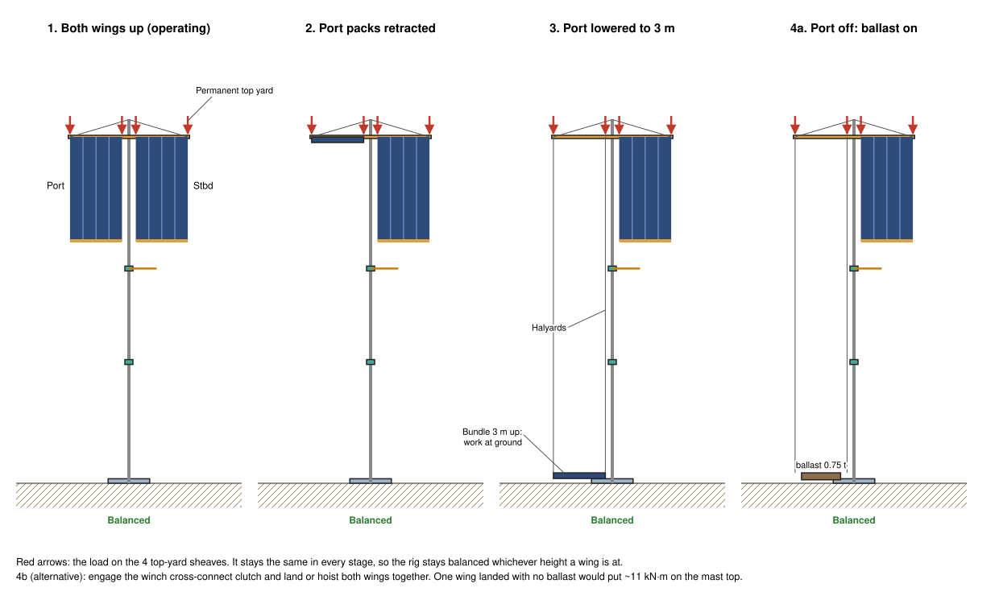
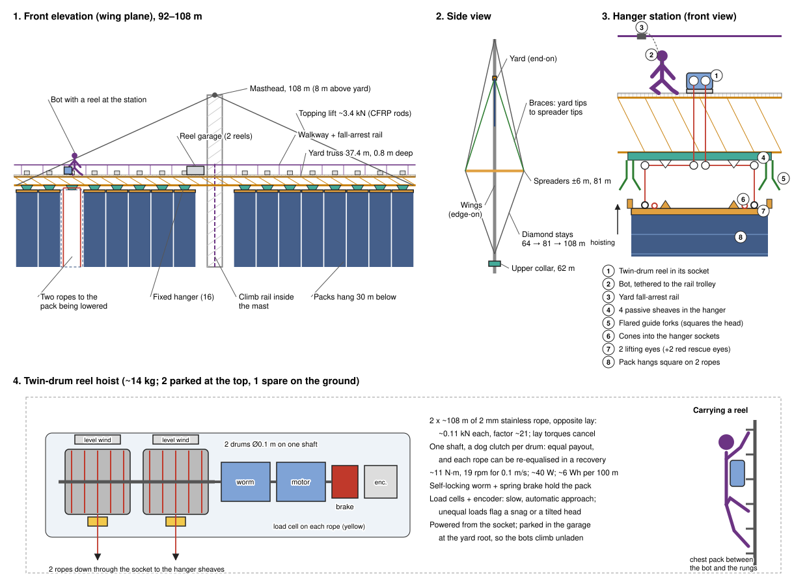
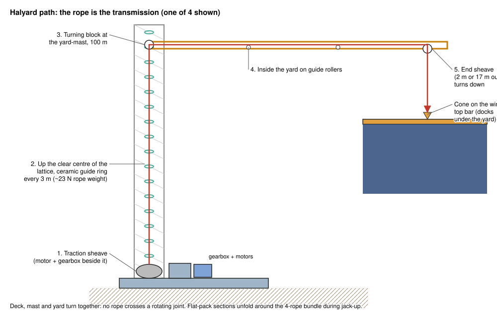
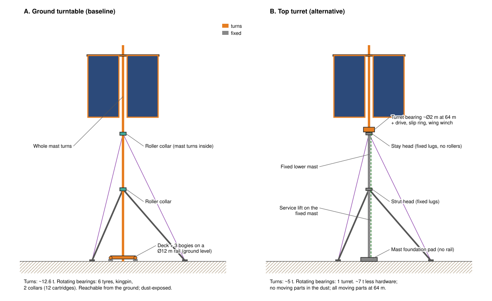
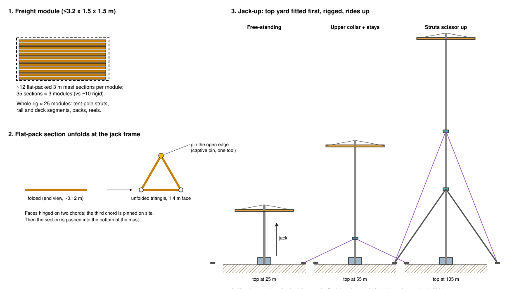

# Lunar polar rotating solar platform: concept design (rev 17, tall mast on a strut tripod)

A small turntable on a circular rail that turns a very tall mast, with the solar array at the top, for a lunar polar crater-rim or ridge site (e.g. Shackleton rim, Malapert, Connecting Ridge). This is a first-pass concept with sizing estimates. Numbers are starting points to refine, not verified engineering.

**Revision history**
- Rev 1: Ø42 m twin-rail turntable carrying a 30 m panel wall.
- Rev 2: rail ring cut to Ø12 m for logistics; cable-stayed rig that uses low gravity and no wind; human-supervised installation equipment.
- Rev 3: array raised to ~100 m to clear terrain and neighbour shadows; mast braced by stationary ground guys through roller collars; lowerable solar curtains.
- Rev 4: the ground guys and their tension anchors are replaced by a **strut tripod**. Three rigid struts run from a **mid-height collar** down to foot pads on the surface. Each foot is wire-braced up to an **upper collar** and tied **horizontally back to the platform's kingpin foundation**. It is a closed, pre-tensioned truss: no ground anchor ever has to resist being pulled up, and there are 2 collars instead of 3.
- Rev 5: base running gear changed to **3 bogies with 4 individually replaceable tyres each**. Three supports always share the load evenly, so rail flatness and settlement don't matter. Any tyre can be lifted off the rail and swapped without jacking the deck. About 10 m of clear rail between bogies leaves room to replace wear-surface segments without a bridging rail.
- Rev 6: **2 tyres per bogie** (6 in all). Each bogie pivots at its centre, so the whole base is statically determinate and every tyre carries exactly the same load, with no springs. Each tyre has a built-in **support shoe** for swaps. The tyres are vertical, not angled outward, because the load they carry is vertical.
- Rev 7: anti-**wind-up** bracing. The upper collar gets 3 **hinged rigid torque arms** whose tips carry the wires, and each strut becomes a narrow **A-frame**. Without them the upper collar would twist ~10° under a partly seized roller, and the strut collar is torsionally unstable (see section 4). The bogie pivot is now a stiff, travel-limited rocker with hard stops.
- Rev 8: the array is split into **port and starboard wings**. Each hangs on halyards from a **permanent top yard** and is raised and lowered on its own for installation and maintenance. The wing's weight stays on the same sheaves whichever height it is at, so lowering one wing does not unbalance the rig. Only taking a wing's weight off its halyards would, and that is handled by a ballast swap or by landing both wings together (section 4).
- Rev 9: each bracing plane's wires become a **single cable that splits into a Y-bridle** at a fixed split plate about 12 m above the ground. The two legs run to the tips of **two hinged arms in a V** on the upper collar. There is one tensioner and one load cell per plane, and twist resistance comes from the monitored, adjustable pre-tension.
- Rev 10: the curtains become **rigid concertina packs**, 1 to 3 m wide (2 m baseline), shipped and replaced as separate units. Each pack deploys and retracts like a **Roman blind**, and each can be **lowered on its own** to the ground for exchange (simplified in rev 15).
- Rev 11: two-point arm root (fold hinge + seat 500 mm below) instead of knee braces.
- Rev 12: hanging A-bracket knee (compression strut into a funnel cup).
- Rev 13: V-plate pendant knee on the torque arms (superseded).
- Rev 14: the torque arms, Y-bridles, knees and crown ring are all removed. Each bracing plane now has **one stay cable** from the foot to the apex of a **V-link**: a flat V-plate hinged on **two close pins** on the upper collar. The V-link only spreads and levers the cable's sideways (twisting) pull into a couple on those two pins. It has no other bracing, and with the cable slack it hangs straight down under gravity. Collar twist is limited by a **collar-torque interlock** on the drive.
- Rev 15: the Roman-blind cords and per-pack hoists are removed. **Both wings are lowered together** on their halyards. Each pack lands in a **landing tray** and folds itself up as the top bar comes down, which brings every pack attachment to working height for replacement. Raising unfolds the packs again. One winch drives all 4 halyards, so the wings can't move out of step.
- Rev 16: **transport packaging and erection** (section 10). Every part is cut down to fit a **3.2 x 1.5 x 1.5 m freight module**. The mast becomes **flat-pack lattice sections**, the struts become **tent-pole segments**, and the deck becomes a 12-segment ring with spokes. Erection is base jack-up with the top weight kept to ~1 t.
- **Rev 17 (this):** **detailed top yard** (section 4a): yard truss, an 8 m masthead (the mast becomes 108 m), topping lifts, braces, halyard sheaves and routing, **docking latches** that take the wings' weight off the halyards, and the **panel elevation winch** (one motor, linked traction sheaves).

## 1. Why it rotates, and why it must be tall

At the poles the Sun stays within ~1.5° of the horizon and goes once around it each lunar day (29.5 Earth days). So the array must stand **vertical** and turn about a vertical axis **once every 29.5 days** (~0.51°/hour), always in the same direction.

At such low Sun angles every bump shades a long way: a 10 m rise casts a shadow ~380 m long at 1.5°, and a 100 m object ~3.8 km. On crater rims and ridges, how many hours of sunlight a point gets rises steeply with height above the ground, because the line to the Sun clears more of the far terrain. So the array top is pushed up as far as structure, installation and site allow. Published illumination models of polar sites, and tower concepts such as Honeybee Robotics' LUNARSABER (~100 m), point to the same order of height.

**How to set the height for a real site:** run a horizon/illumination analysis on LOLA elevation data for the exact spot, for array-top heights of, say, 20 to 200 m. Plot hours of sunlight per year against height and pick the knee of the curve. The structure in this document scales across that range (section 3).

## 2. Using low gravity and no wind

| Load | Earth | Moon | Effect on design |
|---|---|---|---|
| Wind | Governs tall masts | **None** | A slender 100 m+ mast and a 1,000 m² sail with almost no lateral load |
| Gravity | 9.81 m/s² | **1.62 m/s² (1/6)** | Mast and strut compression, wire tension, jacks and bearings are 1/6 the size |
| Seismic | Varies | Shallow moonquakes, small accelerations | Main lateral load; carried by the strut tripod |
| Thermal | Moderate | Large swings and one-sided sunlight | Thermal bow of the mast; use CFRP, keep the gradient steady (below) |
| Rotation dynamics | n/a | 0.51°/h | Negligible; ramp the drive steps gently |

How the design uses this:

1. **A slender braced mast.** Without wind and in 1/6 g, a light lattice mast needs only a little lateral bracing to reach 100 m or more. Its practical limit is set by the site, installation and shading, not strength.
2. **The bracing doesn't rotate.** A stationary **strut tripod** holds the mast through two **roller collars**, and the mast turns inside them. This keeps the base ring small (Ø12 m) while the bracing spreads wide (feet at 30 m).
3. **A closed truss, so no tension anchors.** Each bracing plane is a triangle: strut (compression), wire (tension) and the mast between the two collars. A horizontal tie from each foot to the kingpin foundation closes it at ground level. The three ties pull on the kingpin from 120° apart, so they cancel. The foot pads only ever push down on the ground. Holding up-pull in loose regolith is hard; bearing down on it is easy.
4. **The array sits above all the bracing.** It sweeps a 17 m radius circle from 67 to 100 m. The upper collar is at 62 m, so the turning array never meets a strut or wire. Above the collar the mast is braced by its own rotating **diamond stays** (spreaders and stays that turn with the mast, as on a racing yacht).
5. **Light rigid concertina packs** (~2 kg/m²) that hang from the top. In 1/6 g with no wind they unfold under their own weight and hang flat, with no frame needed to hold the 30 m height.
6. **Balanced rig.** The array is one plane through the mast, left and right equal, so its centre of mass stays on the axis.
7. **Steady sunlight makes thermal bow predictable.** Because the rig tracks the Sun, the same mast face is always sunlit, so the bow is nearly constant and can be trimmed out with wire tension. The mast sits behind the blanket, so its top section is in shade. CFRP tubes (α ≈ 0 to 1x10⁻⁶ /K) keep the bow to a few centimetres. The same 35 m length in aluminium would bow ~0.9 m.
8. **Light installation gear.** The whole mast plus array (~5 t) weighs about 8 kN on the Moon, so a modest jack at deck level can raise all of it (section 7).

## 3. Reference configuration (100 m baseline)

| Item | Value |
|---|---|
| Array top / bottom | **100 m / 70 m** above the deck |
| Mast | **108 m** triangular CFRP lattice (Ti nodes), 1.2 to 1.5 m face, ~25 kg/m (~2.7 t), in **36 flat-pack 3 m sections** (section 10). Top yard at 100 m, masthead 8 m above it |
| Solar wings | **Port and starboard wings**, each 17 m x 30 m (~500 m²), total ≈ **1,000 m²**. Each wing is **8 concertina packs** hung from a top bar. ~1.37 t per wing (~2.2 kN on the Moon) |
| Concertina pack | Rigid panels ~2 m wide x 1 m tall (CFRP-honeycomb, ~2 kg/m² with cells), 30 panels hinged along their horizontal edges. Deployed: 2 m x 30 m. Folded: ~2 m x 1 m x 0.7 m, ~140 kg (~0.23 kN on the Moon). Packs from 1 to 3 m wide use the same station hardware |
| Power (30% cells, 1,361 W/m², ~85% system) | **~350 kWe** |
| Top yard (permanent) | 34 m CFRP truss fixed to the mast at 100 m, with topping lifts from the masthead and braces to the spreader tips. 2 halyard sheaves and 2 docking latches per wing. Details in section 4a |
| Wing top bar | Each wing has a top bar on 2 halyards carrying 8 **pack hangers** (4 alignment cones + captive latches each). No fixed bottom yard: each pack has its own small bottom bar |
| Landing trays | 2 light trays at deck height (~1.5 m) along the maintenance azimuth (port and starboard, 2 to 17 m from the mast), on the deck inboard and on short legs outboard. The packs fold into them |
| Roller collars (stationary) | **Strut collar at 35 m**, **upper collar at 62 m** |
| Struts | 3 **A-frames** at 120°: each 2 CFRP tubes Ø0.3 m x 2 mm, ~46 m long, ~3 kg/m, ball joints at both ends. Joined at the foot, spread ±1.5 m at a torque bracket 4 m out from the strut collar |
| Foot pads | 3 at **30 m radius**, ~1 m² sintered or gabion pad, compression only (~0.5 kN) |
| V-links (upper collar) | 1 per bracing plane: a flat Ti V-plate (~8 mm), **2 pin holes 0.4 m apart** on the collar (horizontally aligned, instrumented load pins) and **1 shackle hole at the apex, 1 m out**. Free to hinge; hangs straight down when the cable is slack. ~2 kg |
| Stay cables | 1 per bracing plane, from the foot tensioner to the V-link shackle (~68 m), 6 mm stainless wire rope, UV-proof. ~1.5 kN pre-tension, adjustable to ~3 kN, load cell at the foot |
| Ties | Foot to kingpin foundation, horizontal at ground level (passing under the raised rail), ~1 kN |
| Upper bracing (rotating) | Diamond stays: spreaders ±6 m at 81 m, stays from 64 m (just above the upper collar) to the mast top |
| Rail ring | Ø12 m single rail, 12 segments of π m, **3 bogies x 2 tyres** at 120° |
| Rotating mass | ~12.6 t (mast 2.5 t, wings + top yard 3.1 t, deck 4 t, bogies 0.2 t, collar bands + margin 1.1 t, kingpin 1 t, diamond stays 0.5 t) |
| Lunar weight on the ring | ~20.5 kN; the pre-tensioned tripod lifts the mast very slightly (~1.5 kN), so the ring carries a little less |
| Maintenance azimuth | Mast parked so the array lies **between** bracing planes (e.g. 30°/210° when the struts are at 0°/120°/240°) |

**Scaling to other heights** (rough; same array, CFRP mast; struts sized for ~4x buckling margin):

| Array top | Upper collar | Strut collar | Foot radius | Strut length | Mast mass | Lunar weight |
|---|---|---|---|---|---|---|
| 60 m | 22 m | 12 m | ~12 m | ~17 m | 1.2 t | ~16 kN |
| **100 m** | **62 m** | **35 m** | **30 m** | **46 m** | **2.5 t** | **~20.5 kN** (rigid packs) |
| 150 m | 112 m | 60 m | ~50 m | ~78 m | 4.8 t | ~23 kN |
| 200 m | 162 m | 85 m | ~70 m | ~110 m | 8 t | ~29 kN |

Above ~150 m the struts get long enough that they need a larger lattice section or a mid-length brace. In practice the height is limited by:
- **Footprint**: the ridge must be ~2x the foot radius wide. That is smaller than the guy anchor footprint in rev 3, but ridges are often only a few hundred metres across.
- **Installation time** at the jack.
- **Sightlines to other collectors**: a taller rig shades more of the ridge.

**Pre-tension (100 m case).** Tighten the wire to ~1.5 kN and the tie to ~1 kN. That puts ~2.5 kN of compression in the strut (buckling load ~10 kN) and leaves each foot pressing ~0.5 kN on its pad. Keep strut compression above ~1.2x the wire tension so the feet never lift. Load cells on every wire and tie show the rig's state.

## 4. Mast, collars and wings

**Roller collars.** Each collar is a stationary ring around the mast, made of 3 bolted 120° segments so it can be fitted around the mast. At that height the mast carries a circular **collar band**: a Ti box ring bolted to the three mast legs, with ceramic/DLC-coated running faces on the top, outside and underside.

The collar holds **6 identical roller cartridges**. Each is a C-frame that wraps the band edge, like a base bogie wraps its rail. It carries three rollers:
- an **upper thrust roller**: the upper collar is pulled down by the wires,
- a **radial guide roller**: holds the mast sideways,
- a **lower thrust roller**: the strut collar is pushed up by the struts, and it also resists quake uplift.

So one cartridge design serves both collars. Each cartridge slides out radially on rails through a window in the collar ring. A preload spring gives ±10 mm of float for thermal mismatch, it has 2 captive bolts, and it has a grapple fixture for the climber robot. The collar works with any one cartridge removed.

The rollers use the same technology as the bogies (dry-lubricated hybrid bearings, dissimilar surfaces). The collars carry only light loads (pre-tension and quake loads), so the heavy, critical parts stay at ground level: vertical load, drive and slip ring. Dust is far lower at height.

A **transport clamp pin** in each cartridge locks the collar to the band during jack-up (section 7) and is pulled once the collar is at height.

**Preventing collar bearing seizure.** The upper collar is the hardest part to reach (62 m up). It carries a steady downward pull from the wires and sees the biggest temperature swings, so it gets the most protection. If it seized while the base kept driving, the mast would be twisted against the tripod. Protection is in five layers:

1. **Remove the causes of seizure.**
   - *Cold welding:* no like-on-like metal contact anywhere. Steel or Si₃N₄ rollers run on a ceramic/DLC-coated Ti band; races and balls are dissimilar (hybrid ceramic bearings).
   - *Lubricant loss:* dry films only (sputtered MoS₂ or WS₂ on races, PTFE/polyimide-composite cages that keep re-transferring lubricant). Nothing evaporates, freezes or creeps in vacuum.
   - *Thermal pinching:* the band and collar ring are both Ti, so they expand alike. Each radial roller sits on a **preload spring with ±10 mm float**, so no temperature difference or thermal bow of the mast can squeeze a roller tight. The thrust rollers are crowned and spring-loaded the same way. White thermal coating plus a light sunshade keep the collar near the mast's temperature.
   - *Dust:* at 62 m the collar is far above most lofted dust. Metal labyrinth lips on the band, a cover over each cartridge, and a brush skirt keep out what does arrive. Wear debris falls onto a catch shelf, not into the next roller.
   - *Light loads:* each collar's rollers are Ø100 mm.
     - *Upper collar:* the wires pull it down by 3 x 1.5 kN x sin 64° ≈ 4.0 kN, plus ~0.25 kN of its own weight. Shared by 6 upper thrust rollers, that is **~0.7 kN each** (0.9 kN with one cartridge out).
     - *Strut collar:* the struts push it up by 3 x 2.5 kN x sin 49° ≈ 5.7 kN, less its weight. That is **~0.9 kN on each lower thrust roller** (1.1 kN with one out).
     - *Radial rollers:* they only see spring preload, quake and thermal-trim loads, a few hundred N.
   - *Very few turns:* each roller runs on a ~6.1 m circle (band Ø1.95 m) once per lunar day, about 6.1 / (π x 0.1) ≈ **20 turns per lunar day**. That is ~240 a year, or ~2,400 in ten years, where an ordinary bearing makes that many turns in a few seconds. Rolling fatigue and wear are therefore negligible. The real risks are static ones during long, almost motionless spells: cold welding, fretting from vibration, and dust settling. The other measures here are aimed at those.
2. **Make a stuck roller harmless.**
   - Each roller has a **second rotation path**: the ball bearing runs on a dry-lubricated sleeve journal. If the bearing locks, the roller turns on the sleeve.
   - If both lock, the roller skids on its hard coated face rather than jamming. The other 5 cartridges keep guiding the mast.
   - No single cartridge can lock the collar.
3. **See it coming.** The V-link load pins read collar friction torque directly.
   - Every roller has a small rotation sensor (magnet + Hall sensor). If the mast turns and a roller doesn't, the system alarms long before the bearing seizes.
   - Load cells on the wires and ties, drive motor current, and strain gauges on the mast between base and collar all track friction torque. A rising trend means "swap a cartridge soon".
4. **Protect the structure if it happens.**
   - A **collar-torque interlock** stops the base drive if the V-link load pins read more than ~200 N·m. A drive torque limiter can't do this job: the drive needs several kN·m to break the deck free in dust. The collar is never wound round more than ~3°.
   - The array keeps working in its last position until the fault is cleared. At most a few percent of a lunar day's energy is lost.
5. **Fix it in place.**
   - The climber robot swaps the cartridge (2 captive bolts, slide out, slide in) while the other 5 hold the mast. Spare cartridges are kept on site.
   - Cartridges are also swapped on a schedule (for example, one per collar per year) and sent back for inspection, to learn real wear rates.
   - Before flight, prove all of this with a **vacuum-thermal life test** of a full cartridge, run on a band section in regolith simulant dust for many times the design number of revolutions.

**Wind-up: keeping the collars from turning with the mast.** Friction in the collar rollers drags the stationary collar round with the mast, so the bracing must hold it against twisting. In rev 4 to 6 every wire and strut lay in a vertical plane through the mast axis, so together they barely resisted twisting (`torsion_check.py` gives the numbers):

| Collar | Rev 4 to 6 | Now |
|---|---|---|
| Upper (stay cables) | ~2.9 kN·m/rad: ~0.2° of twist at normal friction (~10 N·m), ~10° at 500 N·m | **V-link, 1 m lever** (`vlink_check.py`): ~3.8 kN·m/rad at 1.5 kN (**0.15°** at normal friction), ~7.5 kN·m/rad at 3 kN. Fault twist capped at **~3°** (1.5° at 3 kN) by the collar-torque interlock |
| Strut collar | **Negative** (~ -7 kN·m/rad). Compressed struts on ball joints push the collar further round once it starts to turn: torsionally unstable, held only by roller friction | **A-frame struts**: ~14 MN·m/rad, effectively rigid |

(Revs 7 to 13 used 8 m torque arms with crossbars or Y-bridles: up to ~100x stiffer, but with many more parts. They are kept in `torsion_check.py` and `bridle_check.py` for reference.)

How it works:
- **V-link (upper collar), the whole torque lever.** Each bracing plane has a single **stay cable** from the foot tensioner up to the **apex shackle** of a flat **V-plate**. The V's two legs end in **2 pin holes 0.4 m apart** on lugs on the upper collar, on one horizontal axis.
  - The V hinges freely about that axis. Under tension it simply lines up with the cable, so it adds no vertical or rigid bracing of any kind.
  - With the cable slack it **hangs straight down under gravity**.
- **What it does.** If the collar starts to turn, the cable's attachment point moves sideways and the tensioned cable pulls it back. The V moves that attachment out from the collar (1.45 m) to ~1.9 m, and turns the sideways pull into a **couple on its two close pins**. Those pins are instrumented load pins.
- **Stiffness depends on tension.** Twist resistance comes from pre-tension acting on the geometry: k ≈ 3·T·R_foot·r_apex / L_cable.

  | V length | 1.5 kN | 3 kN |
  |---|---|---|
  | 1 m (chosen) | 3.8 kN·m/rad | 7.5 kN·m/rad |
  | 3 m | 5.6 kN·m/rad | 11.2 kN·m/rad |

  - In normal running (~10 N·m of collar friction) the collar twists ~0.15° and stays there, elastically and stably.
  - Raising the tension (monitored at the foot, adjustable to ~3 kN) stiffens it.
  - A longer V adds little and costs clearance, so 1 m is the baseline.
- **Collar-torque interlock (essential with this simple lever).** The base drive must be able to break the deck free in dust (several kN·m), so a drive torque limiter cannot protect the collar. Instead, the **V-link load pins** read the collar's friction torque directly. The drive stops if it exceeds **~200 N·m** (about 20x normal), which caps the twist at **~3°** at 1.5 kN (~1.5° at 3 kN). That is well inside what the cables and clearances accept, and the collar springs back once the fault is cleared.
- **Installation.** The V-links are pinned to the collar and shackled to their stay cables at deck level, before jack-up. As the collar rides up, they hang and then line up with the cables by themselves. Nothing is fitted at height.
- **Loads.** Each V-plate carries the stay tension (~1.5 to 3 kN) in tension. The pin couple at the 200 N·m interlock limit is about ±0.2 kN. Shackles are safety-pin type, coated or of dissimilar metals against cold welding.
- **A-frame struts (strut collar).** Each strut is two tubes joined at the foot and spread ±1.5 m at a torque bracket 4 m out from the collar. This is the same triangle idea, in compression.
- **Clearances.** The V-links stay within ~2 m of the mast, and the A-frame brackets within ~21° of their bracing plane. So the maintenance azimuth (30°/210°) stays clear for lowering the wings. Everything is at or below 62 m, under the array sweep.
- **Torque sensing.** The couple on each V-link's two load pins is a direct measure of the upper collar's friction torque. The load cell at each foot reads the pre-tension. Together they give the seizure early warning in layer 3 below and feed the interlock.

**Port and starboard wings of concertina packs.**

Each wing is a **top bar** with **8 concertina packs** side by side, each 2 m wide (1 to 3 m packs fit the same hangers), with ~0.1 m gaps between them.
- **A pack** is 30 rigid panels, 1 m tall, hinged along their horizontal edges, with a small bottom bar. Folded, it is a ~2 m x 1 m x 0.7 m stack of ~140 kg (~0.23 kN on the Moon), which ships, stores and handles easily.
- **Attachment:** each pack hangs from a **pack hanger** on the top bar (4 alignment cones + captive latches).
- **Fold direction:** alternate hinges are lightly sprung toward their fold direction, so the panels always fold the same zig-zag way.

There is **one raise/lower mechanism**: the top bar of each wing hangs on **2 halyards** over sheaves on the **permanent top yard** (2 m and 17 m from the mast). All **4 halyards** run down the mast to **one winch** on the deck with 4 linked drums.

**Lowering for maintenance (both wings together):**
1. Park the mast at the **maintenance azimuth**, so both wings lie in the clear 30°/210° plane between the bracing planes. Set the 2 **landing trays**.
2. Lower both wings at ~0.1 m/s.
   - On the way down the packs pass the collars, V-links and A-frames ≥1.4 m clear.
   - When the top bars are ~30 m up, the packs' bottom bars touch down in the trays.
3. Keep lowering: each pack **folds itself up** in its tray under gravity, panel by panel, into its zig-zag stack.
4. The top bars come to rest ~1 m above the trays, with **every pack hanger at working height**.
5. Unlatch any damaged pack (4 cones, captive latches) and lift it out of the tray. Set the new folded pack in its place and latch it to the hanger.
6. **Raise** both wings. Each pack unfolds panel by panel as it lifts off its tray, and hangs flat at full height. The top bars latch to the yard.

The whole cycle (down ~20 min, swap, up ~20 min) costs about an hour of output; it is a planned, occasional job.

**Balance.**
- While the packs hang free, their weight sits on the same top-yard sheaves at any height, so the rig stays balanced.
- Once packs land, their weight moves into the trays. One wing landed alone would put up to ~21 kN·m on the mast top above the upper collar (~17 kN extra in the lattice chords).
- So **the wings always move together**. A single winch drives all 4 halyards through linked drums, so the two wings land, fold and lift at the same rate, and the rig stays balanced at every moment.
- Halyard load cells confirm that both sides match. A pack swap changes one side by at most ~0.23 kN (~2 kN·m) while it is unlatched, which is negligible.
- A **regolith ballast pallet** (~1.4 t) remains as a contingency, for example if one wing's top bar ever has to come off.

### 4a. Top yard: structure, lifts, stays and panel elevation winch

**Structure**
- **Yard:** a 34 m CFRP-tube truss with Ti nodes, ~0.8 m deep and ~0.5 m wide. It is built from 12 bolted sections of ~2.8 m, flat-pack like the mast, to fit the freight module. Mass ~0.4 t (~12 kg/m).
  - It is bolted at its centre to a **yard-mast section** at 100 m, so it turns with the mast. There is no bearing.
  - It carries only light, mostly axial loads: ~2.7 kN of compression from the topping lifts. Its buckling load as a 17 m pinned strut is ~275 kN.
- **Masthead:** an 8 m mast extension above the yard (mast top at 108 m), carrying the topping-lift tangs and the diamond-stay head.
  - It is 8 m rather than 5 m because the steeper lift angle (25° instead of 16°) cuts the topping-lift tension from ~4.5 kN to **~3.0 kN**, and the yard compression from ~4.3 to **~2.7 kN**.
  - Cost: one extra mast section (+75 kg).

**Stays at the top**
| Line | From → to | Purpose | Load (wings up) |
|---|---|---|---|
| **Topping lifts** (2) | Masthead → yard tips (±17 m) | Hold the yard ends up against the wing weight | ~3.0 kN each |
| **Braces** (4) | Yard tips → diamond-spreader tips (±6 m fore/aft, at 81 m) | Hold the yard square to the mast against yaw and quake, and stop it swinging | Pre-tension ~0.3 kN |
| **Diamond stays** (2 pairs) | Mast at 64 m → spreader tips (81 m) → masthead (108 m) | Brace the upper mast fore/aft (the wing plane is braced by the yard + topping lifts) | Pre-tension ~1 kN |

- All are 6 mm stainless wire rope with turnbuckles. The topping lifts get **load cells**: the two readings show the wing balance directly.
- The front braces cross in front of the wings, and their shadow (two 6 mm wires) costs <0.05%.

**Halyards and routing**
- Each wing hangs on **2 halyards**, one at each end of its top bar (2 m and 17 m from the mast).
- Each halyard runs up to a **sheave at the yard**, turns 90° to run **inside the yard truss** to a **turning block at the yard-mast section**, then runs **down inside the mast lattice** to the panel elevation winch on the deck.
- Halyard tension is ~1.1 kN with a wing hanging, in 6 mm stainless wire rope (breaking load ~25 kN, factor >20).
- Lengths: ~214 m (outer) and ~200 m (inner), including the 97.5 m stroke from the yard down to the landing trays.
- The halyard loop adds ~4.4 kN of compression to the mast while the wings hang on it. It does not add load at the mast foot: the pull is internal, top to deck.

**How the deck motor drives the wings: the halyard path**

The motor never drives the yard, which is fixed to the mast. It only pulls the halyards, so **the rope is the whole transmission**. In the baseline the deck, mast and yard turn together, so the ropes never cross a rotating joint and cannot twist. Each halyard runs:
1. **Traction sheave on the deck** → straight up into the **clear centre channel of the mast lattice**. The lattice members sit only on the three faces.
2. **Up 100 m** as a loose 4-rope bundle through **ceramic-lined guide rings at every 3 m section**. Each rope weighs only ~23 N over 100 m on the Moon, so it barely touches the rings.
3. **Turning block** at the yard-mast section (100 m) → 90° to horizontal.
4. **Along the inside of the yard truss** on 2–3 guide rollers to the **end sheave** (2 m or 17 m out) → 90° down to the cone on the wing top bar.

- **Friction:** about 85% overall efficiency through 2 sheaves and the rollers.
- **Stretch:** ~0.06% at 1.1 kN, ~13 cm over 214 m. The differences between ropes are handled below.
- **Thermal length change:** ~0.24 m over 200 m for a 100 K swing. It is taken up because the wings sit on the docks in service and the ropes are held at ~0.1 kN by constant-torque motor control.
- **Inner vs outer rope lengths differ** (~200 m vs ~214 m), so their stretch and thermal changes differ too, which the equal-stroke traction sheaves cannot cancel:

  | Source | Difference between inner and outer rope |
  |---|---|
  | Stretch at 1.1 kN | ~9 mm |
  | Uniform 100 K swing | ~17 mm |
  | Uneven heating (one rope ~50 K warmer over 100 m) | ~60 mm, the largest |

  A 6 cm difference tilts a 15 m top bar by only ~0.2°, which is harmless to the structure, but it makes the two cones reach their docks at different moments. Three measures handle it:
  1. **Length-matched routing.** The inner halyard takes a ~7 m out-and-back loop along the yard over a small extra sheave, so all 4 halyards are the same length and follow similar paths. That cancels the systematic stretch and uniform-thermal difference.
  2. **Trim sheaves.** Each halyard passes a small sheave on a lead screw on the deck, motorised with ±0.25 m range. An inclinometer on each wing top bar levels the bar automatically before docking. This also takes out uneven heating, rope creep, and any port/starboard difference.
  3. **Sprung docks.** Each dock has ~60 mm of spring travel, so the first cone to arrive rides up until the second latches. Both limit switches must read latched before the halyards are eased. The same applies on release.
- **Fitting the ropes during jack-up:** the halyards are rove through the top yard first, and the winch pays out as the mast rises. Each **flat-pack section is unfolded around the 4-rope bundle** at the jack frame before its third chord is pinned, so the ropes end up inside every section and nothing is threaded at height.
- **Alternative: send power, not rope.** A winch at the yard, with only a power cable up the mast, gives short ropes but puts the motor and brake at 100 m. The winch is rarely used (the wings sit on docks), so it stays on the deck for ground access. In the turret option (section 9) rope cannot cross the turret bearing, so the winch rides on the turret.

**Docking latches (wings off the halyards when up)**
- At each halyard point the top bar carries a **cone**, which seats in a **dock** under the yard.
- The dock has a **"push-to-latch, push-to-release" mechanism**, the same principle as a ballpoint pen or a parachute release hook. It needs no motor or power at height:
  - *Raising:* hoist the bar ~50 mm past the dock and the latch toggles shut. Ease the halyard and the cone sits on the latch.
  - *Lowering:* hoist ~50 mm again and the latch toggles open, then lower.
- Once docked, the halyards are eased to a light holding tension (~0.1 kN). **The wing weight sits on the yard, not on the halyards or the winch brake**, so wire creep and brake load are avoided while the array operates. A limit switch at each dock confirms latched or open.

**Panel elevation winch (on the deck at the mast base)**
- **One drive for all 4 halyards**, so both wings always move together (section 4, Balance):
  - **4 grooved traction sheaves** (Ø0.4 m, 3 wraps each) on **one shaft**. Constant-diameter traction sheaves give **exactly equal stroke** on all 4 halyards, so the bars stay level whatever length is stored.
  - **4 storage reels**, each with a slip clutch that keeps the rope just taut behind its traction sheave, and a level-wind guide.
- **Drive:** about 4.8 rpm at the sheaves (0.1 m/s), ~890 N·m.
  - **2 brushless motors** (~0.5 kW each, either one can do the job) through a ~600:1 planetary gearbox.
  - A **spring-applied fail-safe brake**, and a **hand-crank socket** for an EVA tool as the last-resort backup.
- **Controls:** load cells on all 4 halyards give balance monitoring and the interlock (section 4). Encoders give position, so the trays and docks are approached slowly. The winch has a dust-sealed housing on the deck.
- **Power** at 0.1 m/s with 70% efficiency is ~0.65 kW: trivial next to the ~350 kW the wings make.

**No panel tilt drive is needed.** At the poles the Sun stays within ~1.5° of the horizon, and vertical panels lose only cos 1.5° ≈ 0.03%. "Elevation" here means only raising and lowering the wings.

**Mast climber robot.** A small robot climbs the lattice to inspect it, swap collar roller cartridges, re-tension diamond stays and service the yards. It is teleoperated with a human supervising, and it doubles as an installation tool (section 7).

## 4b. Shading between collectors

When several rigs share a ridge, one shades another when the Sun lines up behind it. The shade lasts roughly (array width / spacing in degrees + 0.53° Sun disc) / 0.51° per hour, once per lunar day for each neighbour that can line up:

| Spacing | Shade per alignment | Share of the lunar day lost |
|---|---|---|
| 200 m | ~20 h | ~2.9% |
| 340 m (10x width) | ~12 h | ~1.7% |
| 500 m | ~9 h | ~1.2% |
| 1,000 m | ~5 h | ~0.7% |

Layout rules:
- **Space rigs ≥10x the array width apart.**
- **Put them on a line along the ridge crest**, so they line up with the Sun only twice per lunar day.
- **Stagger the heights** of neighbours by more than the array height, so their arrays don't overlap in the sky. Then a neighbour's shadow is only its thin mast, which costs well under 1%.

## 5. Running gear at ground level (low friction, dust tolerant)

**Why 3 bogies with 2 tyres each.** Three bogies give three support points, and three points always define a plane. Each bogie pivots on its centre, so its 2 tyres split that bogie's load exactly in half. The base is therefore **statically determinate**: all 6 tyres carry the same load whatever the rail does (settlement, thermal warp, a small step at a joint), with no springs or adjustment.

The strut tripod carries all overturning and quake loads at the collars, so the base only has to carry vertical load and centre the deck. Three bogies are enough. They are 12.6 m apart along the rail and each is ~1.3 m long, which leaves **~11 m of clear rail** between neighbours: three full rail segments with room to spare.

**Loads.** ~20.5 kN on the Moon over 6 tyres is **~3.4 kN per tyre**. Tyres are designed for 6 kN.

**Which way should the tyres point? (the "duty force")**
- The force on each tyre is **vertical**. The kingpin centres the deck, and each bogie floats ±20 mm radially on its pivot, so no outward or inward push reaches the rail. Tilting the tyres outward would only add a side thrust and scrub.
- If there were a steady radial force (for example a design without a kingpin), the right move would be to tilt the rail head and tyre so the contact faces along the combined force. Here that combined force is vertical, so they stay level.
- Two small angles are still built in:
  - *In plan view:* each axle points at the ring centre. The 2 axles of a bogie fan apart by ~8.6°, so both tyres roll true around the 6 m curve.
  - *In section:* each tread is a shallow cone (half-angle ~1.4°) with its apex at the ring centre. The axle tips ~1.4° down toward the centre, so the contact line lies flat on a **flat rail head** and points at the centre. This is classic turntable geometry: pure rolling across the whole tread width, no scrubbing, no flange needed.

**Bogie**
- Short curved frame (~1.3 m) on a **spherical centre pivot** with ±20 mm radial float. The pivot is the load equaliser.
- **Load balancing is stiff and travel-limited.** With 2 tyres the bogie only has to rock over small height differences: rail joint steps (≤1 mm) and pier settlement between re-levelings (a few mm). So the rocker gets **hard stops at about ±0.5°**, roughly ±4 mm at each tyre. There are no springs and no soft suspension. Within that range the two tyres share load exactly; beyond it the stops (and the support shoes) carry it, and the out-of-level reading tells you which pier to re-level.
- 2 tyres on **cantilevered stub axles** on the outside of the rail. The frame sits inboard, so each tyre slides straight off outward.
- A **support shoe** beside each tyre: a hardened, coated pad on a screw (one tool size). In service it rides **3 mm above** the rail. If a tyre or bearing ever fails, the shoe lands on the rail and carries the load (and the drive's torque limiter stops the platform). The bogie can never drop.
- **Uplift rollers** under the rail head, 2 per bogie (cartridges), against quake bounce.
- **Dust scrapers and brushes** at both ends.
- Bogie ≈ 70 kg on Earth (~12 kg-weight on the Moon).

**Tyres (individually replaceable)**
- Each tyre is a complete **wheel cartridge**: hub, sealed bearing, and a hardened steel tread ring (~Ø300 mm x 80 mm, conical as above), held by one captive hub nut. ~12 kg on Earth, about 2 kg-weight on the Moon.
- **Avoid like-on-like metals** in vacuum (cold welding): hardened steel tread on a ceramic- or DLC-coated rail head.
- Hybrid ceramic bearings with **dry lubrication** (sputtered MoS₂/WS₂, PTFE-composite cages), labyrinth seal plus bellows boot. No grease or oil.
- Rolling resistance Crr ~0.001 to 0.003: **20 to 60 N** total.

**Replacing a tyre**
1. Stop and lock the drive.
2. Wind that tyre's support shoe down onto the rail until it takes the load and the tyre lifts ~5 mm.
3. Undo the captive hub nut, slide the wheel cartridge off outward, slide the spare on, tighten.
4. Wind the shoe back up to its 3 mm standoff. About 15 minutes for one suited person or a robot; no deck jacking.

**Centring, drive, power transfer**
- Central **kingpin** with a slewing bearing (~1.2 m) centres the deck and is the survey datum for building the ring (section 7).
- The **mast foot** sits on a spherical seat at the deck centre, and torque goes through a dog coupling. The collars hold the mast vertical, so small deck tilts from rail settlement are never forced into the mast.
- **Drive**: a pinion on a rack on the rail web, on 2 of the 3 bogies. Either one can turn the platform.
- Running power is milliwatts. Size the drive for breakaway in dust (~20x running force, ~1 kN tangential): a few hundred watts.
- Power crosses the rotation through a **slip ring or rotary transformer** in the kingpin.

## 5b. Bearing and joint schedule

Only **three sets of bearings rotate in service**: the 6 tyres and 2 collars. Everything else is static in service and moves only during installation or maintenance, or by tiny thermal amounts.

| # | Joint | Relative motion | Load (Moon) | Type |
|---|---|---|---|---|
| 1 | **Tyres** (3 bogies x 2) | Rotating, ~0.5°/h, always | ~3.4 kN each, vertical | Wheel cartridges: hybrid ceramic bearings, dry lube, conical tread on a flat rail head |
| 2 | **Upper collar** (62 m, 6 cartridges) | Rotating (mast inside a stationary collar) | Stay pull-down ~4 kN total, ~0.7 kN per thrust roller; small radial | Roller cartridges with dual rotation paths; torque read by the V-link load pins |
| 3 | **Strut collar** (35 m, 6 cartridges) | Rotating | Strut push-up ~5.7 kN total, ~0.9 kN per lower thrust roller | Same cartridge design as the upper collar |
| 4 | Kingpin | Rotating, but radial centring only | A few hundred N (quake, misalignment) | Slewing ring ~1.2 m, with the slip ring / rotary transformer |
| 5 | **Mast foot** on the deck centre | **No rotation** (turns with the deck); small tilt only | **~8 to 9 kN** vertical: mast + wings + top yard (~10 kN), plus stay pull-down (~4 kN), less strut push-up (~5.7 kN) | **Spherical seat** (ball joint), dry-film plain bearing; torque through a dog coupling |
| 6 | Bogie pivots (3) | Rocking ±0.5°, ±20 mm radial float | ~6.8 kN each | Spherical pivot with hard stops |
| 7 | Uplift rollers, support shoes | None in service (standby) | ~0 (quake / fault only) | Rollers / screw shoes |
| 8 | **Strut A-frame ends** (6 tubes, 2 ends each) | **Static in service.** Swing only during the scissor erection; thermal micro-motion after | ~1.25 kN per tube | Spherical plain bearings, dry film. They hardly move, so the concern is fretting, not wear |
| 9 | **V-links** (3 x 2 pins, upper collar) | Static in service; hinge only during installation | Stay tension 1.5 to 3 kN; couple ≤ ±0.2 kN at the interlock limit | Pins in lugs; instrumented load pins |
| 10 | Stay and tie terminations, foot pads | Static (tensioners adjusted occasionally) | 1.5 to 3 kN | Screw tensioners + load cells |
| 11 | **Top yard** at 100 m | **None:** fixed to the mast, turns with it | Wings + yard ~5 kN down, through topping lifts into the mast top, then down the mast to the mast foot | Bolted joint, no bearing |
| 12 | Halyard sheaves (4, top yard) | Only when lowering and raising the wings | ~1.1 kN per halyard | Sheaves on dry-lubricated bushings |
| 13 | Drive pinions (2) | Rotating, always | ≤ ~1 kN at breakaway | Pinion on a rack on the rail web |

## 6. Track (raised, segmented, swappable)

- **Raised rail** on piers ~0.5 m above the regolith, away from near-surface dust and with room to work underneath.
- Rail: hollow box beam with a bolted, replaceable **rail head strip**.
- **12 identical segments**, π m long. Each sits on 2 piers that are shared with its neighbours at the joints, so **12 piers** in all, plus 4 kingpin anchors.
- **Angled (scarf) joints** with slotted holes for ~3 to 5 mm expansion each.
- **Piers** have leveling screws (±50 mm) on sintered-regolith pads, helical ground screws, or regolith-filled gabion bags.
- An overhanging **skirt or brush seal** on the deck keeps falling dust off the rail head.

**Replacing a rail segment or wear strip** (the main reason for the wide bogie gaps)
1. Turn the platform until the damaged segment sits in a gap. With ~11 m of free rail between bogies, any segment can be placed with ~4 m to spare at each end. No bridging rail is needed.
2. If only the running surface is damaged (the usual case), unbolt and swap just the **rail head wear strip** (~10 kg, π m long).
3. If the beam itself is damaged, unbolt the whole segment from its 2 piers, lift it out, drop in the spare and level it against the radius arm (section 7).
4. Turn the platform past the new piece slowly and watch the drive current as each bogie crosses it.

**Replacing a whole bogie** (rare; tyres and uplift rollers are swapped in place)
1. Set a **jack stand** on the rail just beside the bogie (the wide gaps leave room) and lift that corner of the deck ~10 mm.
2. Release the spherical pivot, wind both support shoes up, roll the bogie out along the rail into the gap and lift it off. Fit the spare the same way.
3. Lower, remove the stand.

**Spares on site**: 4 wheel cartridges, 2 uplift roller cartridges, 1 bogie, 2 rail segments, 6 rail head wear strips, 1 drive unit, slip-ring brush cartridges, 2 collar roller cartridges, 1 stay cable, 1 V-link with load pins, and 1 tie with tensioners, 1 strut section, 4 concertina packs, 1 ballast pallet frame (filled with local regolith).

## 7. Installation equipment and sequence (human supervised)

Everything is assembled at deck level and raised. A crew member (EVA, or in a pressurised rover nearby) supervises each step and signs off every hold point. Machines do the lifting.

| # | Equipment | What it does |
|---|---|---|
| E1 | **Kingpin driver** | Sets the central kingpin foundation: the datum for everything else. |
| E2 | **Radius arm ("compass")** | 6 m arm on the kingpin with a laser level, encoder and pier socket. It places and levels the 12 rail piers. With an extension and laser rangefinder, it also lays out the 3 foot-pad sites at 30 m. |
| E3 | **Rail-riding installer cart** | Lays rail segments from the installed rail; later the maintenance cart (tyre, wear strip and segment swaps, jack stand). |
| E4 | **Foot-pad and tie layer** | Compacts or sinters the 3 foot pads and lays the 3 ground ties from the kingpin foundation out to the feet, under the raised rail. No pull-out anchors needed. |
| E5 | **Mast jack-up frame** | Sits on the deck around the kingpin and lifts the whole mast one 3 m section at a time; the new section is pinned in at the bottom. Peak lift is ~8 kN (whole mast + array) plus bracing pre-tension. |
| E6 | **Tie and wire winches with load cells** | One at each foot. They control the ties (which pull the strut feet in as the mast rises) and the wires, and keep the mast plumb. Tensions are shown live on a supervisor tablet. |
| E7 | **Mast climber robot** | Fits and checks the diamond stays and collar cartridges at height. Later used for inspection and maintenance. |
| E8 | **Wing winch** | One winch on the deck with 4 linked halyard drums (both wings always move together), brake and halyard load cells. |
| E9 | **Landing trays** | Two light trays at deck height along the maintenance azimuth; the packs fold into them on lowering and unfold from them on raising. They double as storage for spare packs. |

**Sequence**
1. Survey and clear the site. Set the kingpin (E1). Lay out the 3 foot sites with the radius arm (E2); prepare the pads and lay the ties (E4).
2. Set the 12 rail piers and lay the ring (E2, E3). Hold point: ring flat to ±2 mm.
3. Place the 3 bogies, then assemble the deck (12 ring-girder segments + 12 spokes) on them. Check the deck turns by hand and all 6 support shoes are at their 3 mm standoff.
4. Fit the jack-up frame (E5). Fit the **top yard first**, on the topmost mast section at deck level:
   - **unfolded and horizontal**, at the maintenance azimuth,
   - topping lifts set and tensioned,
   - all 4 halyards rove through their sheaves and led to the wing winch, which pays them out as the mast rises.

   It then simply rides up. During jack-up only the stays and struts are on the mast, and both are always below the yard, so it cannot foul anything and nothing has to be unfolded at height. The wings are not on the mast during jack-up. **Build it as it rises:** every later section goes in at deck level already in its final form. The diamond-spreader section, for example, is fitted with its spreaders open (12 m across) and its stays connected.
5. **Jack up, with a scissor action.** Each collar is fitted around the mast at deck level (3 segments), clamped to its band, and rides up with the mast.
   - Up to ~43 m the mast stands free in the jack frame (section 10.3). When the upper-collar band reaches the deck, the **upper collar** goes on, with its 3 V-links already shackled to their stay cables, which are paid out from the foot winches as it rises. Until the struts are in, these cables act as light temporary guys (a few hundred N). Each foot winch is ballasted with regolith bags so it never needs a pull-out anchor.
   - When the strut band reaches the deck, the **strut collar** goes on. The 3 A-frame struts are pinned to its torque brackets while lying flat on the ground, pointing outward, with their feet on skid dollies.
   - As the mast keeps rising, the struts swing up and the tie winches (E6) **pull the feet in** along the ground, from 46 m to their 30 m pads. Low gravity keeps the strut and dolly loads tiny.
   - At final height, the feet drop onto their pads. The stay cables and ties are trimmed to final tension; the V-links line up with their cables by themselves. The clamp pins are pulled, and from then on the mast turns freely in both collars.
6. At full height (the top yard is already rigged), park at the maintenance azimuth. Shackle both wing top bars, waiting at the trays, to their halyards, set the folded packs in the trays and latch them to their hangers (all 16, or as many as have arrived, in matched port/starboard pairs). **Raise both wings together** (E8, E9); the packs unfold as they lift. More packs can be added later by the same lower, latch and raise cycle.
7. Trim wire and tie tensions to plumb the mast and take out thermal bow. Connect the harness to the slip ring, commission the drive, start tracking.

Design rules for every part: captive fasteners, one tool size, alignment cones, grapple fixtures, and no single piece heavier than ~150 kg-weight on the Moon without lifting gear.

## 8. Environment checklist

| Hazard | Response |
|---|---|
| Terrain and neighbour shadows | Array at the top of a 100 m+ mast; site illumination study sets the height; spacing and stagger rules (section 4b) |
| Temperature swings, one-sided sunlight | CFRP mast and struts, mast behind the blanket, spring tensioners on wires and ties, steady sun-tracking gradient trimmed by wire tension |
| Cold welding in vacuum | Dissimilar or coated mating surfaces, dry lubricants on all rollers |
| Abrasive, electrostatic dust | Raised rail, scrapers, seals, skirt at ground level; collars and array are high above most lofted dust |
| Moonquakes | Strut tripod carries lateral load; balanced rig; lower thrust rollers in the collars and uplift rollers at the base |
| Micrometeoroids | Damaged packs lowered and exchanged one at a time; doubled wires; struts are thick-walled tubes, inspected by the climber |
| UV and radiation on cables | Steel wire rope or coated CFRP rod, not bare aramid or polymer fibre |
| Regolith settlement | Adjustable piers and foot pads; wire and tie tensions monitored with load cells and re-trimmed |

## 9. Trade study: ground turntable (baseline) vs top turret

**Option B, top turret.** The whole mast below ~64 m is **fixed** to a foundation at the base. A single **turret bearing** at ~64 m, just above the upper bracing, carries everything that turns: the upper mast (64 to 108 m), diamond stays, top yard and both wings. The drive, slip ring and wing winch move up onto the turret.

| | **A. Ground turntable (baseline, rev 15)** | **B. Top turret** |
|---|---|---|
| What turns | Whole mast + wings + deck, ~12.6 t (~20.5 kN) | Upper mast + yard + wings, **~5 t (~8 kN)** |
| Rotating bearing sets | 6 tyres, kingpin, 2 collars (12 roller cartridges), drive pinions | **1 turret bearing** (~Ø2 m, 8 cartridges), turret drive |
| Hardware removed by B | n/a | Rail ring + 12 piers, 3 bogies, deck, kingpin, 2 roller collars, V-links, collar-torque interlock: **~7 t less landed mass** |
| Bracing | Stays and A-frame struts on stationary collars around a turning mast | Stays and struts bolt **straight onto the fixed mast**. No wind-up, so the A-frames could revert to single struts (the fixed mast foot carries the small drive torque) |
| Groundwork | 12-segment rail, piers levelled to ±2 mm, raised above the dust | One mast foundation pad, plus the strut feet as before |
| Dust exposure of moving parts | Tyres, rail and drive at ground level, the main wear risk | **None**: every moving part is at 64 m, above most lofted dust |
| Turret bearing loads | n/a | Normal: ~1 kN per cartridge. Quake (0.1 m/s², ~12 kN·m): ±3 kN. One wing landed alone (~21 kN·m): ±5 kN. A crossed-roller ring or 8 collar-style cartridges rated ~6 kN |
| Access to moving parts | **From the ground** (tyres, drive, slip ring) | **At 64 m.** But a fixed mast can carry a permanent **service lift / climber rail** that a turning mast cannot, so access improves for the parts that are high up anyway |
| Power and cables | Slip ring at the kingpin; everything turns with the mast | Slip ring at the turret; cables run down the fixed mast |
| Wing lowering | Winch on the deck | Winch on the turret (halyards must not cross the turning joint). Trays and the maintenance azimuth are unchanged |
| Failure modes | Collar seizure / wind-up; rail damage from regolith; settlement under 3 bogies | Turret seizure, which stops tracking (the collar measures there disappear, but the bearing is a single point); the drive and slip ring are at height |
| Installation | Rail, bogies and deck to set; collars ride up with the mast | Simpler groundwork. The turret assembly is fitted at deck level on its mast section and rides up with the jack-up; no collars, so the bracing heads are just lugs on mast sections |
| Fits the original brief? | **Yes**: platform on circular rails, replaceable wheels and track sections | No: no ground rails or wheels |

**Assessment.**
- *B is simpler:* fewer bearing sets, ~7 t lighter, no dust on moving parts, no wind-up problem, and much less precise groundwork.
- *A's advantages:* its heaviest rotating hardware (tyres, drive, slip ring) can be reached and swapped from the ground, and it matches the original brief.
- *Access cuts both ways.* Both options already depend on the climber robot for parts at height. A fixed mast also allows a permanent service lift, which shrinks B's access penalty.
- *Recommendation:* carry **B as the leading alternative**. Run a short side-by-side study before freezing the design, based on:
  - turret bearing life testing,
  - the site's foundation conditions for one mast pad versus a levelled rail ring, and
  - how often the drive and slip ring are expected to need service.

## 10. Transport packaging and mast erection

### 10.1 The freight constraint

Mass and cost are acceptable. **Package dimensions are the binding limit.** The launcher is not the tight part:
- Falcon 9's fairing has a usable envelope of roughly 4.6 m diameter x 11 m.
- Starship's payload volume is roughly 8 m diameter x 17 m or more.

The tight part is the **lunar lander's cargo deck and unloading gear**, and that is not chosen yet. So every part is cut to fit one conservative **standard freight module: ≤ 3.2 m x 1.5 m x 1.5 m**. It suits small cargo landers, packs many to a large lander, and needs nothing longer than one person-and-robot can handle. If the chosen lander allows bigger pieces, the same parts simply ship with fewer joints.

| Item | Size as designed | Cut for freight | Packed size |
|---|---|---|---|
| Mast (108 m) | Triangular lattice, 1.4 m face | **36 flat-pack sections**, each 3 m long (see 10.2) | ~3 x 1.4 x 0.12 m each; 36 stack to ~4.3 m: **3 modules** |
| Struts (6 tubes, 46 m) | CFRP tube Ø0.3 m | **Tent-pole segments**, 15 x ~3.1 m per tube, sleeve joints, internal steel tensioning cord | 90 tubes, ~25 per module: **4 modules** |
| Rail | Ø12 m ring | 12 segments, π m arcs (~3.1 m chord), unchanged | 1 to 2 modules |
| Deck (Ø12 m) | Was 4 quarter-sections (~8.5 m chord: too big) | **12 ring-girder segments + 12 spokes**, each spoke in 2 x 3 m pieces | 2 modules |
| Top yard (34 m) and wing top bars (2 x 15 m) | Trusses | ~3 m bolted truss sections | 1 to 2 modules |
| Landing trays (2 x 15 m) | Light frames | 3 m sections | 1 module |
| Solar packs (16) | 2 x 30 m deployed | Folded packs ~2 x 1 x 0.7 m (1 to 3 m wide all fit) | 2 per module: **8 modules** |
| Stay cables, ties, halyards | 68 m and less | On reels | 1 module |
| Bogies, collars, V-links, jack frame, winches | ≤ ~2 m | As-is (collar rings in 3 segments, as designed) | 3 to 4 modules |

Roughly **25 freight modules** in total for one rig.

### 10.2 Mast: segments vs telescopic vs deployable

| Option | Packaging | Erection | Verdict |
|---|---|---|---|
| Rigid bolted lattice sections (as before) | Poor: each 3 m section fills a whole 3 x 1.4 x 1.2 m volume and cannot nest | Base jack-up, conventional | Works, but ~10 modules of mostly air |
| **Flat-pack lattice sections** | Each section's 3 faces are hinged along two chords and fold flat (~0.12 m thick). **35 sections in ~3 modules** | At the jack frame each section unfolds into its triangle, the open edge is pinned (captive pins, one tool), and it is pushed into the bottom of the mast | **Baseline.** Low risk, ~3x better packing, simple to inspect |
| Telescopic (nested tubes) | Only if each stage ≤ ~3 m, so 105 m would need ~35 nested stages | Stiffness and overlap losses grow with every stage | **Not practical** for the main mast. Fine for short items (e.g. a 2 to 3 stage service-lift guide) |
| Deployable articulated mast (ADAM-type, as flown on SRTM: a 60 m mast folded to about 1/20 of its length in a canister) | Excellent: 105 m might stow in a canister ~5 to 6 m long, ~1.2 m wide, or two shorter ones | **Deploys bay by bay upward from a canister at the base, which is a jack-up in itself** | Strong future option. It needs a gravity-rated version (SRTM's was for zero g), and has many joints to qualify against dust and cold welding |
| On-site beam builder (truss formed from coiled strip at the base and pushed up) | Best (dense coils) | Continuous extrusion upward | Long-term; low technology maturity |

### 10.3 Erection: bootstrapping height with top weight

**Rules**
1. **Build from the bottom.** All assembly happens at the jack frame at deck level. Top weight never grows as the mast gets taller; only the jack load does. No crane, no work at height.
2. **Fit the top yard first, and keep the top light.** The top yard goes on the very first section, unfolded, horizontal and fully rigged (topping lifts set, halyards rove), and rides up the whole way. The diamond spreaders are fitted open when their section reaches the deck, 24 m below the top. The top weight is **~1 t (~1.6 kN)**: top section + yard + spreaders. Wings and packs go up last on their halyards (section 4). The turret option (section 9) rides up its turret on its own mast section in the same way.
3. **Guy as soon as possible, and from the ground.** The stays come from winches at the feet, so tensioning is always done at ground level.

**Stages**
| Mast top height | What braces it | Check |
|---|---|---|
| 0 to ~43 m | **Free-standing** in the jack frame (2 guide levels 3 m apart). The upper-collar band is still below the deck | Axial ~3.4 kN against ~105 kN cantilever buckling (31x margin). A 0.1 m/s² quake gives ~6.6 kN·m, ~2.2 kN on the guides. No wind, so this is comfortable |
| ~43 m | Upper collar fitted at the deck around its band; V-links shackled to their stay cables | Collar clamped (transport pin), rides up |
| 43 to ~70 m | Stays from the foot winches to the upper collar act as **erection guys**; winches pay out to keep the mast plumb | Stays at a few hundred N |
| ~70 m (strut band at the deck) | Strut collar fitted; A-frame struts pinned to it, lying flat, feet on skid dollies | Scissor action starts |
| 70 to 108 m | Struts swing up as the tie winches pull the feet in to their pads | Feet land at 30 m |
| 108 m | Clamp pins pulled, stays/ties trimmed, wings hoisted on the pre-rove halyards | Peak jack force ~10 kN (mast 2.5 t + top 1 t + stay pull-down) |

At ~1 hour per 3 m section, the mast goes up in roughly **35 working hours** of supervised jacking.

## 11. Alternatives worth comparing

- **Ground guys with tension anchors (rev 3):** 9 guys, 3 collars, anchors at 40 m. Needs proof-loaded pull-out anchors in regolith, which are uncertain and slow to install. The rev 4 tripod avoids them.
- **Rotate only the top** (VSAT / LUNARSABER style): see the full trade study in section 9 (option B).
- **No rail, kingpin only:** the rig is balanced and the tripod carries lateral load, so a single base slewing bearing may be enough. The rail adds redundancy and a track for the maintenance cart. Worth a trade study.
- **Several shorter rigs vs one tall one:** depends on the site's illumination-vs-height curve.

## 12. Next steps

1. **Site illumination study** on LOLA data: sunlight hours vs array height at candidate spots; pick the height.
2. Mast and tripod analysis: strut and mast buckling, pre-tension, thermal bow, moonquake response, every jack-up and scissor stage.
3. Collar cartridge life test (vacuum, thermal cycling, dust), and tyre/rail tests (LHS-1, NU-LHT simulants).
4. Prototype the jack-up with collars, the strut scissor and tie winches at small scale; rehearse with suited operators.
5. Concertina pack trials: self-folding into a tray and unfolding on lift (fold direction, hinge springs, panel edge contact), cycles in vacuum and cold, pack exchange with a suited crew.
6. Confirm the actual lander's freight envelope and re-cut the parts list (section 10) to it; build and fold a flat-pack mast section and a tent-pole strut, and test their assembly with suited operators.
