# Lunar polar rotating solar platform: concept design (rev 30, tall mast on a single base pivot, bot-serviced wings)

A very tall mast that turns on a single spherical base pivot, braced by a stationary strut tripod, with the solar array at the top, for a lunar polar crater-rim or ridge site (e.g. Shackleton rim, Malapert, Connecting Ridge). This is a first-pass concept with sizing estimates. Numbers are starting points to refine, not verified engineering.

**Client presentation:** an 18-slide deck for agency and mission planners, built from this document and its drawings: https://claude.ai/artifact/AGcYswBAxcMva48yaVsggh (private until shared).

## Current design at a glance (rev 30 baseline)

This is the design being developed (mode 1: the **whole mast turns**). Everything under "Revision history" below records how it evolved. Section 9 (mode 2, a top turret) is set aside, and Appendix A (the earlier rail turntable) is superseded.

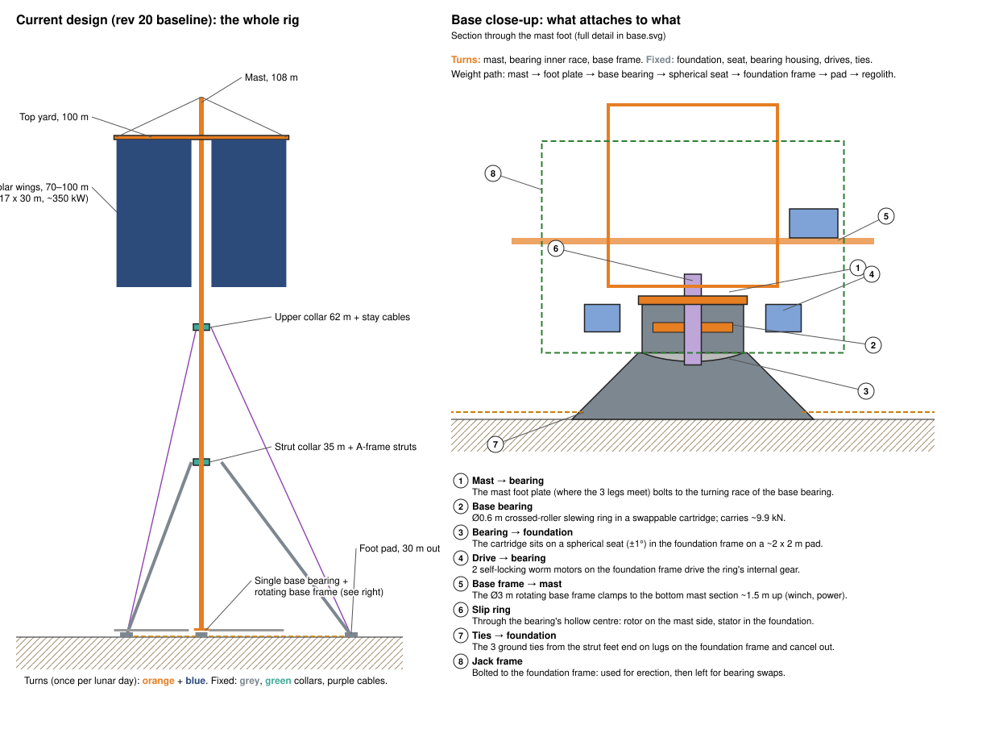

**What it is, from the ground up**
1. **Fixed to the ground:**
   - one central **foundation pad** (~2 x 2 m) carrying the hard **pivot ball** of the base pivot,
   - **3 foot pads** 30 m out, each tied back to the central foundation by a ground cable,
   - 2 **landing trays** on short legs along the maintenance azimuth.
2. **Turning, once per lunar day:**
   - the **108 m mast**, standing on the base pivot through a replaceable **wear cup**;
   - a small **rotating base frame** (Ø ~3 m) clamped to the bottom of the mast, carrying the power gear, the slip-ring rotor, a ~20 kWh storage battery and the service-bot dock;
   - the **top yard** at 100 m;
   - **two solar wings** (port and starboard) of 16 concertina packs on fixed hangers under the yard, between 70 and 100 m, ~350 kW.
3. **Holding the mast upright, without turning:**
   - two **roller collars** around the mast, at 35 m and 62 m;
   - **A-frame struts** from the 35 m collar to the foot pads;
   - **stay cables** from the 62 m collar (via V-links) to the foot pads.
4. **Looked after by 2 service bots** (humanoid-class) that climb a rail **inside the mast** and work from a walkway on the yard. A bot lowers or hoists **one pack at a time** on two ropes from a twin-drum reel hoist that stays parked at the top; there are no halyards or wing winch.

**What attaches to what at the base**

Weight path: mast → foot plate → wear cup (turns) → pivot ball (fixed) → foundation frame → pad → regolith.

- The **mast foot plate** (where the 3 mast legs meet) holds a replaceable, dry-lubricated **concave wear cup** facing down.
- The cup rests on a hard **convex pivot ball** (Ø0.5 m) bolted to the **foundation frame**. The ball faces up, so dust and wear particles fall off it. The spherical contact both carries the load and lets the mast settle plumb (±1°).
- **2 worm-drive motors** on the foundation frame drive a **pin-ring gear** (Ø ~1.2 m) under the foot plate.
- The **rotating base frame** clamps to the bottom mast section ~1.5 m up, and turns with it.
- An **annular slip ring** (Ø ~0.9 m) encircles the pivot: rotor under the foot plate, stator on the foundation frame.
- A removable **protection enclosure** (section 5a) closes the pivot, drives and slip ring off from dust and cold: a fixed tub on the foundation under a lid that turns with the mast.
- The **3 ground ties** from the strut feet end on lugs on the foundation frame and cancel out. The **jack frame** used for erection stays bolted to the foundation frame for wear-cup swaps.

**Revision history**
- Rev 1: Ø42 m twin-rail turntable carrying a 30 m panel wall.
- Rev 2: rail ring cut to Ø12 m for logistics; cable-stayed rig that uses low gravity and no wind; human-supervised installation equipment.
- Rev 3: array raised to ~100 m to clear terrain and neighbour shadows; mast braced by stationary ground guys through roller collars; lowerable solar curtains.
- Rev 4: the ground guys and their tension anchors are replaced by a **strut tripod**. Three rigid struts run from a **mid-height collar** down to foot pads on the surface. Each foot is wire-braced up to an **upper collar** and tied **horizontally back to the platform's kingpin foundation**. It is a closed, pre-tensioned truss: no ground anchor ever has to resist being pulled up, and there are 2 collars instead of 3.
- Rev 5: base running gear changed to **3 bogies with 4 individually replaceable tyres each**. Three supports always share the load evenly, so rail flatness and settlement don't matter. Any tyre can be lifted off the rail and swapped without jacking the deck. About 10 m of clear rail between bogies leaves room to replace wear-surface segments without a bridging rail.
- Rev 6: **2 tyres per bogie** (6 in all). Each bogie pivots at its centre, so the whole base is statically determinate and every tyre carries exactly the same load, with no springs. Each tyre has a built-in **support shoe** for swaps. The tyres are vertical, not angled outward, because the load they carry is vertical.
- Rev 7: anti-**wind-up** bracing. The upper collar gets 3 **hinged rigid torque arms** whose tips carry the wires, and each strut becomes a narrow **A-frame**. Without them the upper collar would twist ~10° under a partly seized roller, and the strut collar is torsionally unstable (see section 4). The bogie pivot is now a stiff, travel-limited rocker with hard stops.
- Rev 8: the array is split into **port and starboard wings**. Each hangs on halyards from a **permanent top yard** and is raised and lowered on its own for installation and maintenance. The wing's weight stays on the same sheaves whichever height it is at, so lowering one wing does not unbalance the rig. Only taking a wing's weight off its halyards would, and that is handled by a ballast swap or by landing both wings together (section 4).
- Rev 9: each bracing plane's wires become a **single cable that splits into a Y-bridle** at a fixed split plate about 12 m above the ground. The two legs run to the tips of **two hinged arms in a V** on the upper collar. There is one tensioner and one load cell per plane, and twist resistance comes from the monitored, adjustable pre-tension.
- Rev 10: the curtains become **rigid concertina packs**, 1 to 3 m wide (2 m baseline), shipped and replaced as separate units. Each pack deploys and retracts like a **Roman blind**, and each can be **lowered on its own** to the ground for exchange (simplified in rev 15).
- Rev 11: two-point arm root (fold hinge + seat 500 mm below) instead of knee braces.
- Rev 12: hanging A-bracket knee (compression strut into a funnel cup).
- Rev 13: V-plate pendant knee on the torque arms (superseded).
- Rev 14: the torque arms, Y-bridles, knees and crown ring are all removed. Each bracing plane now has **one stay cable** from the foot to the apex of a **V-link**: a flat V-plate hinged on **two close pins** on the upper collar. The V-link only spreads and levers the cable's sideways (twisting) pull into a couple on those two pins. It has no other bracing, and with the cable slack it hangs straight down under gravity. Collar twist is limited by a **collar-torque interlock** on the drive.
- Rev 15: the Roman-blind cords and per-pack hoists are removed. **Both wings are lowered together** on their halyards. Each pack lands in a **landing tray** and folds itself up as the top bar comes down, which brings every pack attachment to working height for replacement. Raising unfolds the packs again. One winch drives all 4 halyards, so the wings can't move out of step.
- Rev 16: **transport packaging and erection** (section 10). Every part is cut down to fit a **3.2 x 1.5 x 1.5 m freight module**. The mast becomes **flat-pack lattice sections**, the struts become **tent-pole segments**, and the deck becomes a 12-segment ring with spokes. Erection is base jack-up with the top weight kept to ~1 t.
- Rev 17: **detailed top yard** (section 4a): yard truss, an 8 m masthead (the mast becomes 108 m), topping lifts, braces, halyard sheaves and routing, **docking latches** that take the wings' weight off the halyards, and the **panel elevation winch** (one motor, linked traction sheaves).
- Rev 18: **deck defined** (now Appendix A.2): a spoked frame with 3 deep main spokes over the bogies, a hub carrying the mast-foot seat over the kingpin, gratings only where needed, and an equipment layout. The halyards now enter the mast through a side window, not through the foot seat. Deck mass is revised from 4 t to ~2.5 t, so rotating mass becomes ~11.1 t (~18 kN, ~3.0 kN per tyre).
- Rev 19: **deck spokes characterised** (now Appendix A.2, `spoke_check.py`): tapered triangular CFRP trusses, member sizes, loads, stiffness, joints and mass.
- Rev 20: **single base bearing** (section 5). The rail, piers, bogies, deck, spokes and kingpin are deleted. The struts and stays already carry all tipping loads, so the base only has to carry ~10 kN down, centre the mast foot and turn it. A swappable slewing-ring cartridge on one foundation pad does that, driven by 2 small worm motors, with a small **rotating base frame** for the winch and power gear. This saves ~3.7 t, removes all wheel-on-regolith contact, and lets a mechanical slip clutch protect the collars. The rail turntable is kept in **Appendix A** for reference.
- Rev 21: the base bearing becomes a **plain spherical pivot**: a hard convex **ball** (fixed, facing up) under a dry-lubricated, replaceable concave **wear cup** (turning). Dust and wear particles fall clear of the ball. **Conductive layers embedded in the cup** read wear depth electrically. Rollers, separate seat and seals are gone. The drive moves to a pin-ring gear, and the slip ring becomes annular around the pivot (`pivot_check.py`).
- Rev 22: **service bots replace the halyards** (sections 4 and 4a, `service_bot_check.py`). Two humanoid-class bots climb a fall-arrest rail inside the mast core and walk out along a railed walkway on the yard. Each pack hangs on its own **fixed hanger** under the yard. To swap one, a bot clips a ~12 kg **portable reel hoist** into the socket above it and lowers the pack into its landing tray, where it folds itself up as before, then hoists the new one. The halyards, wing winch, trim sheaves, wing top bars, sprung docks and ballast pallet are deleted (~0.55 t out, ~0.3 t of rails and walkway in). The rest of the array keeps working during a swap. The halyard design is kept in **Appendix B**.
- Rev 23: **two-rope (bifilar) lowering stops pack spin.** A single rope gives a hanging pack no resistance to turning, so it can spin and arrive at the hanger misaligned. The reel becomes a **twin-drum** hoist: two ropes on one shaft run over passive sheaves at the hanger to lifting eyes at both ends of the pack head, ~1.6 m apart. The pair holds the pack square to within ~1° even 100 m down, and **flared guide forks** at the hanger square the last few degrees before the cones engage. The reels now **stay parked in a garage at the yard root**; when one has to travel, the bot carries it as a **chest pack**, the most compact place in a ladder posture.
- Rev 24: **bot tool kit and power.** The bots carry **cable cutters** and **rope grabs** for emergencies such as a fouled (cobbled) reel. The rule is never to cut a loaded rope: the grabs take the pack's weight onto anchor eyes at the station first. The reels gain slack-rope stops and spring take-up to prevent cobbling. The bots recharge from a **~20 kWh custom storage battery on the rotating base frame**, which turns with the mast, so charging needs no slip-ring channel. A small service feeder from it powers the reel sockets and garage even when the array is dark.
- Rev 25: **recovery without cutting or joining.** A joint on one of the two ropes would change its length and how it winds, so the pair would no longer pay out equally and the pack would tilt. Cutting near a hanging pack risks dropping it onto the trays, the base or the bracing. So no rope that holds a pack is ever cut or joined, and the wedge joiners are deleted. A fouled reel is recovered with only the kit on site, escalating step by step: hold on rope grabs, untangle in place, re-equalise each drum with its **indexing clutch**, hoist and latch. If the rope can't be saved, the second reel does a **rescue lowering**: **rope-riding hooks** slide down the stuck ropes into **rescue eyes** on the pack head. The cutters are kept for unloaded lines only.
- Rev 26: **pivot, drive and protection enclosure detailed** (section 5a, `base_drive_check.py`).
  - **Drive:** 2 removable drive cartridges (motor, planetary, self-locking worm, torque limiter, 12-tooth pin wheel) on a 96-pin ring, 24,000:1. They run together with a torque bias against backlash. Each has a mesh release and a hand-drive socket.
  - **Enclosure:** a removable enclosure replaces the brush skirt. It is a fixed 6-panel tub with radiator panels and a drive door per unit, under a rotating lid with a double labyrinth.
  - **Slip ring:** defined as a 600 V DC slip ring, whose ~0.45 kW of heat sets the enclosure's thermal design.
  - **Correction:** the rev 21 sideways cup slide was blocked by the pin ring and slip-ring rotor. The cup and ball now lift out **upward through the foot plate into the mast core**, and the jack lift drops from ~60 to ~10 mm.
- Rev 27: **slip ring and power cabling detailed** (section 5c, `power_cabling_check.py`).
  - **Voltage:** the bus becomes **bipolar ±500 V DC**. That needs 108 kg of trunk conductor against ~270 kg at 600 V, and cuts the slip-ring heat to ~0.25 kW.
  - **Packs:** each pack carries its own MPPT converter in its head and plugs into its hanger through an interlocked blind-mate connector. Its yard bus taps through an e-fuse.
  - **Mast:** 2 jointless trunks run in grounded trays in the corners of the mast core.
  - **Slip ring:** a drum type with 4 power-class rings (including a spare) and 2 signal rings, 8 brush cartridges and barrier fins.
  - **Rule:** no connector or brush ever makes or breaks under load.
- Rev 28: **pack converter and hanger connector detailed** (section 5d, `pack_converter_check.py`).
  - **Converter:** 4 height-banded MPPT boost inputs, a 450 V link, and a dual-active-bridge converter with 2 stacked secondaries giving ±500 V. Its SiC transistors run at ≤42% of their voltage rating. It is 98% efficient and has a hinged radiator fin.
  - **Connector:** 5 pins of three lengths (earth first, then power, then pilots), with shutters on both halves and a floating receptacle. The **hanger e-fuse is the switch**: it stays open unless the pilot loop, including the latch, is closed.
  - **Power figure:** with real cell packing (87%) a pack makes ~21 kW, so the array delivers ~335 kW. Reaching the 350 kW headline needs ~91% packing; that is noted as a design-margin item.
- Rev 29: **collar roller cartridge detailed** (section 4, `collar_cartridge_check.py`).
  - **Rollers:** tapered Si₃N₄ tyres (cone apex on the mast axis, so they roll without spin) on replaceable, DLC-coated 440C running strips. Each sits on a hybrid bearing with a sleeve journal as a second rotation path.
  - **Springs:** Belleville stacks put both thrust rollers in contact; a spring swing arm carries the radial roller.
  - **Removal:** a 90° release cam unloads every roller so the cartridge slides out.
  - **Sensing:** a sensor and load bridge on every cartridge, and a self-powered radio sensor hub on each collar.
  - **Fault check:** a skidding roller (both paths locked) makes ~345 N·m, so the 200 N·m interlock stops the drive.
- **Rev 30 (this):** **V-link and stay tensioner detailed** (section 4, `vlink_tensioner_check.py`).
  - **V-plate and pins:** a 2.5 kg Ti V-plate on two 2-axis load pins in spherical bushings, with a swaged fork terminal at the apex.
  - **Tensioner:** the foot winch used in erection stays on as the permanent **servo tensioner**: a self-locking worm drum, a Belleville buffer, a load cell and a 10 W servo.
  - **Why it must be active:** 67 m of steel stay changes length by ~0.25 m between sun and shade, ±2.6 kN if held rigid. A white coating halves that, so even with the power off the tension stays at ~0.2 to 2.8 kN.
  - **Correction:** the pin couple at the 200 N·m interlock is ~±90 N, not ±0.2 kN (that is the 500 N·m figure).

## 1. Why it rotates, and why it must be tall

At the poles the Sun stays within ~1.5° of the horizon and goes once around it each lunar day (29.5 Earth days). So the array must stand **vertical** and turn about a vertical axis **once every 29.5 days** (~0.51°/hour), always in the same direction.

At such low Sun angles every bump shades a long way: a 10 m rise casts a shadow ~380 m long at 1.5°, and a 100 m object ~3.8 km. On crater rims and ridges, how many hours of sunlight a point gets rises steeply with height above the ground, because the line to the Sun clears more of the far terrain. So the array top is pushed up as far as structure, installation and site allow. Published illumination models of polar sites, and tower concepts such as Honeybee Robotics' LUNARSABER (~100 m), point to the same order of height.

**How to set the height for a real site:** run a horizon/illumination analysis on LOLA elevation data for the exact spot, for array-top heights of, say, 20 to 200 m. Plot hours of sunlight per year against height and pick the knee of the curve. The structure in this document scales across that range (section 3).

## 2. Using low gravity and no wind

| Load | Earth | Moon | Effect on design |
|---|---|---|---|
| Wind | Governs tall masts | **None** | A slender 100 m+ mast and a 1,000 m² sail with almost no lateral load |
| Gravity | 9.81 m/s² | **1.62 m/s² (1/6)** | Mast and strut compression, wire tension, jacks and bearings are 1/6 the size |
| Seismic | Varies | Shallow moonquakes, small accelerations | Main lateral load; carried by the strut tripod |
| Thermal | Moderate | Large swings and one-sided sunlight | Thermal bow of the mast; use CFRP, keep the gradient steady (below) |
| Rotation dynamics | n/a | 0.51°/h | Negligible; ramp the drive steps gently |

How the design uses this:

1. **A slender braced mast.** Without wind and in 1/6 g, a light lattice mast needs only a little lateral bracing to reach 100 m or more. Its practical limit is set by the site, installation and shading, not strength.
2. **The bracing doesn't rotate.** A stationary **strut tripod** holds the mast through two **roller collars**, and the mast turns inside them. This keeps the base down to a single pivot while the bracing spreads wide (feet at 30 m).
3. **A closed truss, so no tension anchors.** Each bracing plane is a triangle: strut (compression), wire (tension) and the mast between the two collars. A horizontal tie from each foot to the central foundation closes it at ground level. The three ties pull on the foundation from 120° apart, so they cancel. The foot pads only ever push down on the ground. Holding up-pull in loose regolith is hard; bearing down on it is easy.
4. **The array sits above all the bracing.** It sweeps a 17 m radius circle from 67 to 100 m. The upper collar is at 62 m, so the turning array never meets a strut or wire. Above the collar the mast is braced by its own rotating **diamond stays** (spreaders and stays that turn with the mast, as on a racing yacht).
5. **Light rigid concertina packs** (~2 kg/m²) that hang from the top. In 1/6 g with no wind they unfold under their own weight and hang flat, with no frame needed to hold the 30 m height.
6. **Balanced rig.** The array is one plane through the mast, left and right equal, so its centre of mass stays on the axis.
7. **Steady sunlight makes thermal bow predictable.** Because the rig tracks the Sun, the same mast face is always sunlit, so the bow is nearly constant and can be trimmed out with wire tension. The mast sits behind the blanket, so its top section is in shade. CFRP tubes (α ≈ 0 to 1x10⁻⁶ /K) keep the bow to a few centimetres. The same 35 m length in aluminium would bow ~0.9 m.
8. **Light installation gear.** The whole mast plus array (~5 t) weighs about 8 kN on the Moon, so a modest jack at the base can raise all of it (section 7).

## 3. Reference configuration (100 m baseline)

| Item | Value |
|---|---|
| Array top / bottom | **100 m / 70 m** above the ground |
| Mast | **108 m** triangular CFRP lattice (Ti nodes), 1.2 to 1.5 m face, ~25 kg/m (~2.7 t), in **36 flat-pack 3 m sections** (section 10). Top yard at 100 m, masthead 8 m above it |
| Solar wings | **Port and starboard wings**, each 17 m x 30 m (~500 m²), total ≈ **1,000 m²**. Each wing is **8 concertina packs**, each on its own fixed hanger under the top yard. ~1.37 t per wing (~2.2 kN on the Moon) |
| Concertina pack | Rigid panels ~2 m wide x 1 m tall (CFRP-honeycomb, ~2 kg/m² with cells), 30 panels hinged along their horizontal edges. Deployed: 2 m x 30 m. Folded: ~2 m x 1 m x 0.7 m, ~140 kg (~0.23 kN on the Moon). Packs from 1 to 3 m wide use the same station hardware |
| Power (30% cells, 1,361 W/m², ~85% system) | **~350 kWe** |
| Top yard (permanent) | 34 m CFRP truss fixed to the mast at 100 m, with topping lifts from the masthead and braces to the spreader tips. 8 fixed **pack hangers** per wing, each with 4 rope sheaves, guide forks and a **reel socket** above it, a reel garage at the root, and a railed **walkway** along the top. Details in section 4a |
| Service bots | **2 humanoid-class bots** (~70 kg, ~0.11 kN on the Moon), supervised or teleoperated. They climb a fall-arrest rail inside the mast core (clear ~Ø0.69 m). Pack swaps use **twin-drum reel hoists** (~14 kg, 2 x ~108 m of 2 mm stainless rope) kept in a garage at the yard root. They carry cable cutters and rope grabs for emergencies. Docked and charged from a ~20 kWh storage battery on the rotating base frame |
| Landing trays | 2 light trays on short ground legs (~1.5 m high) along the maintenance azimuth (port and starboard, 2 to 17 m from the mast). The packs fold into them |
| Roller collars (stationary) | **Strut collar at 35 m**, **upper collar at 62 m** |
| Struts | 3 **A-frames** at 120°: each 2 CFRP tubes Ø0.3 m x 2 mm, ~46 m long, ~3 kg/m, ball joints at both ends. Joined at the foot, spread ±1.5 m at a torque bracket 4 m out from the strut collar |
| Foot pads | 3 at **30 m radius**, ~1 m² sintered or gabion pad, compression only (~0.5 kN) |
| V-links (upper collar) | 1 per bracing plane: a flat Ti V-plate (~8 mm), **2 pin holes 0.4 m apart** on the collar (horizontally aligned, instrumented load pins) and **1 shackle hole at the apex, 1 m out**. Free to hinge; hangs straight down when the cable is slack. ~2 kg |
| Stay cables | 1 per bracing plane, from the foot tensioner to the V-link shackle (~68 m), 6 mm stainless wire rope, UV-proof. ~1.5 kN pre-tension, adjustable to ~3 kN, load cell at the foot |
| Ties | Foot to the central foundation frame, horizontal at ground level, ~1 kN |
| Upper bracing (rotating) | Diamond stays: spreaders ±6 m at 81 m, stays from 64 m (just above the upper collar) to the mast top |
| Base | **Spherical plain pivot**: hard convex ball R 0.25 m (fixed) under a dry-lubricated concave wear cup with embedded wear-sensing layers (turning), on a ~2 x 2 m foundation pad. **2 worm-drive motors** on a Ø1.2 m pin-ring gear, slip clutch ~300 N·m. **Rotating base frame** Ø ~3 m (section 5) |
| Rotating mass | ~7.1 t (mast 2.7 t, wings + top yard 3.1 t, diamond stays 0.5 t, collar bands 0.2 t, rotating base frame 0.6 t). Revs 22 to 24 net about −0.1 t (the battery adds ~0.17 t), kept as margin |
| Load on the base pivot | ~11.5 kN weight; **~9.9 kN** net after the stay pull-down (+4 kN) and strut push-up (−5.7 kN) at the collars |
| Maintenance azimuth | Mast parked so the array lies **between** bracing planes (e.g. 30°/210° when the struts are at 0°/120°/240°), over the landing trays |

**Scaling to other heights** (rough; same array, CFRP mast; struts sized for ~4x buckling margin):

| Array top | Upper collar | Strut collar | Foot radius | Strut length | Mast mass | Lunar weight |
|---|---|---|---|---|---|---|
| 60 m | 22 m | 12 m | ~12 m | ~17 m | 1.2 t | ~9 kN |
| **100 m** | **62 m** | **35 m** | **30 m** | **46 m** | **2.7 t** | **~11.5 kN** |
| 150 m | 112 m | 60 m | ~50 m | ~78 m | 4.8 t | ~15 kN |
| 200 m | 162 m | 85 m | ~70 m | ~110 m | 8 t | ~20 kN |

Above ~150 m the struts get long enough that they need a larger lattice section or a mid-length brace. In practice the height is limited by:
- **Footprint**: the ridge must be ~2x the foot radius wide. That is smaller than the guy anchor footprint in rev 3, but ridges are often only a few hundred metres across.
- **Installation time** at the jack.
- **Sightlines to other collectors**: a taller rig shades more of the ridge.

**Pre-tension (100 m case).** Tighten the wire to ~1.5 kN and the tie to ~1 kN. That puts ~2.5 kN of compression in the strut (buckling load ~10 kN) and leaves each foot pressing ~0.5 kN on its pad. Keep strut compression above ~1.2x the wire tension so the feet never lift. Load cells on every wire and tie show the rig's state.

## 4. Mast, collars and wings

**Roller collars.** Each collar is a stationary ring around the mast, made of 3 bolted 120° segments so it can be fitted around the mast. At that height the mast carries a circular **collar band**: a Ti box ring bolted to the three mast legs, with ceramic/DLC-coated running faces on the top, outside and underside.

The collar holds **6 identical roller cartridges**. Each is a C-frame that wraps the band edge, like a rail clamp. It carries three rollers:
- an **upper thrust roller**: the upper collar is pulled down by the wires,
- a **radial guide roller**: holds the mast sideways,
- a **lower thrust roller**: the strut collar is pushed up by the struts, and it also resists quake uplift.

So one cartridge design serves both collars. Each cartridge slides out radially on rails through a window in the collar ring. A preload spring gives ±10 mm of float for thermal mismatch, it has 2 captive bolts, and it has a grapple fixture for the service bots. The collar works with any one cartridge removed.

The rollers use dry-lubricated hybrid rollers on dissimilar surfaces, the same no-cold-weld rule as the base pivot. The collars carry only light loads (pre-tension and quake loads), so the heavy, critical parts stay at ground level: vertical load, drive and slip ring. Dust is far lower at height.

A **transport clamp pin** in each cartridge locks the collar to the band during jack-up (section 7) and is pulled once the collar is at height.

**Roller cartridge detail** (`collar_cartridge_check.py`)

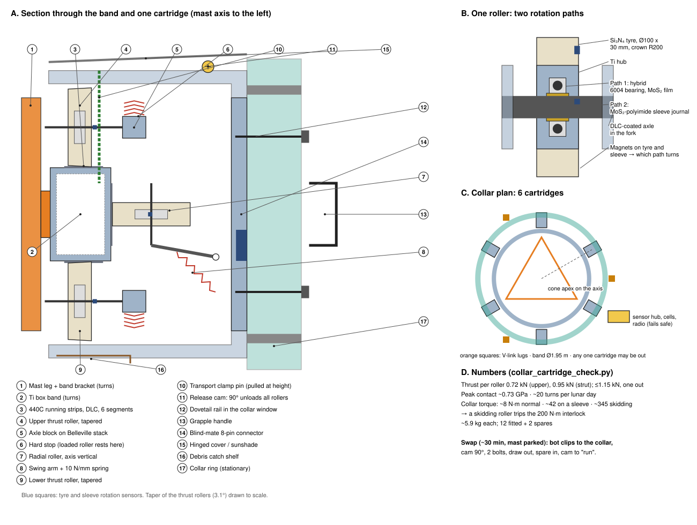

- **Band and running strips.**
  - The Ti box band is bolted to the three mast legs. Its outer face is at r 0.975 m, and the thrust faces sit at a mean r 0.935 m.
  - Its top, outer and underside faces carry **replaceable 440C steel running strips**: 2 mm, through-hardened, DLC-coated.
  - The strips come in 6 segments per face, with angled scarf joints so the rollers cross them smoothly. The gaps absorb the ~1.8 mm of steel-on-Ti thermal mismatch round the ring over a 200 K swing.
  - A worn strip is unbolted and replaced from outside the collar.
- **Rollers.** All three are Ø100 mm, 30 mm wide, with **Si₃N₄ ceramic tyres** crowned to R 200 mm: ceramic on steel, so there is no like-on-like contact.
  - The two **thrust rollers are tapered** (3.1° half-angle, cone apex on the mast axis), so they roll on the flat annular faces without spin. A straight roller would scrub ±1.6% across its face.
  - Peak contact stress at the worst load (1.15 kN, strut collar with one cartridge out) is **~0.73 GPa**, well inside what both materials carry routinely.
- **Inside each roller: two rotation paths.**
  - The tyre turns on a **hybrid 6004-size ball bearing** (Si₃N₄ balls, 440C races, sputtered MoS₂, PTFE/polyimide-composite cage).
  - The bearing's inner race rides on a **sleeve journal** (MoS₂-filled polyimide) on a DLC-coated axle.
  - If the bearing locks, the sleeve turns instead. Two magnets, one on the tyre and one on the sleeve, read by Hall sensors, show which path is turning.
  - Fatigue is irrelevant: the bearing's L10 at full load is ~200,000 times the 10-year count of ~2,400 turns. The dry film's life in vacuum and dust is what the life test must prove.
- **Springs and float.**
  - Both thrust rollers sit on **Belleville stacks** preloaded to 300 N, with 1.5 mm of travel to a hard stop. The loaded roller rests on its stop (upper roller on the upper collar, lower roller on the strut collar), so it is rigid. The unloaded one keeps 300 N on the band, so nothing rattles in a quake.
  - The **radial roller** is on a spring swing arm: 250 N preload, 10 N/mm, ±10 mm float (150 to 350 N). That takes up thermal bow and mismatch.
- **Friction, normal and faulty** (upper collar):

  | Case | Collar torque | Result |
  |---|---|---|
  | Normal (all rollers on their bearings) | ~8 N·m | Tracks normally |
  | One bearing locked, roller on its sleeve | ~42 N·m | Alarm; swap at the next visit |
  | One roller skidding (both paths locked) | ~345 N·m | Over the 200 N·m interlock: the drive stops until the cartridge is swapped |

- **Release cam.** A 90° turn with the bot's hex tool retracts both thrust rollers 3 mm and the radial roller 15 mm. The other 5 cartridges take the load (≤1.15 kN per roller), and this one slides out radially on its dovetail rails without dragging.
- **Sensing.** Each cartridge reports through one blind-mate 8-pin connector at its back:
  - 3 tyre sensors and 3 sleeve sensors;
  - a strain bridge on the loaded thrust roller's axle block, which reads that roller's share of the stay pull-down;
  - a temperature sensor.
- **Collar sensor hub.** The collars are stationary, so nothing reaches them through the slip ring.
  - Each collar carries a small hub (~5 W) that collects the cartridge sensors and the V-link load pins.
  - It is powered by a ring of small solar cells round the collar, with a ~240 Wh battery for 48 h of darkness.
  - It reports to the base by short-range radio.
  - **Loss of the link counts as a fault: the drive stops,** so the collar-torque interlock fails safe.
- **Dust and sun.** Each cartridge has a hinged cover that doubles as a sunshade, a brush lip against the band, and a catch shelf under the rollers for wear debris.
- **Mass:** ~5.9 kg per cartridge (Ti C-frame ~3 kg). 12 are fitted and 2 kept as spares.

**Cartridge swap** (~30 min at height)
1. Park the mast.
2. A bot climbs the core rail to the collar's exit, steps out and clips to the collar's grab rail.
3. Turn the release cam 90°.
4. Undo the 2 captive bolts and draw the cartridge out on its rails by the grapple handle (~1 kg-weight on the Moon).
5. Slide the spare in, bolt it, set the cam to "run", and check that its sensors report and the rollers turn.
6. The old cartridge goes down in the bot's chest pack for inspection, to learn real wear rates.

**Preventing collar bearing seizure.** The upper collar is the hardest part to reach (62 m up). It carries a steady downward pull from the wires and sees the biggest temperature swings, so it gets the most protection. If it seized while the base kept driving, the mast would be twisted against the tripod. Protection is in five layers:

1. **Remove the causes of seizure.**
   - *Cold welding:* no like-on-like metal contact anywhere. Si₃N₄ roller tyres run on DLC-coated 440C running strips; races and balls are dissimilar (hybrid ceramic bearings).
   - *Lubricant loss:* dry films only (sputtered MoS₂ or WS₂ on races, PTFE/polyimide-composite cages that keep re-transferring lubricant). Nothing evaporates, freezes or creeps in vacuum.
   - *Thermal pinching:* the band and collar ring are both Ti, so they expand alike. Each radial roller sits on a **preload spring with ±10 mm float**, so no temperature difference or thermal bow of the mast can squeeze a roller tight. The thrust rollers are crowned and spring-loaded the same way. White thermal coating plus a light sunshade keep the collar near the mast's temperature.
   - *Dust:* at 62 m the collar is far above most lofted dust. Metal labyrinth lips on the band, a cover over each cartridge, and a brush skirt keep out what does arrive. Wear debris falls onto a catch shelf, not into the next roller.
   - *Light loads:* each collar's rollers are Ø100 mm.
     - *Upper collar:* the wires pull it down by 3 x 1.5 kN x sin 64° ≈ 4.0 kN, plus ~0.25 kN of its own weight. Shared by 6 upper thrust rollers, that is **~0.7 kN each** (0.9 kN with one cartridge out).
     - *Strut collar:* the struts push it up by 3 x 2.5 kN x sin 49° ≈ 5.7 kN, less its weight. That is **~0.9 kN on each lower thrust roller** (1.1 kN with one out).
     - *Radial rollers:* they only see spring preload, quake and thermal-trim loads, a few hundred N.
   - *Very few turns:* each roller runs on a ~6.1 m circle (band Ø1.95 m) once per lunar day, about 6.1 / (π x 0.1) ≈ **20 turns per lunar day**. That is ~240 a year, or ~2,400 in ten years, where an ordinary bearing makes that many turns in a few seconds. Rolling fatigue and wear are therefore negligible. The real risks are static ones during long, almost motionless spells: cold welding, fretting from vibration, and dust settling. The other measures here are aimed at those.
2. **Make a stuck roller harmless.**
   - Each roller has a **second rotation path**: the ball bearing runs on a dry-lubricated sleeve journal. If the bearing locks, the roller turns on the sleeve.
   - If both lock, the roller skids on its hard face rather than jamming. The other 5 cartridges keep guiding the mast, and the skid friction (~345 N·m) trips the collar-torque interlock, so the drive stops until the cartridge is swapped.
   - No single cartridge can lock the collar.
3. **See it coming.** The V-link load pins read collar friction torque directly.
   - Every roller has a small rotation sensor (magnet + Hall sensor). If the mast turns and a roller doesn't, the system alarms long before the bearing seizes.
   - Load cells on the wires and ties, drive motor current, and strain gauges on the mast between base and collar all track friction torque. A rising trend means "swap a cartridge soon".
4. **Protect the structure if it happens.**
   - A **collar-torque interlock** stops the base drive if the V-link load pins read more than ~200 N·m. Since rev 20 the drive needs only ~50 to 165 N·m, so a **mechanical slip clutch at ~300 N·m** on each drive motor backs it up (section 5). The collar is never wound round more than ~3°.
   - The array keeps working in its last position until the fault is cleared. At most a few percent of a lunar day's energy is lost.
5. **Fix it in place.**
   - A service bot swaps the cartridge (2 captive bolts, slide out, slide in) while the other 5 hold the mast. Spare cartridges are kept on site.
   - Cartridges are also swapped on a schedule (for example, one per collar per year) and sent back for inspection, to learn real wear rates.
   - Before flight, prove all of this with a **vacuum-thermal life test** of a full cartridge, run on a band section in regolith simulant dust for many times the design number of revolutions.

**Wind-up: keeping the collars from turning with the mast.** Friction in the collar rollers drags the stationary collar round with the mast, so the bracing must hold it against twisting. In rev 4 to 6 every wire and strut lay in a vertical plane through the mast axis, so together they barely resisted twisting (`torsion_check.py` gives the numbers):

| Collar | Rev 4 to 6 | Now |
|---|---|---|
| Upper (stay cables) | ~2.9 kN·m/rad: ~0.2° of twist at normal friction (~10 N·m), ~10° at 500 N·m | **V-link, 1 m lever** (`vlink_check.py`): ~3.8 kN·m/rad at 1.5 kN (**0.15°** at normal friction), ~7.5 kN·m/rad at 3 kN. Fault twist capped at **~3°** (1.5° at 3 kN) by the collar-torque interlock |
| Strut collar | **Negative** (~ -7 kN·m/rad). Compressed struts on ball joints push the collar further round once it starts to turn: torsionally unstable, held only by roller friction | **A-frame struts**: ~14 MN·m/rad, effectively rigid |

(Revs 7 to 13 used 8 m torque arms with crossbars or Y-bridles: up to ~100x stiffer, but with many more parts. They are kept in `torsion_check.py` and `bridle_check.py` for reference.)

How it works:
- **V-link (upper collar), the whole torque lever.** Each bracing plane has a single **stay cable** from the foot tensioner up to the **apex shackle** of a flat **V-plate**. The V's two legs end in **2 pin holes 0.4 m apart** on lugs on the upper collar, on one horizontal axis.
  - The V hinges freely about that axis. Under tension it simply lines up with the cable, so it adds no vertical or rigid bracing of any kind.
  - With the cable slack it **hangs straight down under gravity**.
- **What it does.** If the collar starts to turn, the cable's attachment point moves sideways and the tensioned cable pulls it back. The V moves that attachment out from the collar (1.45 m) to ~1.9 m, and turns the sideways pull into a **couple on its two close pins**. Those pins are instrumented load pins.
- **Stiffness depends on tension.** Twist resistance comes from pre-tension acting on the geometry: k ≈ 3·T·R_foot·r_apex / L_cable.

  | V length | 1.5 kN | 3 kN |
  |---|---|---|
  | 1 m (chosen) | 3.8 kN·m/rad | 7.5 kN·m/rad |
  | 3 m | 5.6 kN·m/rad | 11.2 kN·m/rad |

  - In normal running (~10 N·m of collar friction) the collar twists ~0.15° and stays there, elastically and stably.
  - Raising the tension (monitored at the foot, adjustable to ~3 kN) stiffens it.
  - A longer V adds little and costs clearance, so 1 m is the baseline.
- **Collar-torque interlock (essential with this simple lever).** The **V-link load pins** read the collar's friction torque directly. The drive stops if it exceeds **~200 N·m** (about 20x normal), which caps the twist at **~3°** at 1.5 kN (~1.5° at 3 kN). That is well inside what the cables and clearances accept, and the collar springs back once the fault is cleared.
- **Installation.** The V-links are pinned to the collar and shackled to their stay cables at the base, before jack-up. As the collar rides up, they hang and then line up with the cables by themselves. Nothing is fitted at height.
- **Loads.** Each V-plate carries the stay tension (~1.5 to 3 kN) in tension. The pin couple at the 200 N·m interlock limit is about ±90 N (±0.22 kN at 500 N·m). Shackles are safety-pin type, coated or of dissimilar metals against cold welding.
- **A-frame struts (strut collar).** Each strut is two tubes joined at the foot and spread ±1.5 m at a torque bracket 4 m out from the collar. This is the same triangle idea, in compression.
- **Clearances.** The V-links stay within ~2 m of the mast, and the A-frame brackets within ~21° of their bracing plane. So the maintenance azimuth (30°/210°) stays clear for lowering packs. Everything is at or below 62 m, under the array sweep.
- **Torque sensing.** The couple on each V-link's two load pins is a direct measure of the upper collar's friction torque. The load cell at each foot reads the pre-tension. Together they give the seizure early warning in layer 3 below and feed the interlock.

**V-link and stay tensioner detail** (`vlink_tensioner_check.py`)

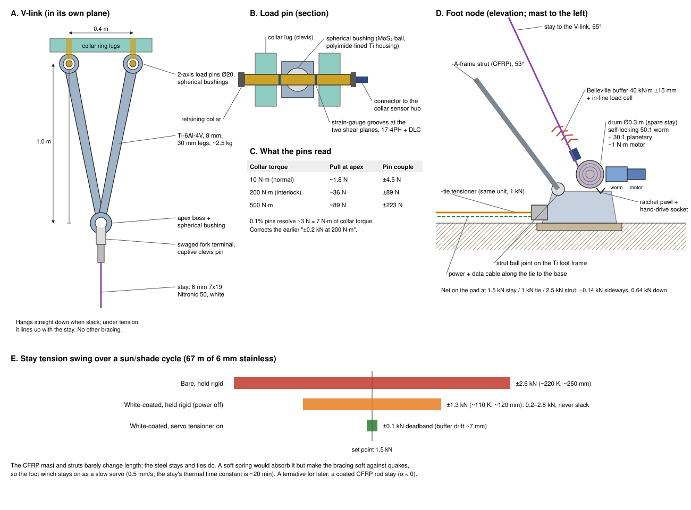

- **V-plate.** Ti-6Al-4V, 8 mm thick, two 30 mm legs meeting at a boss 1.0 m from the hinge axis (half-angle 11.3°), ~2.5 kg.
  - At 3 kN each leg carries ~1.5 kN, only ~6 MPa. The plate is sized for handling, holes and stiffness, not strength.
  - It is proof-loaded to 6 kN.
- **Hinge pins = load pins.** The two pins (0.4 m apart, one horizontal axis) are **2-axis strain-gauged load pins**, Ø20 mm, 17-4PH with DLC. They run in **spherical plain bushings** in the plate (MoS₂-coated steel balls in polyimide-lined Ti housings), so cable sway and the collar's small twists never bind the hinge.
  - The pins sit in lugs on the collar ring. They turn only during installation, so fretting, not wear, is the concern, and the dry film covers it.
- **What the pins read.** The couple across the two pins is the collar's friction torque:

  | Collar torque | Sideways pull at each apex | Pin couple |
  |---|---|---|
  | 10 N·m (normal) | ~1.8 N | ±4.5 N |
  | 200 N·m (interlock) | ~36 N | ±89 N |
  | 500 N·m | ~89 N | ±223 N |

  Pins with a 3 kN range at 0.1% resolve ~3 N, about 7 N·m of collar torque, so the 200 N·m trip is ~30 times the resolution. The pins report to the collar sensor hub.
- **Apex termination.** A spherical bushing in the apex boss takes a **swaged fork terminal** on the stay, through a captive clevis pin with a keeper. All the metals are dissimilar against cold welding. No split pins or wire: a bot can open it with one tool.
- **Stay cable.** 6 mm 7x19 stainless (Nitronic 50, tough when cold), breaking load ~25 kN: a factor of 8 at 3 kN.
  - It is ~67 m long with a stiffness of ~21 kN/m, so it stretches ~72 mm at 1.5 kN.
  - It gets a **thin white high-emissivity coating**. A bare stay swings from ~318 K in the Sun to ~100 K in shade; the coating cuts the swing from ~220 K to ~110 K.
- **Why the tensioner must be active.** The CFRP mast and struts barely change length with temperature; the steel stays do.

  | Stay | Thermal swing | Length change | Tension change if held rigid |
  |---|---|---|---|
  | Bare | ~220 K | ~250 mm | ±2.6 kN |
  | White-coated | ~110 K | ~120 mm | ±1.3 kN |

  A passive spring soft enough to absorb that would also make the bracing soft against quakes. The stay's thermal time constant is ~20 min and shadows move at 0.51°/h, so a slow servo keeps up easily.
- **Stay tensioner = the foot winch.** The winch that pays the stay out during jack-up (E6) stays on as its permanent tensioner. It has:
  - a Ø0.3 m drum holding the spare stay;
  - a **self-locking 50:1 worm** behind a 30:1 planetary, with a ~1 N·m motor (450 N·m on the drum at 3 kN);
  - a **Belleville buffer** (40 kN/m, ±15 mm) in the line, so the stay drifts only ~7 mm between trims;
  - an in-line **load cell**, a ratchet pawl as a second lock, and a hand-drive socket for a bot.
- **Servo.** It holds **1.5 kN** (or **3 kN** in "stiff" mode) to ±0.1 kN, trimming at 0.5 mm/s. A 250 mm thermal change takes under 10 minutes of motor time. Power is ~10 W average per foot, from the fixed side through a cable laid along the tie, backed by the base battery.
- **If the power fails.** The worm locks. With the white coating the tension then wanders only between ~0.2 and ~2.8 kN as temperatures change: never slack, never near overload. The drive is stopped anyway when the collar sensors go silent.
- **Ties.** The 28.5 m horizontal ties use the same unit with a 1 kN setpoint.
- **Foot node.** Each foot node is a Ti frame on the ~1 m² sintered pad. It carries:
  - the A-frame strut's ball joint;
  - the stay tensioner, pulling up and in at 65°;
  - the tie tensioner, pulling horizontally to the centre.

  At 1.5 kN stay, 1 kN tie and 2.5 kN strut, the forces nearly cancel sideways (−0.14 kN, taken by pad friction) and the pad is pressed down by ~0.64 kN. The servos keep strut compression above ~1.2 times the stay tension, so the pad never lifts.
- **Alternative.** A coated CFRP rod stay (α ≈ 0) would remove the thermal problem: a passive swing of only ~±0.15 kN. But it needs a Ø1.2 m+ drum to pay out during jack-up, and it is brittle under impact and dust abrasion. It is kept as a trade for later.

**Port and starboard wings of concertina packs.**

Each wing is **8 concertina packs** side by side between 2 and 17 m from the mast, each ~2 m wide (1 to 3 m packs fit the same hangers), with ~0.1 m gaps.
- **A pack** is 30 rigid panels, 1 m tall, hinged along their horizontal edges, with a small bottom bar. Folded, it is a ~2 m x 1 m x 0.7 m stack of ~140 kg (~0.23 kN on the Moon), which ships, stores and handles easily.
- **Pack head:** the top of each pack is a light 2 m beam with 4 alignment cones, an end tab at each end for the guide forks, and a **lifting eye at each end**, ~1.6 m apart, with a **rescue eye** beside each (section 4, recovery).
- **Attachment:** the pack head latches into a **fixed pack hanger** under the top yard (section 4a). There is no wing top bar and no halyard: the yard carries every pack directly.
- **Fold direction:** alternate hinges are lightly sprung toward their fold direction, so the panels always fold the same zig-zag way.

**One pack at a time, by a service bot** (`service_bot_check.py`)

There is no raise/lower machinery on the rig. A **service bot** takes a ~14 kg **twin-drum reel hoist** from the garage at the yard root, clips it into the **reel socket** above the pack's hanger, and lowers or hoists that one pack on **two** ~108 m, 2 mm stainless ropes, one to each end of the pack head (~0.11 kN per rope, safety factor ~21). The other packs keep working.

Pack swap, about 1.2 h with one bot:
1. Park the mast at the **maintenance azimuth**, with the array between bracing planes and over the 2 **landing trays**. Bring the new folded pack to the tray, next to the old pack's slot.
2. The bot climbs the **rail inside the mast** (~11 min, carrying nothing), steps out onto the **yard walkway**, clipped to its fall-arrest rail, takes a reel from the garage and walks out to the station.
3. It clips the reel into the socket, hooks the two ropes to the pack head's two lifting eyes, takes the load (~50 mm off the cones) and opens the hanger latch.
4. **Lower** at ~0.1 m/s (~16 min).
   - For the first 30 m the pack slides down past its hanging neighbours. With no wind, everything hangs still.
   - It passes the collars, V-links and A-frames ≥1.4 m clear.
   - Its bottom bar lands in its tray slot with ~30 m still to pay out. The pack then **folds itself up** in the slot, panel by panel, as the whole wings did in revs 15 to 21.
5. A rover or a suited crew member unhooks the old pack, moves it aside, sets the new folded pack in the slot and hooks the rope on.
6. **Hoist.** The pack unfolds panel by panel as it lifts off the tray. In the last ~0.4 m its end tabs enter the **flared guide forks**, which square it up, and the cones seat. The bot closes the latch (the limit switch confirms), slackens and unhooks the ropes, returns the reel to the garage and climbs down.

- Two bots with two reels can swap a mirrored port/starboard pair at once.

**Keeping the pack from spinning** (`service_bot_check.py`)
- **The problem:** a pack on a single rope has nothing to stop it turning. Wire rope also unwinds slightly under load (its lay torque), so a pack lowered on one rope can spin or wander through large angles and arrive back at the hanger misaligned. Its inertia about the vertical (~47 kg·m²) is the same as on Earth, so once turning it keeps going.
- **The fix: two ropes, ~1.6 m apart (a bifilar hang).** Any twist lifts the pack slightly, so gravity turns it back. The restoring stiffness is W·d²/4L:

  | Rope out | Stiffness | Twist from the ropes' own lay torque | Twist period |
  |---|---|---|---|
  | 100 m | ~1.5 N·m/rad | ~1.3° | ~36 s |
  | 30 m | ~4.8 N·m/rad | ~0.4° | ~20 s |
  | 5 m | ~29 N·m/rad | ~0.1° | ~8 s |
  | 1 m | ~145 N·m/rad | ~0° | ~4 s |

- **Opposite-lay ropes** (one left-hand, one right-hand) cancel even that ~1.3°.
- Both ropes wind on **one shaft**, so they always pay out equally and the pack head stays level.
- **Final alignment:** each hanger has a **flared guide fork** at each end. The pack head's end tabs enter them ~0.4 m below the cones and are squared to ±1 mm before the cones engage, from up to ±10° or ±50 mm. The bot can also steady the head by hand as it arrives.
- **Landing:** the same pair keeps the pack square to its tray slot, whose sides are flared too.
- A swivel would let the pack spin freely, so none is used.

**If a reel fouls: recovery with what is on site**

On the Moon there is no outside help, so every fault must be recoverable with the kit already there. A dropped pack would land on the tray, the base frame or the bracing. Rules:
- **No rope that holds a pack is ever cut or joined.** A joint on one rope would change its length and how it winds on its drum, so the two ropes would stop paying out equally and the pack would tilt.
- **Two holds at all times.** One is the reel (self-locking worm and brake). Once a fault appears, rope grabs on the station's anchor eyes are added.
- **Untangle, never cut.** The cutters are only for lines that carry no load.
- **Nothing is urgent.** The pack can hang for days. The rest of the array keeps working, but the mast stays **parked**, because a pack hanging mid-height would swing into the bracing if the mast turned.

**Prevention.** Most cobbling comes from paying out slack rope, for example when the pack lands in its tray and the ropes go loose. So each drum has a **slack-rope stop**: its load cell halts payout the moment the rope unloads. A light **spring take-up** keeps the wraps tight, and a camera watches the level winds.

**Recovery ladder** (each step only if the one before fails):
1. **Hold.** The bot clips a **rope grab** (a cam clamp, as on wire-rope fall arrest) onto each loaded rope just below the reel socket, and shackles it to one of the 2 **anchor eyes** at the station. The grabs now hold the pack and the reel is unloaded.
2. **Untangle in place.**
   - Each drum has its own **indexing dog clutch** on the shared shaft. The bot declutches the drums, unwinds the fouled wraps by hand and rewinds them under hand tension.
   - A kinked rope still has a safety factor of ~10 even if the kink halves its strength. That is enough for one hoist; the rope is replaced on the ground afterwards.
3. **Re-equalise.** The bot winds each drum on its own until both load cells read the same (~0.11 kN), then re-engages both clutches. The rope between grab and pack never changed length, so the pack head stays level.
4. **Hoist and latch.** Up is the safe direction. The bot releases the grabs, the guide forks square the pack, and it is latched.
5. **Drive failed, not the rope.** With the grabs holding, the bot moves the drum cassette, ropes and all, into the spare reel body and carries on.
6. **Rope or drum beyond saving: rescue lowering with the second reel.**
   - The second bot brings the second reel from the garage. It clamps 2 **edge rollers** to the walkway edge above the two stuck ropes, and the rescue ropes run over them.
   - Each rescue rope ends in a **rope-riding rescue hook**. The bot closes it around a stuck rope just below the hanger. It slides down that rope as its guide and drops into the **rescue eye** beside the lifting eye on the pack head (self-latching, with a funnel). A camera and the load cells confirm it.
   - The rescue reel takes the load, with its two load cells equal, and the grabs come off.
   - The fouled drums are declutched and feed out behind the pack as it is lowered, the bot clearing the tangle by hand as it goes. This is slow, but nothing hangs on that rope any more.
   - The pack lands in its tray slot and folds. On the ground the crew or a rover unhooks everything. The stuck ropes are drawn out from below and the fouled reel goes down to be re-roped.
7. **If even that fails,** the pack stays on two holds (grabs and reel) with the mast parked until parts arrive.

**Cutters** are kept only for lines that carry no load:
- trimming a damaged rope end on the ground;
- freeing debris or a snag that holds no weight;
- removing a rope after its pack is latched or landed.

- If the bots are out of action the array keeps running; only pack swaps wait.
- Best done when the Sun is within ~30° of the array's facing direction at the maintenance azimuth, a window of a few days each lunar day. At other times the parked array makes less power for the ~1.3 h.

**Balance.**
- While a pack hangs on the rope its weight is still on the yard, so the balance changes only once it lands.
- With the outermost pack off, the imbalance is **~3.6 kN·m**. With the bot and reel at the opposite yard tip, the worst case is **~6 kN·m**. That is about half the ~12 kN·m quake case the mast and collars are already checked for. The topping-lift load cells read the imbalance directly.
- The whole wings never land any more, so the ~21 kN·m one-wing-landed case and the ballast pallet are gone.
- The first fit of the 16 packs, and any job on several packs, alternates port and starboard, so the rig is never more than one pack out of balance.

### 4a. Top yard: structure, stays, pack hangers and walkway

**Structure**
- **Yard:** a 34 m CFRP-tube truss with Ti nodes, ~0.8 m deep and ~0.5 m wide. It is built from 12 bolted sections of ~2.8 m, flat-pack like the mast, to fit the freight module. Mass ~0.4 t (~12 kg/m).
  - It is bolted at its centre to a **yard-mast section** at 100 m, so it turns with the mast. There is no bearing.
  - It carries only light, mostly axial loads: ~2.7 kN of compression from the topping lifts. Its buckling load as a 17 m pinned strut is ~275 kN.
- **Masthead:** an 8 m mast extension above the yard (mast top at 108 m), carrying the topping-lift tangs and the diamond-stay head.
  - It is 8 m rather than 5 m because the steeper lift angle (25° instead of 16°) cuts the topping-lift tension from ~4.5 kN to **~3.0 kN**, and the yard compression from ~4.3 to **~2.7 kN**.
  - Cost: one extra mast section (+75 kg).

**Stays at the top**
| Line | From → to | Purpose | Load (wings up) |
|---|---|---|---|
| **Topping lifts** (2) | Masthead → yard tips (±17 m) | Hold the yard ends up against the wing weight | ~3.0 kN each |
| **Braces** (4) | Yard tips → diamond-spreader tips (±6 m fore/aft, at 81 m) | Hold the yard square to the mast against yaw and quake, and stop it swinging | Pre-tension ~0.3 kN |
| **Diamond stays** (2 pairs) | Mast at 64 m → spreader tips (81 m) → masthead (108 m) | Brace the upper mast fore/aft (the wing plane is braced by the yard + topping lifts) | Pre-tension ~1 kN |

- All are 6 mm stainless wire rope with turnbuckles. The topping lifts get **load cells**: the two readings show the wing balance directly.
- The front braces cross in front of the wings, and their shadow (two 6 mm wires) costs <0.05%.

**Pack hangers (16, fixed under the yard)**
- One per pack, between 2 and 17 m from the mast on each side, bolted under the yard's bottom chord.
- **4 cone sockets** take the pack head's cones. A **captive latch** holds them: a hooked bar on a hand lever, spring-closed, with a lock pin.
- The lever suits a robot hand or a simple end tool, and carries a large position flag that a camera can read. A limit switch reports latched or open.
- Above each hanger, on the walkway, is a **reel socket**: a standard clamp interface and a power/data plug fed from the service feeder (section 5c).
- **4 small passive sheaves** in the hanger take the two ropes down from the socket, out ~0.8 m each way, and down to the two lifting eyes. They turn only during a swap, on dry-lubricated bushings.
- A **flared guide fork** at each end of the hanger squares the pack head before the cones engage.
- **2 anchor eyes** on the walkway beside each socket take the rope grabs in a fouled-reel recovery (section 4).

**Walkway and fall-arrest rail**
- A 0.5 m grating along the top of each yard arm, with a continuous T-section **fall-arrest rail**. It joins the climb rail inside the mast through an opening in the yard-mast section.
- ~0.15 t for both arms.
- A bot and a reel add at most ~0.14 kN at a yard tip, or ~0.36 kN with a pack on the rope. Each wing already puts ~2.2 kN on the yard, so the yard and topping lifts need no change.

**Twin-drum reel hoist (2 at the top + 1 spare on the ground)**
- ~14 kg, about 0.3 x 0.2 x 0.18 m. **Two Ø0.1 m drums on one shaft**, each with ~108 m of 2 mm stainless wire rope (one left-hand, one right-hand lay). The rope breaks at ~2.4 kN, factor ~21 on the ~0.11 kN per rope.
- It has a level wind on each drum, a self-locking worm gear, a spring-applied brake, a load cell on each rope and an encoder.
- ~11 N·m on the shaft and 19 rpm for 0.1 m/s; ~40 W, ~6 Wh per 100 m.
- It draws power from the reel socket, so the bot carries no extra battery. Unequal rope loads show a snag or a tilted pack head.
- **Anti-cobbling:** a slack-rope stop on each drum (payout stops when its load cell unloads), a spring take-up on the wraps, and a camera on the level winds.
- The drum pair is a **cassette** that lifts out with its rope, so a failed drive can be swapped at height.
- Each drum has an **indexing dog clutch** on the shared shaft. It is normally locked, so the strokes stay equal. In a recovery it lets each rope be rewound on its own and the loads re-equalised.
- **Parked at the top.** The two working reels live in a shaded **reel garage** on the walkway at the yard root, plugged in for survival heating and checks. The bots then climb unladen.
- **Chest pack.** When a reel has to travel (to the ground for service, or a spare going up), the bot wears it as a **chest pack**. On a ladder the bot's chest faces the rungs, and that gap is otherwise empty, so it is the most compact place and keeps the bot's centre of mass close to the rail.
- The rope is stainless, not polymer fibre, following the UV rule in section 8.
- The load cell and encoder slow the pack automatically as it nears the tray and the cones. The brake holds the pack if power fails.

**No panel tilt drive is needed.** At the poles the Sun stays within ~1.5° of the horizon, and vertical panels lose only cos 1.5° ≈ 0.03%. The packs move only for exchange, one at a time.

**Service bots (replacing the mast climber robot)**
- **2 humanoid-class bots** (~70 kg, ~0.11 kN on the Moon), supervised by crew nearby or teleoperated. Slow, planned jobs can be run from Earth despite the delay. They do the work at height that would otherwise need EVA.
- **They climb inside the mast.** The lattice has members only on its three faces, so the core is clear: about **Ø0.69 m** with the 1.4 m face, but only ~Ø0.57 m at 1.2 m. So the mast keeps the **1.4 m face over its full height**.
  - The bot normally climbs unladen (the reels stay at the top). When it carries one, the reel rides as a chest pack in the gap between its chest and the rungs.
  - The old halyard channel becomes the climbway.
  - Inside the mast the bot never meets the collars, V-links, stays or spreaders, which are all outside it.
- **Climb rail:** a T-section rail with rungs runs up one inner face, from a hatch at the base frame to the yard.
  - It carries a **captive fall-arrest trolley** whose cam brake bites on fast downward motion, as on ladder fall-arrest systems.
  - An unarrested fall from 100 m would hit at ~18 m/s, so the bot is always clipped on.
  - A rail segment is fitted to each flat-pack mast section and pinned at the joints during jack-up.
- **Exits:** through gaps in the lattice faces, with grab rails and anchor points, at the strut collar (35 m), the upper collar (62 m), the spreaders (81 m) and the yard (100 m).
- **Effort:** climbing 100 m, even with a reel, takes ~4 Wh against gravity, and ~11 min at ~0.15 m/s.
- **Jobs:** pack swaps and the first fit of the packs, collar cartridge swaps, stay re-tensioning and inspection.
- **Rescue kit** (kept in the reel garage): 2 rope-riding rescue hooks and 2 walkway edge rollers, used with the second reel (section 4, recovery ladder step 6).
- **Tool kit** (on a belt, tethered): **cable cutters** for 2 to 6 mm wire rope (unloaded lines only), **4 rope grabs** with shackles, the hanger-latch end tool, a hex driver for captive bolts, and a camera.
- **Power:** each bot has a ~2 kWh battery, and a pack swap uses ~0.4 kWh (~20%). The bots recharge at the dock (~2 h at 1 kW) from the **storage battery on the rotating base frame** (section 5).
- **Dock:** a dock on the rotating base frame charges the bots from its storage battery and stores the spare reel, spare rope and tools.

## 4b. Shading between collectors

When several rigs share a ridge, one shades another when the Sun lines up behind it. The shade lasts roughly (array width / spacing in degrees + 0.53° Sun disc) / 0.51° per hour, once per lunar day for each neighbour that can line up:

| Spacing | Shade per alignment | Share of the lunar day lost |
|---|---|---|
| 200 m | ~20 h | ~2.9% |
| 340 m (10x width) | ~12 h | ~1.7% |
| 500 m | ~9 h | ~1.2% |
| 1,000 m | ~5 h | ~0.7% |

Layout rules:
- **Space rigs ≥10x the array width apart.**
- **Put them on a line along the ridge crest**, so they line up with the Sun only twice per lunar day.
- **Stagger the heights** of neighbours by more than the array height, so their arrays don't overlap in the sky. Then a neighbour's shadow is only its thin mast, which costs well under 1%.

## 5. Base pivot, drive and rotating base frame

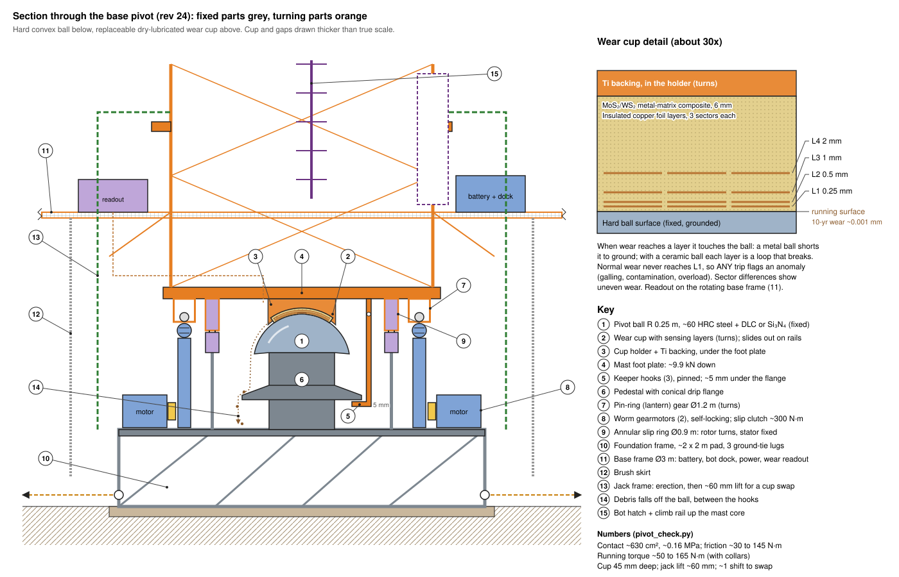

**Why a single pivot is enough.** The strut tripod and stays carry all tipping, quake and wing-imbalance loads at the collars. So the mast foot is effectively a **pin**: it only has to carry the weight (~10 kN), keep the foot centred, and turn. A rail turntable (Appendix A) did those jobs with ~5 t of rail, piers, bogies, deck and kingpin.

**Foundation (fixed)**
- A **~2 x 2 m pad** of compacted and sintered regolith (or regolith-filled gabions) under a bolted **foundation frame** (Ti/steel, ~0.3 t, in 2 freight pieces). Bearing pressure ~2.5 kPa, trivial for compacted regolith.
- The frame carries:
  - the **pivot ball**, bolted on a short pedestal;
  - the **2 drive motors**;
  - the **stator of the annular slip ring**;
  - **lugs for the 3 ground ties** (their pulls cancel at the centre);
  - the **jack-frame** mounting.
- The pivot sits ~1 m above the regolith, out of the near-surface dust, inside the **protection enclosure** (section 5a).

**Base pivot: hard ball below, wear cup above** (`pivot_check.py`)
- **Pivot ball (fixed):** a convex spherical cap, **R 0.25 m** (Ø0.5 m), bolted to a pedestal on the foundation frame and facing **up**.
  - Through-hardened bearing steel (~60 HRC) with a DLC or TiN coating, or a Si₃N₄ ceramic shell.
  - Hard, smooth and convex, so any dust or wear particles **roll off its sides** instead of collecting.
- **Wear cup (turning):** a matching **concave** liner, ~6 mm thick on a Ti backing, held in a **holder ring** that drops into a Ø0.55 m opening in the mast foot plate from above, facing **down** (section 5a).
  - It is the **only intended wear part**: a sintered metal-matrix composite with MoS₂/WS₂ solid lubricant, which works in vacuum and cold with no outgassing. A MoS₂-filled polyimide liner is the alternative.
  - Dissimilar, hard-against-soft surfaces cannot cold-weld.
- **One part, three jobs.** The spherical contact carries the ~9.9 kN, centres the mast foot (radial and quake loads), and lets the mast settle plumb within ±1°, so the separate seat is gone. There are no rollers to seize.
- **Contact:** an annulus from r ~22 mm (a small apex relief) to ~143 mm (35° half-angle), ~630 cm². Mean pressure **~0.16 MPa**, very light for a dry plain bearing.
- **Friction torque ~30 to 145 N·m** (μ 0.03 to 0.15, effective radius ~0.1 m).
- **Wear is negligible.** The cup slides only ~7.6 m per year at its effective radius. Even with an abrasive third-body wear rate (Archard k ~1e-13 m³/N·m, dusty contact), that is **~1 µm in 10 years**.
- **Embedded wear-indicator layers.** The cup carries thin insulated **conductive foil layers at 0.25, 0.5, 1 and 2 mm** below the running surface, each split into 3 sectors.
  - When wear reaches a layer, that layer touches the grounded ball and its circuit changes, so wear depth is read electrically. With a metal ball the foil shorts to ground; with a ceramic (insulating) ball each layer is a loop that breaks instead.
  - The sectors show uneven wear, for example from a tilted mast.
  - The readout electronics sit on the rotating base frame next to the cup, so no extra slip-ring channels are needed.
  - Normal wear should never reach the first layer. **Any layer tripping signals an anomaly** (galling, contamination, overload) long before it matters.
- **Keeper hooks:** 3 hooks on the foot plate reach under a flange on the ball pedestal with ~5 mm clearance. They stop the cup lifting off during handling or a quake, though the net load is always ~10 kN down. The flange is **conical** (a drip edge) and the open arcs between the hooks let debris fall through to the foundation frame. The hooks are pinned and are removed before the mast is jacked.
- **Dust:** the enclosure keeps dust out. Anything that does get in falls off the convex ball, off the conical flange and between the keeper hooks, onto the foundation deck ~0.4 m below the contact, which slopes to a removable debris drawer.

**Drive**
- **Running torque ~50 to 165 N·m:** pivot friction ~30 to 145 N·m plus ~20 N·m from the two collars. The mechanical power is microwatts.
- **2 worm-drive gearmotors** (either one enough) on the foundation frame drive a **pin-ring (lantern) gear, Ø ~1.2 m**, under the mast foot plate.
  - Pin gears tolerate dust and the ±1° pivot tilt (about ±10 mm at the ring), which a fine involute gear would not.
  - Worms are **self-locking**, so the mast holds position with no brake power.
- Sized for ~500 N·m. There are no wheels in dust, so there is no kN·m breakaway torque.
- **Collar protection:** each motor carries a **mechanical slip clutch at ~300 N·m**, set just above the highest pivot friction. It backs up the electronic collar-torque interlock (V-link load pins, ~200 N·m), and neither the base drive nor a stuck collar can wind the mast round more than ~3°.
- **Power transfer:** an **annular drum slip ring**, Ø ~0.93 m, around the pivot, carrying all the array power at **±500 V DC** (~350 A per pole). Details in section 5c.
  - Silver-plated rings with 16 silver-MoS₂-graphite brushes per ring, as on spacecraft solar-array drives.
  - ~0.25 kW of loss, shed by the enclosure radiators.
  - Data crosses on a short-range contactless link. A separate ground ring and brush tie the mast to ground.
  - The rotor is under the foot plate and the stator on the foundation frame, so the pivot ball stays solid.

**Rotating base frame**
- A light CFRP/Ti platform, **Ø ~3 m**, clamped to the bottom mast section ~1.5 m above the ground. It turns with the mast. ~0.75 t with the battery, in 3 freight pieces plus the battery modules. It carries:
  - a **custom storage battery**, ~20 kWh (~0.17 t).
    - It is made of modules in an insulated, heated box, spread evenly round the mast.
    - The array charges it through the base power cabinet.
    - It turns with the mast, so bot charging needs no slip-ring channel.
    - It covers 2 full bot charges plus ~48 h of reels, garage heating, sensors and survival heat if the array is dark (`service_bot_check.py`).
    - A small **service feeder** from it runs up the mast to the reel sockets and the reel garage.
  - the **service-bot dock**: chargers for the 2 bots, a rack for the spare reel hoist, spare rope and tools, and the **hatch** into the climb rail in the mast core;
  - the **base power cabinet** (section 5c): trunk terminations and breakers, the insulation monitor, the battery's bidirectional DC/DC, the bot chargers and the service-feeder converter, feeding the **slip-ring rotor**;
  - **drive, wear-sensor and other electronics**, and cameras looking at the pivot, the trays and the bot hatch;
  - a **grating walkway** round the mast for suited crew and robots.

**Swapping the wear cup (rare: only if a wear layer trips)**
1. Park the mast (the worms hold it). Unpin the 3 keeper hooks; their pins are reached from above, inside the mast core.
2. The **jack frame**, left bolted to the foundation after erection, lifts the mast **~10 mm** at its jack lugs, enough to unload the pivot. The collars and tripod hold it upright, and only ~10 kN is lifted.
3. Inside the mast core, a bot or suited crew member undoes the holder ring's 12 captive bolts. The **pivot service davit** (E3) on the climb rail lifts the ring and cup **out upward**. The new cup goes in the same way, and its wear-layer connector mates as it seats.
4. Lower the mast, re-pin the hooks and check the wear-layer circuits.
   - About half a shift.
   - The enclosure, drives and slip ring are not disturbed.
   - The array stops tracking only during the swap.
5. The ball, which should never wear, comes out the same way after the cup: 12 bolts to the pedestal, ~51 kg (~8 kg-weight on the Moon).

## 5a. Pivot and drive detail, and the protection enclosure

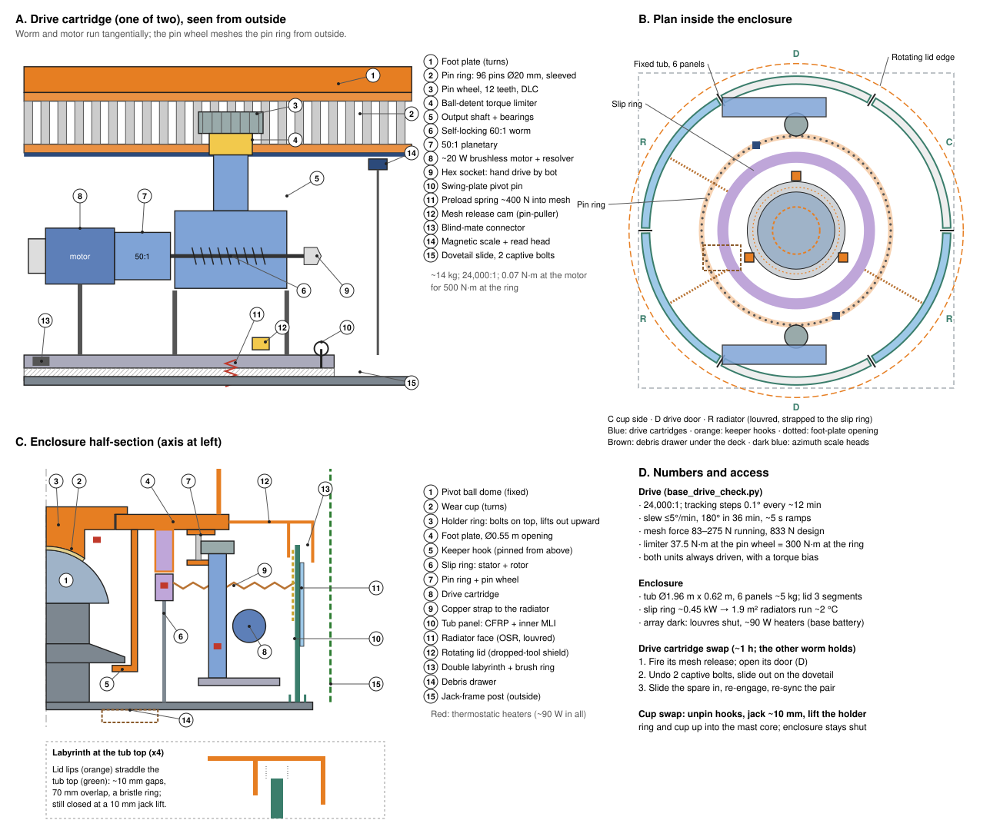

Numbers from `base_drive_check.py`.

**A correction found while detailing.** In rev 21 the wear cup was to slide out sideways on rails. That path is blocked all round by the pin-ring gear and the slip-ring rotor, which sit at the same height. The cup and the ball now come out **upward**, through a Ø0.55 m opening in the foot plate into the clear mast core. So the jack only has to unload the pivot (~10 mm), and nothing else is disturbed.

**Pivot assembly**

| Part | Detail |
|---|---|
| Pivot ball (fixed) | Forged, through-hardened steel dome shell. R 0.25 m, 20 mm thick, to 80° (Ø0.49 m at its edge), ~51 kg. Ground to ≤10 µm sphericity, polished to Ra ≤0.1 µm, 2–3 µm DLC (or a bonded Si₃N₄ shell). 12 captive bolts to the pedestal. Grounding strap and thermistor |
| Pedestal | Ribbed Ti, Ø0.34 m, with the conical drip flange (Ø0.62 m). 3 strain-gauge bridges read the vertical load, a running check on the sum of the bracing pre-tensions |
| Wear cup (turns) | Ti backing 8 mm + 6 mm MoS₂/WS₂ composite liner, 35° cap, rim Ø0.30 m, ~8 kg. Ø44 mm apex relief. A 13-pin spring connector on the rim flange carries the 4 layers x 3 sectors + ground |
| Holder ring (turns) | Ti ring that drops into the foot plate's Ø0.55 m opening from above and seats on a ledge. Load path: foot plate → ledge → holder ring → cup → ball. 12 captive M10 bolts, reached inside the mast core |
| Keeper hooks (3) | Pinned to the foot plate, ~5 mm under the drip flange. Pins reached from above |
| Thermal match | Steel dome against a Ti-backed cup: over a 200 K swing the radii differ by only ~0.03 mm, taken up by the liner |

**Drive units** (2, either one enough)
- **Gear train** (24,000:1 overall):
  - ~20 W brushless motor, vacuum-rated, with a resolver and dry-lubricated bearings;
  - 50:1 planetary, MoS₂-lubricated;
  - 60:1 single-start **self-locking worm**: case-hardened steel worm and aluminium-bronze wheel, both MoS₂-coated, so the surfaces are dissimilar;
  - ball-detent **torque limiter**;
  - **12-tooth pin wheel** (hardened steel, DLC) on a vertical output shaft.
- **Pin ring:**
  - 96 hardened steel pins, Ø20 mm with free-turning sleeves, on a 39.3 mm pitch at Ø1.2 m.
  - The pins are held between two Ti flanges under the foot plate, in 4 bolted segments.
  - The pins are 100 mm long and the pin wheel 50 mm wide. That gives ±25 mm of vertical float, covering the ±1° tilt (±10 mm) and the 10 mm jack lift.
- **Torques:**
  - Running: 50 to 165 N·m at the ring (mesh force 83 to 275 N).
  - Limiter: 37.5 N·m at the pin wheel, which is 300 N·m at the ring.
  - Design: 500 N·m (833 N). Even then the motor needs only ~0.07 N·m; the ~20 W size is for cold-start margin.
- **Mesh compliance:** each unit sits on a swing plate pivoting on a vertical pin, spring-preloaded (~400 N) into mesh. It takes up ±5 mm of centre-distance change, with a hard stop.
- **Two units, one ring.**
  - Both self-locking worms are always in mesh, so they run together under one controller, with a small torque bias between them to take out backlash (as on dual-pinion slewing drives).
  - A failed unit would lock the ring. So each has a **mesh release**: a spring cam, fired remotely by a small pin-puller or turned by hand, swings it out of mesh. The other unit then carries on alone.
- **Hand drive:** a hex socket on the worm shaft. 1.33 turns per degree, ~3 N·m at 500 N·m, so a bot can park the mast with a hand tool if both motors are dead.
- **Sensing:**
  - a resolver on each motor;
  - an encoder on each pin-wheel shaft;
  - an absolute magnetic ring scale on the pin-ring flange, read by 2 fixed heads, giving mast azimuth to ~0.01°.
  - If the motor and pin-wheel readings disagree, the limiter has slipped.
- **Removable cartridge:** each unit (~14 kg, ~0.5 x 0.25 x 0.55 m) sits on a dovetail slide on the foundation deck, with 2 captive bolts and a blind-mate connector. Swap (~1 h; the other worm holds the mast):
  1. Release its mesh.
  2. Undo the 2 bolts and slide it out through its enclosure door.
  3. Slide the spare in, re-engage the mesh and re-sync.
- **Wear:** the pin wheel turns only ~100 times a year, so pin and tooth wear is negligible.

**Control**
- **Tracking** at 0.508°/h: the mast steps 0.1° every ~12 min (6.7 motor turns, ~0.4 s), so the array is never more than 0.1° off the Sun.
- **Slewing** (parking) at up to 5°/min, with ~5 s ramps. 180° takes 36 min. The whole rotating rig (~340,000 kg·m²) then holds only ~0.4 J, so stops are gentle.
- **Interlocks:**
  - collar torque (V-link load pins, 200 N·m);
  - motor current;
  - torque-limiter slip;
  - **no rotation while any reel socket reports a load**, that is, while a pack hangs on ropes.
  - A wear-layer trip raises an alarm only.

**Protection enclosure (removable)**

It replaces the brush skirt. It:
- keeps out lofted, electrostatic dust and rocket-landing ejecta;
- holds the drives, slip ring and pivot at −20 to +40 °C;
- sheds the slip ring's heat;
- stops a tool dropped from the yard (~160 J for 1 kg from 100 m) reaching the mechanism;
- lets a bot or suited crew reach any part by removing one light panel.

Its parts:
- **Fixed tub** on the foundation deck: Ø1.96 m, 0.62 m tall (0.40 to 1.02 m above the ground). It is made of **6 curved panels** (60° each, ~5 kg), CFRP honeycomb with a grounded conductive outer skin.
  - Each panel drops into a floor channel and locks to a top ring with 2 quarter-turn captive fasteners. It has grapple handles, and one bot lifts it out in ~2 min.
  - 2 panels carry a **drive door** facing each drive unit.
  - 3 panels are **radiators**: a white OSR (silvered Teflon) outer face with bimetal louvres, joined to the slip-ring stator by flexible copper straps.
  - The other panel and the lid carry **MLI** on the inside.
- **Rotating lid:** an annulus, r 0.72 to 1.06 m, in 3 segments bolted under the foot-plate rim, so it turns with the mast.
  - A **double labyrinth** seals it to the tub: an outer lip outside the tub top and an inner lip inside it, ~10 mm gaps and 70 mm overlap. A stainless-bristle brush ring on the tub top adds <2 N·m.
  - The 70 mm overlap stays closed with the mast jacked 10 mm.
  - Its CFRP/Ti sandwich is the dropped-tool shield. Inside the mast core, the solid foot plate does that job.
- **Floor:** the foundation deck, sloped 2° to a removable **debris drawer** under the drip-flange drop zone, emptied from outside.
- **Thermal:**
  - Operating: ~0.25 kW of slip-ring heat leaves through 1.9 m² of radiator, with the louvres modulating to hold the inside at −20 to +40 °C.
  - Array dark: the louvres shut, and ~90 W of thermostatic heaters (drives, slip ring, cup holder) run from the base battery. That is 4.4 kWh for 48 h, inside its 12 kWh dark budget.
- **Inside:** 4 cameras with LED lights, temperature sensors and a dust witness plate.
- **Penetrations:** harness glands through the deck. The tie lugs and jack-frame posts are outside, and the mast passes through the lid.
- **Mass:** ~45 kg (tub ~30 kg, lid ~15 kg).

## 5b. Bearing and joint schedule

Only **three bearing sets rotate in service**: the base pivot and the 2 collars. Everything else is static in service and moves only during installation or maintenance, or by tiny thermal amounts.

| # | Joint | Relative motion | Load (Moon) | Type |
|---|---|---|---|---|
| 1 | **Base pivot** | Rotating, ~0.5°/h, always | **~9.9 kN** down (~0.16 MPa); small radial and quake loads | Spherical plain pivot: hard convex ball (fixed) under a replaceable MoS₂/WS₂ composite wear cup (turning) with embedded wear-sensing layers |
| 2 | **Upper collar** (62 m, 6 cartridges) | Rotating (mast inside a stationary collar) | Stay pull-down ~4 kN total, ~0.7 kN per thrust roller; small radial | 6 roller cartridges: tapered Si₃N₄ tyres on 440C strips, hybrid bearing + sleeve journal, Belleville and swing-arm preload |
| 3 | **Strut collar** (35 m, 6 cartridges) | Rotating | Strut push-up ~5.7 kN total, ~0.9 kN per lower thrust roller | Same cartridge design as the upper collar |
| 4 | Pivot keeper hooks (3) | None in service (~5 mm clearance) | ~0 (handling, quake only) | Pinned hooks on the foot plate, under a conical flange on the pedestal |
| 5 | Drive units (2) | Rotating, always (very slowly) | ~50 to 165 N·m running, limiter at ~300 N·m | Removable cartridges: motor, 50:1 planetary, self-locking 60:1 worm, torque limiter, 12-tooth pin wheel on a 96-pin Ø1.2 m ring (24,000:1) |
| 6 | **Strut A-frame ends** (6 tubes, 2 ends each) | **Static in service.** Swing only during the scissor erection; thermal micro-motion after | ~1.25 kN per tube | Spherical plain bearings, dry film. They hardly move, so the concern is fretting, not wear |
| 7 | **V-links** (3 x 2 pins, upper collar) | Static in service; hinge only during installation | Stay tension 1.5 to 3 kN; couple ≤ ±0.2 kN at the interlock limit | Pins in lugs; instrumented load pins |
| 8 | Stay and tie terminations, foot tensioners | Servo-trimmed slowly (thermal, ~0.25 m over a day at most) | 1.5 to 3 kN | Self-locking worm drum + Belleville buffer + load cell; swaged fork terminals, spherical bushings |
| 9 | **Top yard** at 100 m | **None:** fixed to the mast, turns with it | Wings + yard ~5 kN down, through topping lifts into the mast top, then down the mast to the base pivot | Bolted joint, no bearing |
| 10 | Pack hangers (16, top yard) | Static; unlatched only for a pack swap; 4 rope sheaves turn only during a swap | ~0.23 kN per pack | 4 alignment cones, 2 flared guide forks, a captive latch worked by the bot; limit switch |
| 11 | Climb- and yard-rail trolleys | Only while a bot moves | Bot + reel ~0.14 kN; arrest load ~2 kN | Captive trolley with a cam fall-arrest brake |
| 12 | **Slip ring** (Ø0.93 m drum) | Rotating, always | ~350 A per pole at ±500 V | Silver-plated rings, 16 silver-MoS₂-graphite brushes per ring in 8 cartridges, barrier fins |

## 5c. Power: cabling and slip ring

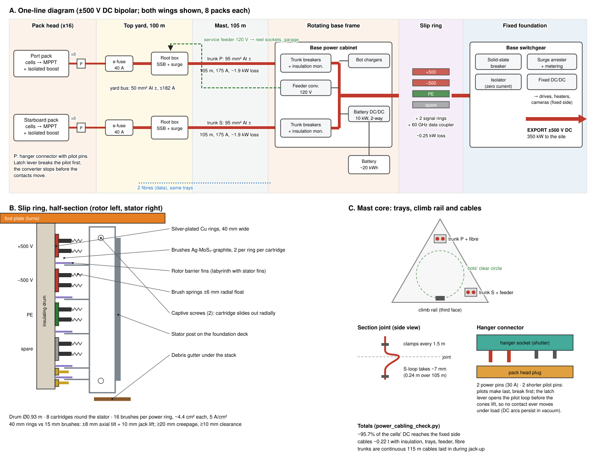

Numbers from `power_cabling_check.py`.

**Choices**
- **Bipolar ±500 V DC** from the packs to the fixed side: 1 kV pole to pole, 500 V to structure. At ±500 V the two mast trunks need ~108 kg of aluminium for ~1.1% loss; at 600 V they would need ~270 kg.
- **No connector or brush ever makes or breaks under load.** A DC arc in vacuum can sustain itself. So all switching is done by solid-state breakers, and connectors and isolators open only at zero current, guarded by pilot interlocks.
- **Floating bus with a high-resistance midpoint ground** and an insulation monitor. A first insulation fault is an alarm, not an outage.
- **Each pack is its own source.** The packs connect in parallel, so a pack removed for a swap simply drops off the bus.

**From pack to base**
1. **Pack converter, in the pack head** (detail in section 5d). MPPT plus an isolated converter to ±500 V, ~98% efficient, ~21 A, ~12 kg with its radiator. It travels with the pack, so it reaches the ground for repair at every swap.
2. **Hanger connector** (detail in section 5d). A floating, shuttered, 5-pin blind-mate connector aligned by the cones. The **hanger's e-fuse is the switch**: it stays open unless the pilot loop, which runs through the latch, is closed. So the contacts never carry current while they move.
3. **Yard bus.** Each wing has a ± pair of tapered aluminium conductors (50 mm² at the root, ~182 A) in a closed, grounded tray inside the yard truss. Each hanger taps it through a 40 A **e-fuse** in a small junction box. Loss is ~0.45 kW for both wings at full power.
4. **Yard-root junction box,** at the yard-mast section. It holds a solid-state breaker, surge suppressor and current sensor for each wing. It also takes the service feeder and the fibre, and feeds the reel sockets and the reel garage.
5. **Mast trunks.** There are 2 independent trunks, one per wing. Each is a ± pair of 95 mm² aluminium cables with polyimide/PTFE insulation, ~105 m long, carrying ~175 A with ~1.9 kW of loss at full power. Either trunk can be isolated without stopping the other wing.
   - They run in 2 closed, grounded aluminium **trays in two corners of the triangular mast core**, outside the bots' clear circle. The climb rail is on the third face. The trays protect the bots from the cables and the cables from the bots.
   - They are clamped every 1.5 m, with a gentle **S-loop at each section joint** to take ~0.24 m of thermal length change over 105 m (~7 mm per joint).
   - **No joints:** each trunk is one continuous 115 m cable. It is fed from a reel at the jack frame as the mast rises and laid into each new section's tray as that section goes in.
   - The service feeder (120 V, 2 x 4 mm² copper, ~400 W) and 2 radiation-tolerant fibres share the trays.
6. **Base power cabinet,** on the rotating base frame. It holds the trunk terminations and breakers, the insulation monitor, the battery's bidirectional DC/DC (~10 kW), the bot chargers and the service-feeder converter. Short flexible bus bars run down through the foot plate to the slip-ring rotor.

**Slip ring** (inside the base enclosure)
- **Drum type, mean Ø0.93 m,** around the pivot. The rotor is an insulating CFRP/ceramic drum hung under the foot plate. The stator is 8 **brush-holder cartridges** on posts from the foundation deck.
- **Rings, top to bottom:**

  | Ring | Use | Size |
  |---|---|---|
  | 1 | +500 V | 40 mm wide, silver-plated copper, 60 mm pitch |
  | 2 | −500 V | same |
  | 3 | Protective earth: mast structure to foundation | same |
  | 4 | Spare power ring; replaces ring 1 or 2 by moving its bus-bar link | same |
  | 5, 6 | Signal rings (gold), the back-up data path (CAN) | 12 mm wide, 20 mm pitch |

  The whole stack is 280 mm tall, which fits the space between the foundation deck posts and the foot plate.
- **Brushes:** silver-MoS₂-graphite, 16 per power ring (2 per cartridge), ~4.4 cm² each, run at 5 A/cm² (derated for vacuum).
  - Losses: ~0.21 kW at the contacts + ~0.04 kW in the rings and leads = **~0.25 kW**, shed by the enclosure radiators.
- **Float:** the rings are 40 mm wide against 15 mm brushes, and the brush arms give ±6 mm radially. That covers the ±1° pivot tilt (±8 mm axial, ±4 mm radial) and the 10 mm jack lift.
- **Wear:** the ring turns only ~12 times a year (~36 m of sliding), so brush wear is negligible. Each brush still has a length sensor.
- **Insulation:** 500 V to structure.
  - Insulating barrier fins between the rings interleave with fins on the stator to form a labyrinth, so conductive wear dust cannot bridge from ring to ring.
  - ≥20 mm creepage, ≥10 mm clearance, and a debris gutter under the stack.
- **Data:** a contactless 60 GHz ring coupler carries the main data link; the 2 gold signal rings are the back-up.
- **Power to the fixed side at night:** the bus works both ways. When the array is dark, the base battery holds it up and powers the fixed-side loads (drives, enclosure heaters, cameras) through a small DC/DC on the fixed side.
- **Brush cartridge swap** (~30 min outage):
  1. Open the base breakers; the pack converters go idle.
  2. Remove the nearest tub panel.
  3. Undo 2 captive screws and slide the cartridge out radially.
  4. Slide the spare in.

  With one cartridge out, the other 7 still carry full current, so a fault can wait for the next planned window.

**Fixed side and export**
- The stator bus bars go to the **base switchgear** on the foundation, inside the enclosure. It holds:
  - a solid-state breaker;
  - a mechanical isolator, opened only at zero current;
  - a surge arrester;
  - metering;
  - the fixed-side DC/DC.
- The export cable leaves through a deck gland at ±500 V DC, 350 kW, to the user's substation. For runs of several kilometres, stepping up near the rig (for example to ±3 kV) saves cable mass; that belongs to the site network.

**Totals**
- **~95.7%** of the cells' DC reaches the fixed side, after the pack converters, yard buses, trunks and slip ring.
- Cable mass ~0.22 t, including insulation, trays, feeder and fibre.

## 5d. Pack converter and hanger connector

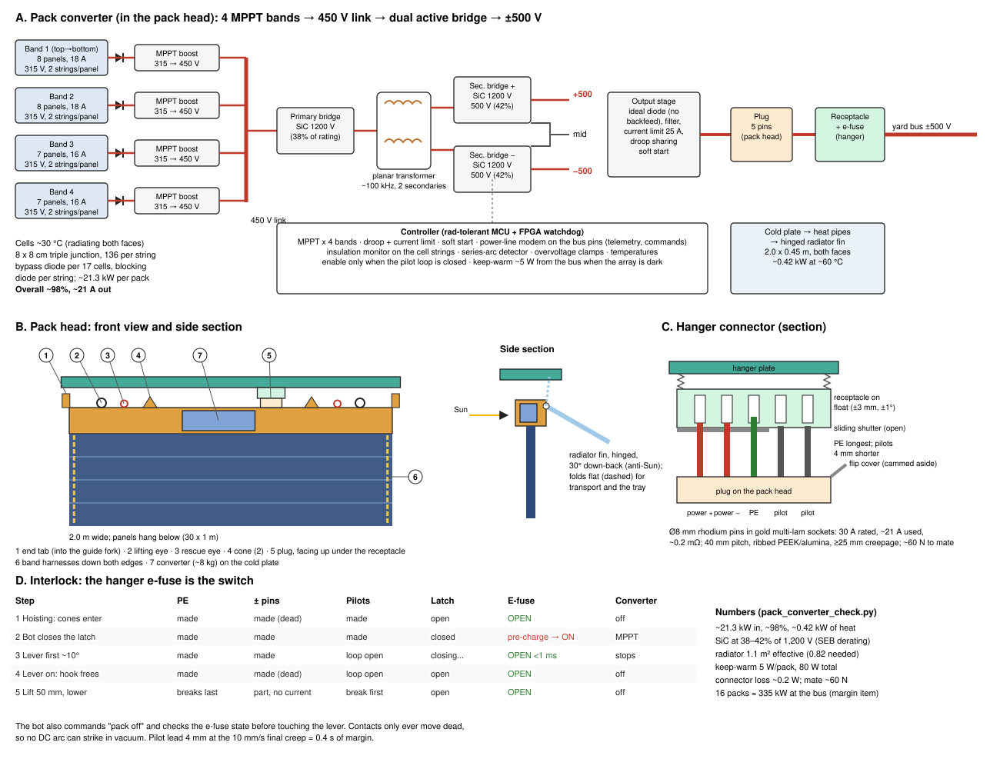

Numbers from `pack_converter_check.py`.

**Cells and strings**
- **Cell temperature:** a vertical pack facing the low Sun radiates from both faces to a cold sky, so its cells run at only ~30 °C.
- **Cells:** 8 x 8 cm triple-junction, 30%: Vmp ~2.32 V, Imp ~1.13 A.
- **Strings:** each 2 m² panel carries 2 strings of 136 cells (~315 V), at 87% packing.
- **Bands:** the 30 panels form **4 MPPT bands by height** (8, 8, 7 and 7 panels, top to bottom), because terrain shade creeps up from the bottom as the Sun's elevation changes. Each band is ~16 to 18 A at 315 V, ~5 to 5.7 kW.
- **Protection:** a bypass diode every 17 cells and a blocking diode per string. The flat harness crosses each hinge in a loop sized for the fold.
- **Output:** ~21.3 kW per pack at the converter input.
  - **This is a margin item.** 16 packs then deliver ~335 kW at the bus, ~5% under the 350 kW headline.
  - Closing the gap needs ~91% packing (larger or edge-trimmed cells), or slightly larger packs.

**Pack converter** (in the pack head; ~8 kg plus a ~4 kg radiator)
- **4 interleaved boost MPPT stages** (315 → 450 V, ~99.2%), one per band, feed a shared **450 V link**.
- **Dual active bridge** (SiC, ~100 kHz). A planar transformer with **2 secondaries** feeds 2 bridges whose outputs are stacked: +500 V, midpoint, −500 V (~98.8%). The output is isolated from the cells, so the cell strings sit close to structure potential, which keeps arcing and charging stress low.
- **Overall ~98%:** ~0.42 kW of loss and ~21 A out.
- **Radiation derating:** every transistor sees ≤42% of its 1,200 V rating (450 V on the boost and primary, 500 V on each secondary). That is within the ≤50% guideline against single-event burnout from cosmic rays. This is the reason for the stacked secondaries rather than a single 1 kV bridge.
- **Built for vacuum and cold:**
  - film and ceramic capacitors only;
  - the high-voltage transformer and bus bars potted in degassed silicone, with conformal coating elsewhere;
  - vented through a dust labyrinth so outgassing cannot linger at corona-prone pressures.
  - High voltage is enabled only after a vacuum hold at first deployment.
- **Heat:** a **hinged radiator fin** on the back of the pack head (2.0 x 0.45 m, both faces, heat pipes from the cold plate) holds the plate at ~60 °C with margin (1.1 m² effective against 0.82 m² needed). The fin folds flat against the head for transport and in the tray.
- **Keep-warm:** ~5 W per pack, drawn from the bus side when the array is dark. All 16 packs take 80 W from the base battery, inside its dark budget.
- **Control:**
  - MPPT per band;
  - output **droop** so the 16 packs share the bus without talking to each other;
  - a 25 A current limit and soft start;
  - an ideal-diode output, so the pack can never draw from the bus.
- **Protection:** an insulation monitor on the cell strings, series-arc detection (from the high-frequency signature), overvoltage clamps, and an output e-fuse at the hanger.
- **Data:** telemetry and commands go by power-line communication on the bus pins, so no extra connector pins are needed.

**Hanger connector**

Each half is ~1.5 kg. The receptacle hangs under the hanger, facing down, 0.25 m off the hanger centre, clear of the rope sheaves. The plug sits on top of the pack head, facing up.

- **5 pins, three lengths:**

  | Pin | Length | Job |
  |---|---|---|
  | PE | Longest | Bonds the pack frame to the structure first, and breaks last |
  | +500, −500 | Middle | Ø8 mm rhodium-plated pins in gold-plated multi-lam sockets: 30 A rated, ~21 A used, ~0.2 mΩ each. The dissimilar platings avoid cold welding in vacuum |
  | Pilot x 2 | 4 mm shorter | Make last and break first. They close a loop that also runs through a switch on the latch lever |

- **Spacing:** pins 40 mm apart, with a ribbed PEEK/alumina insulator giving ≥25 mm creepage.
- **Float:** the receptacle sits on a compliant mount (±3 mm, ±1°). The cones and guide forks bring the plug to ±1 mm; the float takes the rest.
- **Dust:**
  - The receptacle's sliding shutter is pushed open by a boss on the plug as the cones engage.
  - The plug's flip cover is cammed aside by the hanger.
  - Both close by spring when apart, so the contacts are never open to dust, even in the tray.
- **Mating force:** ~60 N, supplied by the reel hoist in the last 50 mm, at a 10 mm/s creep.

**Interlock sequence** (the hanger e-fuse is the switch)
1. **Hoisting in:** the forks square the head, the cones enter and the shutters open. PE touches first, then the power pins, then the pilots. The e-fuse is still **open**, so both sides of the power pins are dead.
2. **Latching:** the bot closes the latch, which completes the pilot loop. The e-fuse pre-charges the converter's output (~100 ms soft start), then closes, and the converter starts MPPT.
3. **Unlatching:** the first ~10° of latch-lever travel opens the pilot switch. The e-fuse opens in <1 ms and the converter stops. Only then does further lever travel free the hook.
4. **Lowering:** the pack lifts 50 mm off the cones and the contacts part with no current. The pilots break first anyway: 4 mm of lead at 10 mm/s gives 0.4 s of margin.
5. **Double check:** the bot also requests "pack off" through the controller before touching the lever, and checks the e-fuse state on its display.

## 6. Spares on site

2 pivot wear cups, 1 pivot ball, 1 drive-unit cartridge, 1 torque limiter, 1 pin-ring segment, 2 enclosure panels (1 radiator, 1 plain), 1 lid segment, 2 slip-ring brush cartridges, 1 pack converter, 1 converter radiator fin, 1 hanger receptacle and 1 plug, 4 e-fuses, 2 collar roller cartridges, 2 running-strip segments, 1 collar sensor hub, 1 stay cable, 1 V-link with load pins, 1 tie, 1 foot tensioner unit, 1 strut section, 4 concertina packs, 1 spare reel hoist and 2 spare ropes, spare fall-arrest trolleys, 2 cable cutters, 4 rope grabs, 1 spare rescue kit (2 rope-riding hooks, 2 edge rollers), 2 battery modules. A third service bot in reserve is worth considering.

## 7. Installation equipment and sequence (human supervised)

Everything is assembled at the base (on the foundation, inside the jack frame) and raised. A crew member (EVA, or in a pressurised rover nearby) supervises each step and signs off every hold point. Machines do the lifting.

| # | Equipment | What it does |
|---|---|---|
| E1 | **Foundation rig** | Compacts or sinters the central pad and sets the foundation frame and pivot pedestal: the datum for everything else. |
| E2 | **Radius arm ("compass")** | Arm on the foundation datum with a laser level, encoder and rangefinder. It lays out the 3 foot-pad sites at 30 m and the landing-tray legs. |
| E3 | **Pivot service davit** | A small hoist that clamps to the climb rail inside the mast core and lifts the cup, the holder ring or the ball in and out through the foot-plate opening (installation and swaps). |
| E4 | **Foot-pad and tie layer** | Compacts or sinters the 3 foot pads and lays the 3 ground ties from the central foundation out to the feet. No pull-out anchors needed. |
| E5 | **Mast jack-up frame** | Bolts to the foundation frame around the pivot and lifts the whole mast one 3 m section at a time; the new section is pinned in at the bottom. Peak lift ~10 kN. It stays afterwards for wear-cup swaps. |
| E6 | **Tie and stay winches with load cells (stay on as the permanent servo tensioners)** | One at each foot. They control the ties (which pull the strut feet in as the mast rises) and the wires, and keep the mast plumb. Tensions are shown live on a supervisor tablet. |
| E7 | **Service bots (2)** | Humanoid-class, supervised. They climb the rail inside the mast, fit and check the diamond stays and collar cartridges at height, and hoist the packs. They stay on site for maintenance. |
| E8 | **Twin-drum reel hoists (2 + 1 spare)** | ~14 kg each, parked in the garage at the yard root. They clip into the reel socket above any pack hanger and lower or hoist one pack on two 2 mm stainless ropes, powered from the socket. |
| E9 | **Landing trays** | Two light trays on short ground legs along the maintenance azimuth; each pack folds into its slot on lowering and unfolds from it on hoisting. They double as storage for spare packs. |

**Sequence**
1. Survey and clear the site. Make the central pad and set the foundation frame and pivot pedestal (E1). Lay out the 3 foot sites and the tray legs with the radius arm (E2); prepare the pads and lay the ties (E4).
2. Bolt the pivot ball to the foundation frame (E3), fit the 2 drive-unit cartridges and the slip-ring stator, and set the enclosure floor channel and top ring. The wear cup, pin-ring gear and slip-ring rotor go on the bottom mast section's foot plate.
3. Bolt the jack frame (E5) to the foundation frame around the pivot.
4. Fit the **top yard first**, on the topmost mast section at the base:
   - **unfolded and horizontal**, at the maintenance azimuth,
   - topping lifts set and tensioned,
   - the yard-root junction box, with the 2 mast trunks, the service feeder and the fibres connected to it. They pay out from reels at the jack frame as the mast rises and are laid into each new section's corner trays;
   - walkway, fall-arrest rail, pack hangers (with their sheaves, guide forks, connectors and e-fuses), reel sockets and the reel garage fitted, with the 2 reels in it.

   The climb rail is part of every mast section, pinned at each joint as the section goes in.

   It then simply rides up. During jack-up only the stays and struts are on the mast, and both are always below the yard, so it cannot foul anything and nothing has to be unfolded at height. The wings are not on the mast during jack-up. **Build it as it rises:** every later section goes in at the base already in its final form. The diamond-spreader section, for example, is fitted with its spreaders open (12 m across) and its stays connected.
5. **Jack up, with a scissor action.** Each collar is fitted around the mast at the base (3 segments), clamped to its band, and rides up with the mast.
   - Up to ~43 m the mast stands free in the jack frame (section 10.3). When the upper-collar band reaches the jack frame, the **upper collar** goes on, with its 3 V-links already shackled to their stay cables, which are paid out from the foot winches as it rises. Until the struts are in, these cables act as light temporary guys (a few hundred N). Each foot winch is ballasted with regolith bags so it never needs a pull-out anchor.
   - When the strut band reaches the jack frame, the **strut collar** goes on. The 3 A-frame struts are pinned to its torque brackets while lying flat on the ground, pointing outward, with their feet on skid dollies.
   - As the mast keeps rising, the struts swing up and the tie winches (E6) **pull the feet in** along the ground, from 46 m to their 30 m pads. Low gravity keeps the strut and dolly loads tiny.
   - At final height, the feet drop onto their pads. The stay cables and ties are trimmed to final tension; the V-links line up with their cables by themselves. The clamp pins are pulled. The bottom section's foot plate (wear cup, pin-ring gear, keeper hooks) is lowered onto the pivot ball, and the **rotating base frame** is clamped on ~1.5 m up. The enclosure lid segments are bolted under the foot plate and the tub panels dropped in. From then on the mast turns freely on the base pivot and in both collars.
6. At full height (the top yard is already rigged), park at the maintenance azimuth and set the folded packs in their tray slots. The service bots (E7) climb to the yard and **hoist the packs one at a time** with the reel hoists (E8), ~16 min each, alternating port and starboard so the rig is never more than one pack out of balance. Each pack unfolds as it lifts off its tray and is latched to its hanger. All 16 take ~8 h with one bot and ~4 h with two. More packs can be added later the same way.
7. Trim wire and tie tensions to plumb the mast and take out thermal bow. Terminate the trunks in the base power cabinet, check insulation and polarity, then energise the packs one by one through the slip ring; commission the worm drives and slip clutches, start tracking.

Design rules for every part: captive fasteners, one tool size, alignment cones, grapple fixtures, and no single piece heavier than ~150 kg-weight on the Moon without lifting gear.

## 8. Environment checklist

| Hazard | Response |
|---|---|
| Terrain and neighbour shadows | Array at the top of a 100 m+ mast; site illumination study sets the height; spacing and stagger rules (section 4b) |
| Temperature swings, one-sided sunlight | CFRP mast and struts, mast behind the blanket, white-coated stays on servo foot tensioners (self-locking; ±1.3 kN drift at most if unpowered), steady sun-tracking gradient trimmed by wire tension |
| Cold welding in vacuum | Dissimilar or coated mating surfaces: hard ball against a solid-lubricant composite cup at the base; dry lubricants on all collar rollers |
| Abrasive, electrostatic dust | Only one moving part at ground level: the base pivot, ~1 m up, inside a removable enclosure with a labyrinth lid. Its convex ball sheds debris, and the wear cup's embedded layers flag any abrasive wear. Nothing rolls on regolith. Collars and array are high above most lofted dust |
| Moonquakes | Strut tripod carries lateral load; balanced rig; lower thrust rollers in the collars; the base pivot has keeper hooks and is always ~10 kN in compression |
| Micrometeoroids | Damaged packs lowered and exchanged one at a time by a service bot; doubled wires; struts are thick-walled tubes, inspected by the bots |
| Work at 100 m | Bots, not crew, work at height. They are always clipped to a captive fall-arrest trolley on the climb rail (inside the mast) or the yard rail. Packs move on a reel with a fail-safe brake. No rope that holds a pack is ever cut or joined. A fouled reel is recovered with rope grabs and untangling, or a rescue lowering on the second reel |
| High voltage in vacuum and dust | ±500 V bus (500 V to structure); no connector or brush makes or breaks under load (pilot interlocks, solid-state breakers); insulation monitor; barrier fins and creepage in the slip ring; recessed, shuttered connectors |
| UV and radiation on cables | Steel wire rope or coated CFRP rod, not bare aramid or polymer fibre |
| Regolith settlement | Shimmable foundation frame and foot pads; the spherical seat lets the mast stay plumb; wire and tie tensions monitored and re-trimmed |

## 9. Trade study: whole mast turns (baseline) vs top turret (set aside)

**Option B, top turret.** The whole mast below ~64 m is **fixed** to a foundation at the base. A single **turret bearing** at ~64 m, just above the upper bracing, carries everything that turns: the upper mast (64 to 108 m), diamond stays, top yard and both wings. The drive and slip ring move up onto the turret.

| | **A. Whole mast turns on a base pivot (baseline, rev 22)** | **B. Top turret (set aside)** |
|---|---|---|
| What turns | Whole mast + wings + base frame, ~7.1 t (~11.5 kN) | Upper mast + yard + wings, **~5 t (~8 kN)** |
| Rotating bearing sets | Base spherical pivot + 2 collars (12 roller cartridges) | **1 turret bearing** (~Ø2 m, 8 cartridges) |
| Hardware difference | n/a | B drops the 2 roller collars, V-links and collar-torque interlock (~1 t), but adds a Ø2 m bearing and drive at 64 m |
| Bracing | Stays and A-frame struts on stationary collars around a turning mast | Stays and struts bolt **straight onto the fixed mast**. No wind-up, so the A-frames could revert to single struts (the fixed mast foot carries the small drive torque) |
| Groundwork | One foundation pad, plus the strut feet | Same |
| Dust exposure of moving parts | One base pivot ~1 m above the ground; its convex ball sheds dust | **None**: every moving part is at 64 m |
| Turret bearing loads | n/a | Normal: ~1 kN per cartridge. Quake (0.1 m/s², ~12 kN·m): ±3 kN. One wing landed alone (~21 kN·m): ±5 kN. A crossed-roller ring or 8 collar-style cartridges rated ~6 kN |
| Access to moving parts | **From the ground** (base pivot, drive, slip ring); bots reach the collars and yard on a climb rail inside the mast | **At 64 m** (bearing, drive, slip ring). Bots climb the same way, crossing the turret joint through a short section that turns with the turret |
| Power and cables | Annular slip ring around the base pivot; everything turns with the mast | Slip ring at the turret; cables run down the fixed mast |
| Pack exchange | Bot with a twin-rope reel at the yard; nothing crosses a turning joint | Same. Trays and the maintenance azimuth are unchanged |
| Failure modes | Collar seizure / wind-up (V-links, interlock, slip clutch); base pivot single point (plain pivot cannot jam; wear sensed; cup swappable) | Turret seizure, which stops tracking (the collar measures there disappear, but the bearing is a single point); the drive and slip ring are at height |
| Installation | Pivot ball on one pad; collars ride up with the mast | Simpler groundwork. The turret assembly is fitted at the base on its mast section and rides up with the jack-up; no collars, so the bracing heads are just lugs on mast sections |
| Fits the original brief? | Partly: whole platform turns at ground level; no rails since rev 20 | No |

**Assessment.** Since rev 20 the gap is small. B saves ~2 t and the collars, but puts the only rotating bearing, the drive and the slip ring at 64 m. A keeps all of them reachable from the ground and needs nothing new at height. **A is the baseline. B is set aside** and can be reopened if collar life testing disappoints.

## 10. Transport packaging and mast erection

### 10.1 The freight constraint

Mass and cost are acceptable. **Package dimensions are the binding limit.** The launcher is not the tight part:
- Falcon 9's fairing has a usable envelope of roughly 4.6 m diameter x 11 m.
- Starship's payload volume is roughly 8 m diameter x 17 m or more.

The tight part is the **lunar lander's cargo deck and unloading gear**, and that is not chosen yet. So every part is cut to fit one conservative **standard freight module: ≤ 3.2 m x 1.5 m x 1.5 m**. It suits small cargo landers, packs many to a large lander, and needs nothing longer than one person-and-robot can handle. If the chosen lander allows bigger pieces, the same parts simply ship with fewer joints.

| Item | Size as designed | Cut for freight | Packed size |
|---|---|---|---|
| Mast (108 m) | Triangular lattice, 1.4 m face | **36 flat-pack sections**, each 3 m long (see 10.2) | ~3 x 1.4 x 0.12 m each; 36 stack to ~4.3 m: **3 modules** |
| Struts (6 tubes, 46 m) | CFRP tube Ø0.3 m | **Tent-pole segments**, 15 x ~3.1 m per tube, sleeve joints, internal steel tensioning cord | 90 tubes, ~25 per module: **4 modules** |
| Pivot ball, wear cups, foundation frame | Ø0.5 m ball; frame ~2 x 2 m | Ball and cups as-is; frame in 2 pieces | 1 module |
| Rotating base frame (Ø3 m) | Light platform | 3 pieces | 1 module |
| Top yard (34 m) with walkway, rail and pack hangers | Truss | ~3 m bolted truss sections | 1 to 2 modules |
| Landing trays (2 x 15 m) | Light frames | 3 m sections | 1 module |
| Solar packs (16) | 2 x 30 m deployed | Folded packs ~2 x 1 x 0.7 m (1 to 3 m wide all fit) | 2 per module: **8 modules** |
| Stay cables, ties, reel-hoist ropes | 68 m and less | On reels | 1 module |
| Power trunks (2 x 115 m), service feeder, fibres | Continuous cables | On reels | 1 module |
| Collars, V-links, jack frame, foot winches, drive cartridges, base enclosure, reel hoists | ≤ ~2 m | As-is (collar rings in 3 segments, as designed) | 3 modules |
| Service bots (2) | Humanoid-class | Folded in padded crates, ~1.8 x 0.8 x 0.6 m each | 1 module |

Roughly **23 freight modules** in total for one rig.

### 10.2 Mast: segments vs telescopic vs deployable

| Option | Packaging | Erection | Verdict |
|---|---|---|---|
| Rigid bolted lattice sections (as before) | Poor: each 3 m section fills a whole 3 x 1.4 x 1.2 m volume and cannot nest | Base jack-up, conventional | Works, but ~10 modules of mostly air |
| **Flat-pack lattice sections** | Each section's 3 faces are hinged along two chords and fold flat (~0.12 m thick). **35 sections in ~3 modules** | At the jack frame each section unfolds into its triangle, the open edge is pinned (captive pins, one tool), and it is pushed into the bottom of the mast | **Baseline.** Low risk, ~3x better packing, simple to inspect |
| Telescopic (nested tubes) | Only if each stage ≤ ~3 m, so 105 m would need ~35 nested stages | Stiffness and overlap losses grow with every stage | **Not practical** for the main mast. Fine for short items (e.g. a 2 to 3 stage service-lift guide) |
| Deployable articulated mast (ADAM-type, as flown on SRTM: a 60 m mast folded to about 1/20 of its length in a canister) | Excellent: 105 m might stow in a canister ~5 to 6 m long, ~1.2 m wide, or two shorter ones | **Deploys bay by bay upward from a canister at the base, which is a jack-up in itself** | Strong future option. It needs a gravity-rated version (SRTM's was for zero g), and has many joints to qualify against dust and cold welding |
| On-site beam builder (truss formed from coiled strip at the base and pushed up) | Best (dense coils) | Continuous extrusion upward | Long-term; low technology maturity |

### 10.3 Erection: bootstrapping height with top weight

**Rules**
1. **Build from the bottom.** All assembly happens at the jack frame at the base. Top weight never grows as the mast gets taller; only the jack load does. No crane, no work at height.
2. **Fit the top yard first, and keep the top light.** The top yard goes on the very first section, unfolded, horizontal and fully rigged (topping lifts set; walkway, rail and pack hangers fitted), and rides up the whole way. The diamond spreaders are fitted open when their section reaches the jack frame, 24 m below the top. The top weight is **~1 t (~1.6 kN)**: top section + yard + spreaders. The packs go up last, hoisted one at a time by the bots (section 4). The turret option (section 9) rides up its turret on its own mast section in the same way.
3. **Guy as soon as possible, and from the ground.** The stays come from winches at the feet, so tensioning is always done at ground level.

**Stages**
| Mast top height | What braces it | Check |
|---|---|---|
| 0 to ~43 m | **Free-standing** in the jack frame (2 guide levels 3 m apart). The upper-collar band is still below the jack frame | Axial ~3.4 kN against ~105 kN cantilever buckling (31x margin). A 0.1 m/s² quake gives ~6.6 kN·m, ~2.2 kN on the guides. No wind, so this is comfortable |
| ~43 m | Upper collar fitted at the jack frame around its band; V-links shackled to their stay cables | Collar clamped (transport pin), rides up |
| 43 to ~70 m | Stays from the foot winches to the upper collar act as **erection guys**; winches pay out to keep the mast plumb | Stays at a few hundred N |
| ~70 m (strut band at the jack frame) | Strut collar fitted; A-frame struts pinned to it, lying flat, feet on skid dollies | Scissor action starts |
| 70 to 108 m | Struts swing up as the tie winches pull the feet in to their pads | Feet land at 30 m |
| 108 m | Clamp pins pulled, stays/ties trimmed, packs hoisted by the bots | Peak jack force ~10 kN (mast 2.5 t + top 1 t + stay pull-down) |

At ~1 hour per 3 m section, the mast goes up in roughly **35 working hours** of supervised jacking.

## 11. Alternatives worth comparing

- **Ground guys with tension anchors (rev 3):** 9 guys, 3 collars, anchors at 40 m. Needs proof-loaded pull-out anchors in regolith, which are uncertain and slow to install. The rev 4 tripod avoids them.
- **Rotate only the top** (VSAT / LUNARSABER style): see the full trade study in section 9 (option B).
- **Rail turntable base (revs 2 to 19):** 3 bogies on a Ø12 m rail with a spoked deck. It gave tyre-level redundancy and ground-level wheel and track swaps, at ~3.7 t more mass and with wheels in the dust. Superseded by the single base bearing (rev 20), now the spherical pivot (rev 21); see Appendix A.
- **Halyard wing lowering (revs 8 to 21):** one base winch lowered both wings together on 4 halyards into the trays. It needed ~200 m ropes, length-matching, trim sheaves and sprung docks, and lost all output during a swap. Superseded by bot-carried reels; see Appendix B.
- **Several shorter rigs vs one tall one:** depends on the site's illumination-vs-height curve.

## 12. Next steps

1. **Site illumination study** on LOLA data: sunlight hours vs array height at candidate spots; pick the height.
2. Mast and tripod analysis: strut and mast buckling, pre-tension, thermal bow, moonquake response, every jack-up and scissor stage.
3. Life tests in vacuum, thermal cycling and dust (LHS-1, NU-LHT simulants) for the collar cartridges (a full cartridge on a band section with scarf-jointed strips: dry-film life, sleeve-path break-out, skid friction) and the base pivot: friction, wear rate with regolith simulant, and the wear-indicator layers. Thermal-vacuum test of the base enclosure with the slip ring under load at ±500 V with simulant dust (brush wear, contact drop, tracking); make-and-break tests of the hanger connector interlock; a pack converter heavy-ion test (single-event burnout at the 42% derating) and a thermal-vacuum test with its radiator fin; a cell-packing study to close the ~5% gap to 350 kW; and a dual-drive torque-bias and mesh-release test.
4. Prototype the jack-up with collars, the strut scissor and tie winches at small scale; rehearse with suited operators.
5. Concertina pack trials: self-folding into a tray and unfolding on lift (fold direction, hinge springs, panel edge contact), cycles in vacuum and cold; lowering one pack past its neighbours.
6. Confirm the actual lander's freight envelope and re-cut the parts list (section 10) to it; build and fold a flat-pack mast section and a tent-pole strut, and test their assembly with suited operators.
7. **Service-bot trials:** climb a full-size mast-core mock-up (1.4 m face) on the fall-arrest rail with a reel as a chest pack; work the hanger latch and the reel socket; lower and re-latch a full-size pack on two ropes, measuring spin and guide-fork capture; rehearse the recovery ladder (grabs, untangling, re-equalising with the drum clutches, and a rescue lowering with rope-riding hooks); cold-soak the base battery and bot charging; check supervision and teleoperation modes and fall-arrest drop tests.

## Appendix A. Superseded: rail turntable base (revs 2 to 19)

Kept for reference. In rev 20 the base became a single bearing (section 5); everything below no longer applies to the baseline.

### A.1 Running gear at ground level (low friction, dust tolerant)

**Why 3 bogies with 2 tyres each.** Three bogies give three support points, and three points always define a plane. Each bogie pivots on its centre, so its 2 tyres split that bogie's load exactly in half. The base is therefore **statically determinate**: all 6 tyres carry the same load whatever the rail does (settlement, thermal warp, a small step at a joint), with no springs or adjustment.

The strut tripod carries all overturning and quake loads at the collars, so the base only has to carry vertical load and centre the deck. Three bogies are enough. They are 12.6 m apart along the rail and each is ~1.3 m long, which leaves **~11 m of clear rail** between neighbours: three full rail segments with room to spare.

**Loads.** ~18 kN on the Moon over 6 tyres is **~3.0 kN per tyre**. Tyres are designed for 6 kN.

**Which way should the tyres point? (the "duty force")**
- The force on each tyre is **vertical**. The kingpin centres the deck, and each bogie floats ±20 mm radially on its pivot, so no outward or inward push reaches the rail. Tilting the tyres outward would only add a side thrust and scrub.
- If there were a steady radial force (for example a design without a kingpin), the right move would be to tilt the rail head and tyre so the contact faces along the combined force. Here that combined force is vertical, so they stay level.
- Two small angles are still built in:
  - *In plan view:* each axle points at the ring centre. The 2 axles of a bogie fan apart by ~8.6°, so both tyres roll true around the 6 m curve.
  - *In section:* each tread is a shallow cone (half-angle ~1.4°) with its apex at the ring centre. The axle tips ~1.4° down toward the centre, so the contact line lies flat on a **flat rail head** and points at the centre. This is classic turntable geometry: pure rolling across the whole tread width, no scrubbing, no flange needed.

**Bogie**
- Short curved frame (~1.3 m) on a **spherical centre pivot** with ±20 mm radial float. The pivot is the load equaliser.
- **Load balancing is stiff and travel-limited.** With 2 tyres the bogie only has to rock over small height differences: rail joint steps (≤1 mm) and pier settlement between re-levelings (a few mm). So the rocker gets **hard stops at about ±0.5°**, roughly ±4 mm at each tyre. There are no springs and no soft suspension. Within that range the two tyres share load exactly; beyond it the stops (and the support shoes) carry it, and the out-of-level reading tells you which pier to re-level.
- 2 tyres on **cantilevered stub axles** on the outside of the rail. The frame sits inboard, so each tyre slides straight off outward.
- A **support shoe** beside each tyre: a hardened, coated pad on a screw (one tool size). In service it rides **3 mm above** the rail. If a tyre or bearing ever fails, the shoe lands on the rail and carries the load (and the drive's torque limiter stops the platform). The bogie can never drop.
- **Uplift rollers** under the rail head, 2 per bogie (cartridges), against quake bounce.
- **Dust scrapers and brushes** at both ends.
- Bogie ≈ 70 kg on Earth (~12 kg-weight on the Moon).

**Tyres (individually replaceable)**
- Each tyre is a complete **wheel cartridge**: hub, sealed bearing, and a hardened steel tread ring (~Ø300 mm x 80 mm, conical as above), held by one captive hub nut. ~12 kg on Earth, about 2 kg-weight on the Moon.
- **Avoid like-on-like metals** in vacuum (cold welding): hardened steel tread on a ceramic- or DLC-coated rail head.
- Hybrid ceramic bearings with **dry lubrication** (sputtered MoS₂/WS₂, PTFE-composite cages), labyrinth seal plus bellows boot. No grease or oil.
- Rolling resistance Crr ~0.001 to 0.003: **20 to 60 N** total.

**Replacing a tyre**
1. Stop and lock the drive.
2. Wind that tyre's support shoe down onto the rail until it takes the load and the tyre lifts ~5 mm.
3. Undo the captive hub nut, slide the wheel cartridge off outward, slide the spare on, tighten.
4. Wind the shoe back up to its 3 mm standoff. About 15 minutes for one suited person or a robot; no deck jacking.

**Centring, drive, power transfer**
- Central **kingpin** with a slewing bearing (~1.2 m) centres the deck and is the survey datum for building the ring (section 7).
- The **mast foot** sits on a spherical seat at the deck centre, and torque goes through a dog coupling. The collars hold the mast vertical, so small deck tilts from rail settlement are never forced into the mast.
- **Drive**: a pinion on a rack on the rail web, on 2 of the 3 bogies. Either one can turn the platform.
- Running power is milliwatts. Size the drive for breakaway in dust (~20x running force, ~1 kN tangential): a few hundred watts.
- Power crosses the rotation through a **slip ring or rotary transformer** in the kingpin.

### A.2 Deck

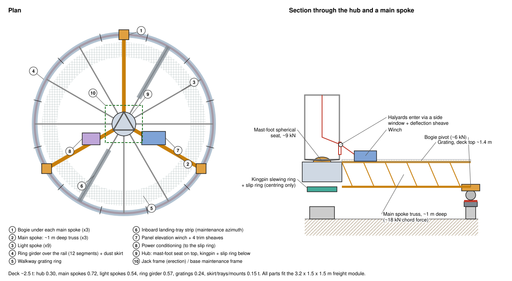

**What it is.** The deck is the **turning platform at the base**. It rides on the 3 bogies, is centred by the kingpin, carries the mast on its hub, and holds all the base equipment that turns with the mast. It turns once per lunar day with everything above it.

**Geometry**
- Ø12 m, a spoked frame rather than a solid floor. The top surface is **~1.4 m above the regolith**: rail on piers 0.5 m, bogies, then the frame.
- Built from **12 ring-girder segments** (π m arcs) and **12 spokes**. Each spoke ships in 2 x 3 m pieces, and everything bolts together with captive fasteners (section 10).

**Structure and load path**
| Part | Description | Load |
|---|---|---|
| **Hub** (Ø ~1.6 m) | Ti/steel weldment at the centre. Top: the **mast-foot spherical seat** with its dog coupling. Underside: the **kingpin slewing ring** (radial centring only) and the **slip-ring / rotary-transformer rotor** | Mast foot **~9 kN** down, small radial |
| **3 main spokes** | Tapered triangular CFRP/Ti trusses (1.0 m deep at the hub → 0.4 m at the rim), radially over the 3 bogie pivots. They carry the hub load out to the bogies (see Spokes below) | Each takes ~3 kN from the hub, ~18 kN·m at the bogie end, ~18 kN chord force |
| **9 light spokes** | 0.45 m deep triangular trusses between the main spokes. They support gratings and equipment and tie the ring girder in | ~1 kN at the tip |
| **Ring girder** | Box girder over the rail, in 12 segments. Ties the spokes together, carries the 3 bogie pivots and the dust skirt | Bogie reactions ~6 kN each |
| **Gratings** | Open CFRP grating panels only where people and robots work: a walkway ring, the mast-base area, the equipment bays and the inboard tray strip. No solid floor, to save mass and stop dust collecting | Foot and robot traffic |
| **Dust skirt** | Brush/flap skirt hanging from the ring girder over the rail head | n/a |

**Spokes**

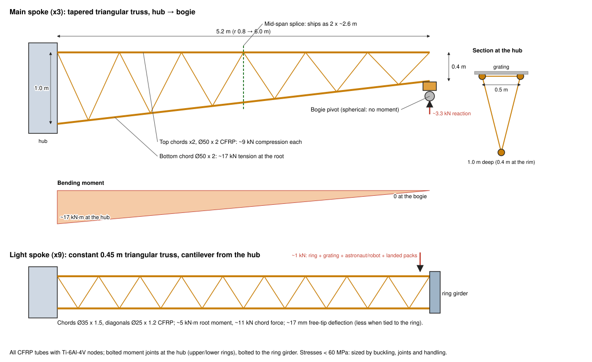

*How they work.* The hub is a stiff, moment-carrying "spider" (an upper and a lower ring ~1 m apart). Each spoke is bolted rigidly to the hub and runs out to the ring girder.
- The **3 main spokes** end on the bogie pivots, which are spherical and carry no moment. The deck is therefore a stiff hub on 3 pinned legs: each main spoke takes a third of the hub load as shear, and its bending moment grows from **zero at the bogie to a maximum at the hub**. So the main spokes are **tapered**: deep at the hub, shallow at the rim.
- The **9 light spokes** are short cantilevers from the hub carrying gratings, equipment and their share of the ring girder. The ring girder ties all spoke ends together. It also carries the drive's tangential forces from bogie to bogie around the rim, so the spokes see little sideways load.

| | **Main spoke (x3)** | **Light spoke (x9)** |
|---|---|---|
| Where | Radially over each bogie (0°, 120°, 240°) | Every 30° between them; the 30° and 210° spokes also carry the inboard landing-tray strip |
| Span | 5.2 m (hub edge r 0.8 m → bogie pivot r 6.0 m) | 5.2 m (hub → ring girder) |
| Form | **Triangular-section truss**: 2 top chords (0.5 m apart, carrying the grating) and 1 bottom chord; Warren diagonals; 0.8 m panels | Triangular-section truss, same pattern, 0.6 m panels |
| Depth | **Tapered 1.0 m at the hub → 0.4 m at the bogie** | Constant **0.45 m** |
| Chords | CFRP tube Ø50 x 2 mm | CFRP tube Ø35 x 1.5 mm |
| Diagonals | CFRP tube Ø30 x 1.5 mm | CFRP tube Ø25 x 1.2 mm |
| Nodes and ends | Ti-6Al-4V node fittings, bonded and pinned to the tubes. Ti end plates: a 3-bolt moment joint to the hub's upper and lower rings; at the rim, the **bogie-pivot socket** and a bolted joint to the ring girder | Ti node fittings; 2-bolt joint to the hub's upper and middle rings; bolted to the ring girder |
| Splice | Mid-span, bolted chord sleeves with captive bolts, so it ships as **2 pieces of ~2.6 m** | Same: 2 pieces of ~2.6 m |
| Design load | Hub share **~3.3 kN** (mast foot ~8.9 kN + hub + winch, over 3) plus self-weight; **0.5 kN sideways** at the rim | **~1 kN** at the tip: ring and grating share, a suited astronaut or robot (~300 kg), and landed packs on the tray strip |
| Root moment | **~17 kN·m** | **~5 kN·m** |
| Chord forces at root | Bottom chord **~17 kN tension** (55 MPa); top chords **~9 kN compression** each | ~11 kN |
| Buckling margin | Top chord over a 0.8 m panel: ~180 kN, **21x** | ~80 kN, >7x |
| Deflection | Hub sits **~12 mm** below the bogie pivots under full load (L/420), the same on all 3 so the mast stays plumb | ~17 mm at the tip as a free cantilever, less in practice because the ring girder ties the tips |
| Mass | ~12 kg/m calculated; **carried at 20 kg/m** for fittings and margin: **~105 kg each, ~0.31 t for 3** | ~5 kg/m calculated, carried at 8 kg/m: **~42 kg each, ~0.37 t for 9** |

*Design notes*
- **Stiffness and joints set the sizes, not strength.** Member stresses are below 60 MPa. The tubes are sized for buckling, handling and robust bonded-and-pinned Ti joints.
- **Thermal.** CFRP has near-zero expansion, so the spokes hardly change length. Any mismatch with the ring girder is taken by the bogies' ±20 mm radial float.
- **Dust.** Open trusses under open gratings: nothing traps regolith, and debris falls through.
- **Mass saving.** The calculated spokes (~0.69 t for all 12) come in well under the earlier 1.26 t allowance. The deck total stays at **2.5 t**, with the ~0.5 t difference held as **margin**.

**Equipment on the deck** (all turns with the mast)
- **Panel elevation winch** with its 4 trim sheaves, beside the mast base (section 4a).
- **Rope entry.** The halyards turn into the mast through a **side window in mast section 1** over a deflection sheave ~2 m up, then run up the centre channel. That keeps them clear of the **mast-foot seat**, which sits under the mast centre.
- **Power conditioning:** combiners and DC/DC converters from the wings feed the slip ring at the hub. Cables run down the mast in a tray on one face.
- **Drive:** the 2 drive units sit on their bogies, not on the deck, with control boxes on the deck.
- **Jack-up frame** around the mast base. It is used for erection and stays as the base maintenance frame (jacking points, tool stowage).
- **Landing tray, inboard part**, along the maintenance azimuth, from 2 m out to the rim on both sides.
- **Jack points** for a whole-bogie swap (section 6), and **parking lock pins** that lock the deck to the rail during maintenance.
- **Instruments:** inclinometer, deck temperature sensors, cameras at the mast base and trays, and load-cell readouts for the halyards and bogies.

**Mass ~2.5 t** (revised from the earlier 4 t):

| Part | Mass |
|---|---|
| Main spokes | 0.72 t |
| Light spokes | 0.54 t |
| Ring girder | 0.57 t |
| Hub | 0.30 t |
| Gratings | 0.24 t |
| Skirt, trays and mounts | 0.15 t |

### A.3 Track (raised, segmented, swappable)

- **Raised rail** on piers ~0.5 m above the regolith, away from near-surface dust and with room to work underneath.
- Rail: hollow box beam with a bolted, replaceable **rail head strip**.
- **12 identical segments**, π m long. Each sits on 2 piers that are shared with its neighbours at the joints, so **12 piers** in all, plus 4 kingpin anchors.
- **Angled (scarf) joints** with slotted holes for ~3 to 5 mm expansion each.
- **Piers** have leveling screws (±50 mm) on sintered-regolith pads, helical ground screws, or regolith-filled gabion bags.
- An overhanging **skirt or brush seal** on the deck keeps falling dust off the rail head.

**Replacing a rail segment or wear strip** (the main reason for the wide bogie gaps)
1. Turn the platform until the damaged segment sits in a gap. With ~11 m of free rail between bogies, any segment can be placed with ~4 m to spare at each end. No bridging rail is needed.
2. If only the running surface is damaged (the usual case), unbolt and swap just the **rail head wear strip** (~10 kg, π m long).
3. If the beam itself is damaged, unbolt the whole segment from its 2 piers, lift it out, drop in the spare and level it against the radius arm (section 7).
4. Turn the platform past the new piece slowly and watch the drive current as each bogie crosses it.

**Replacing a whole bogie** (rare; tyres and uplift rollers are swapped in place)
1. Set a **jack stand** on the rail just beside the bogie (the wide gaps leave room) and lift that corner of the deck ~10 mm.
2. Release the spherical pivot, wind both support shoes up, roll the bogie out along the rail into the gap and lift it off. Fit the spare the same way.
3. Lower, remove the stand.

## Appendix B. Superseded: halyard wing lowering (revs 8 to 21)

Kept for reference. In rev 22 the halyards, wing winch and wing top bars were replaced by service bots with portable reel hoists (sections 4 and 4a). Everything below no longer applies to the baseline.

### B.1 Wings on top bars, lowered together

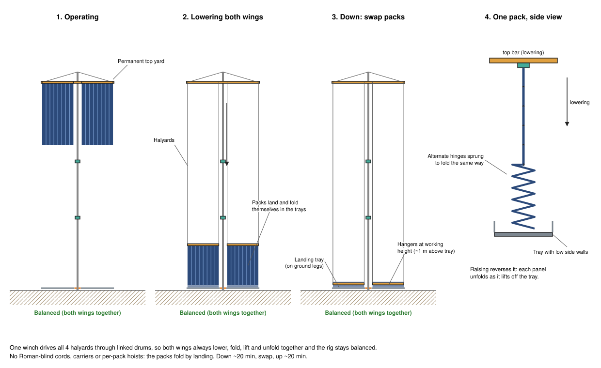

Each wing is a **top bar** with **8 concertina packs** side by side, each 2 m wide (1 to 3 m packs fit the same hangers), with ~0.1 m gaps between them.
- **A pack** is 30 rigid panels, 1 m tall, hinged along their horizontal edges, with a small bottom bar. Folded, it is a ~2 m x 1 m x 0.7 m stack of ~140 kg (~0.23 kN on the Moon), which ships, stores and handles easily.
- **Attachment:** each pack hangs from a **pack hanger** on the top bar (4 alignment cones + captive latches).
- **Fold direction:** alternate hinges are lightly sprung toward their fold direction, so the panels always fold the same zig-zag way.

There is **one raise/lower mechanism**: the top bar of each wing hangs on **2 halyards** over sheaves on the **permanent top yard** (2 m and 17 m from the mast). All **4 halyards** run down the mast to **one winch** on the rotating base frame with 4 linked drums.

**Lowering for maintenance (both wings together):**
1. Park the mast at the **maintenance azimuth**, so both wings lie in the clear 30°/210° plane between the bracing planes. Set the 2 **landing trays**.
2. Lower both wings at ~0.1 m/s.
   - On the way down the packs pass the collars, V-links and A-frames ≥1.4 m clear.
   - When the top bars are ~30 m up, the packs' bottom bars touch down in the trays.
3. Keep lowering: each pack **folds itself up** in its tray under gravity, panel by panel, into its zig-zag stack.
4. The top bars come to rest ~1 m above the trays, with **every pack hanger at working height**.
5. Unlatch any damaged pack (4 cones, captive latches) and lift it out of the tray. Set the new folded pack in its place and latch it to the hanger.
6. **Raise** both wings. Each pack unfolds panel by panel as it lifts off its tray, and hangs flat at full height. The top bars latch to the yard.

The whole cycle (down ~20 min, swap, up ~20 min) costs about an hour of output; it is a planned, occasional job.

**Balance.**
- While the packs hang free, their weight sits on the same top-yard sheaves at any height, so the rig stays balanced.
- Once packs land, their weight moves into the trays. One wing landed alone would put up to ~21 kN·m on the mast top above the upper collar (~17 kN extra in the lattice chords).
- So **the wings always move together**. A single winch drives all 4 halyards through linked drums, so the two wings land, fold and lift at the same rate, and the rig stays balanced at every moment.
- Halyard load cells confirm that both sides match. A pack swap changes one side by at most ~0.23 kN (~2 kN·m) while it is unlatched, which is negligible.
- A **regolith ballast pallet** (~1.4 t) remains as a contingency, for example if one wing's top bar ever has to come off.

### B.2 Halyards, docking latches and the panel elevation winch

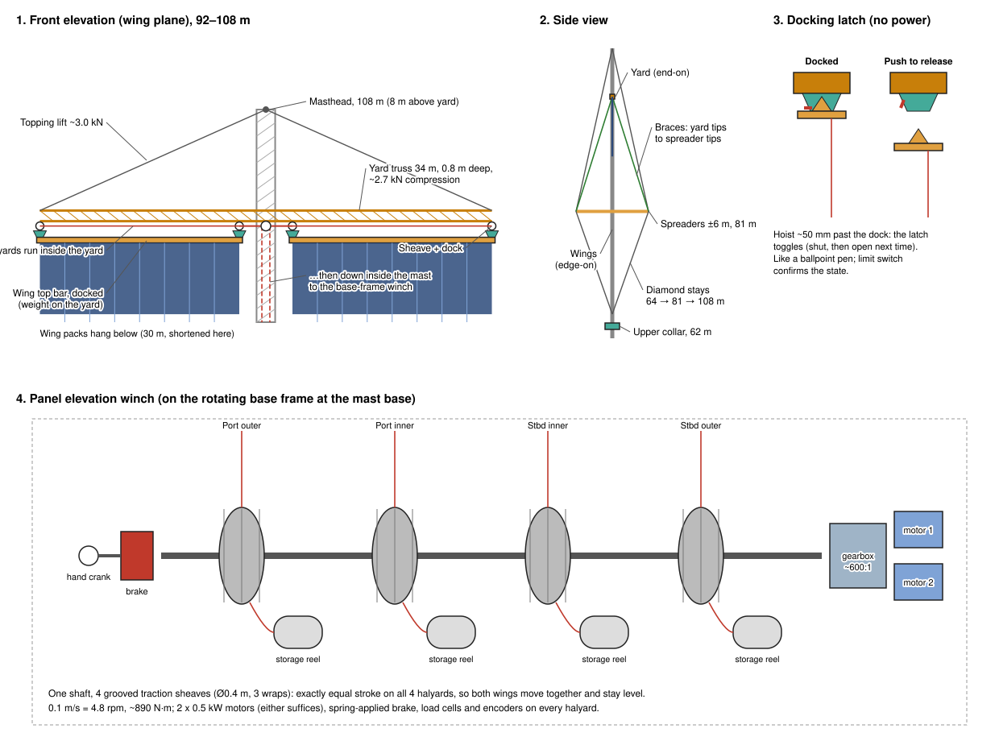

**Halyards and routing**
- Each wing hangs on **2 halyards**, one at each end of its top bar (2 m and 17 m from the mast).
- Each halyard runs up to a **sheave at the yard**, turns 90° to run **inside the yard truss** to a **turning block at the yard-mast section**, then runs **down inside the mast lattice** to the panel elevation winch on the rotating base frame.
- Halyard tension is ~1.1 kN with a wing hanging, in 6 mm stainless wire rope (breaking load ~25 kN, factor >20).
- Lengths: ~214 m (outer) and ~200 m (inner), including the 97.5 m stroke from the yard down to the landing trays.
- The halyard loop adds ~4.4 kN of compression to the mast while the wings hang on it. It does not add load at the mast foot: the pull is internal, top to base frame.

**How the base winch drives the wings: the halyard path**

The motor never drives the yard, which is fixed to the mast. It only pulls the halyards, so **the rope is the whole transmission**. The base frame, mast and yard turn together, so the ropes never cross a rotating joint and cannot twist. Each halyard runs:
1. **Traction sheave on the rotating base frame** → through a **side window in mast section 1** over a deflection sheave ~2 m up (clear of the mast-foot seat at the centre) → into the **clear centre channel of the mast lattice**. The lattice members sit only on the three faces.
2. **Up 100 m** as a loose 4-rope bundle through **ceramic-lined guide rings at every 3 m section**. Each rope weighs only ~23 N over 100 m on the Moon, so it barely touches the rings.
3. **Turning block** at the yard-mast section (100 m) → 90° to horizontal.
4. **Along the inside of the yard truss** on 2–3 guide rollers to the **end sheave** (2 m or 17 m out) → 90° down to the cone on the wing top bar.

- **Friction:** about 85% overall efficiency through 2 sheaves and the rollers.
- **Stretch:** ~0.06% at 1.1 kN, ~13 cm over 214 m. The differences between ropes are handled below.
- **Thermal length change:** ~0.24 m over 200 m for a 100 K swing. It is taken up because the wings sit on the docks in service and the ropes are held at ~0.1 kN by constant-torque motor control.
- **Inner vs outer rope lengths differ** (~200 m vs ~214 m), so their stretch and thermal changes differ too, which the equal-stroke traction sheaves cannot cancel:

  | Source | Difference between inner and outer rope |
  |---|---|
  | Stretch at 1.1 kN | ~9 mm |
  | Uniform 100 K swing | ~17 mm |
  | Uneven heating (one rope ~50 K warmer over 100 m) | ~60 mm, the largest |

  A 6 cm difference tilts a 15 m top bar by only ~0.2°, which is harmless to the structure, but it makes the two cones reach their docks at different moments. Three measures handle it:
  1. **Length-matched routing.** The inner halyard takes a ~7 m out-and-back loop along the yard over a small extra sheave, so all 4 halyards are the same length and follow similar paths. That cancels the systematic stretch and uniform-thermal difference.
  2. **Trim sheaves.** Each halyard passes a small sheave on a lead screw on the base frame, motorised with ±0.25 m range. An inclinometer on each wing top bar levels the bar automatically before docking. This also takes out uneven heating, rope creep, and any port/starboard difference.
  3. **Sprung docks.** Each dock has ~60 mm of spring travel, so the first cone to arrive rides up until the second latches. Both limit switches must read latched before the halyards are eased. The same applies on release.
- **Fitting the ropes during jack-up:** the halyards are rove through the top yard first, and the winch pays out as the mast rises. Each **flat-pack section is unfolded around the 4-rope bundle** at the jack frame before its third chord is pinned, so the ropes end up inside every section and nothing is threaded at height.
- **Alternative: send power, not rope.** A winch at the yard, with only a power cable up the mast, gives short ropes but puts the motor and brake at 100 m. The winch is rarely used (the wings sit on docks), so it stays on the base frame for ground access. In the turret option (section 9) rope cannot cross the turret bearing, so the winch rides on the turret.

**Docking latches (wings off the halyards when up)**
- At each halyard point the top bar carries a **cone**, which seats in a **dock** under the yard.
- The dock has a **"push-to-latch, push-to-release" mechanism**, the same principle as a ballpoint pen or a parachute release hook. It needs no motor or power at height:
  - *Raising:* hoist the bar ~50 mm past the dock and the latch toggles shut. Ease the halyard and the cone sits on the latch.
  - *Lowering:* hoist ~50 mm again and the latch toggles open, then lower.
- Once docked, the halyards are eased to a light holding tension (~0.1 kN). **The wing weight sits on the yard, not on the halyards or the winch brake**, so wire creep and brake load are avoided while the array operates. A limit switch at each dock confirms latched or open.

**Panel elevation winch (on the rotating base frame)**
- **One drive for all 4 halyards**, so both wings always move together (section 4, Balance):
  - **4 grooved traction sheaves** (Ø0.4 m, 3 wraps each) on **one shaft**. Constant-diameter traction sheaves give **exactly equal stroke** on all 4 halyards, so the bars stay level whatever length is stored.
  - **4 storage reels**, each with a slip clutch that keeps the rope just taut behind its traction sheave, and a level-wind guide.
- **Drive:** about 4.8 rpm at the sheaves (0.1 m/s), ~890 N·m.
  - **2 brushless motors** (~0.5 kW each, either one can do the job) through a ~600:1 planetary gearbox.
  - A **spring-applied fail-safe brake**, and a **hand-crank socket** for an EVA tool as the last-resort backup.
- **Controls:** load cells on all 4 halyards give balance monitoring and the interlock (section 4). Encoders give position, so the trays and docks are approached slowly. The winch has a dust-sealed housing on the base frame.
- **Power** at 0.1 m/s with 70% efficiency is ~0.65 kW: trivial next to the ~350 kW the wings make.

**Mast climber robot.** A small robot climbs the lattice to inspect it, swap collar roller cartridges, re-tension diamond stays and service the yards. It is teleoperated with a human supervising, and it doubles as an installation tool (section 7).
